# 智能 OJ 与编程学习平台——架构设计与系统设计文档

| 文档属性 | 内容 |
| --- | --- |
| 文档编号 | SDD-OJ-002 |
| 版本 | v0.3，阶段二第三次提交修订稿 |
| 文档状态与版本计划 | SDD v0.1→v0.2→v0.3修订→v1.0文档冻结；冻结条件见§1.3，系统验收另见§12.3 |
| 日期 | 2026-10-13 |
| 作者／学号／班级 | 覃锐谦／U202414575／CS2402班 |
| 设计对象 | 课程级智能 OJ 与编程学习平台 |
| 需求基线 | [阶段二提交/基线/01_需求分析文档_v1.0-冻结.md](基线/01_需求分析文档_v1.0-冻结.md)，SRS-OJ-001，v1.0 |
| 设计状态 | 可指导实现和测试；尚未表示真实部署、压测、沙箱或 AI 质量验收完成 |

> 本文是阶段二的设计文档。阶段一 v1.0 冻结需求编号、业务规则和阈值全部沿用；需求来源、编号对照和实施条件补充见第1节及[需求基线说明](02_需求基线说明.md)。文中“目标”“应”“候选”是设计约束或待执行验收条件，不能替代真实测试证据。

## 1. 目的、范围与基线

### 1.1 设计目的

本文把阶段一 v1.0 冻结需求基线转化为可实现的架构、模块、流程、接口、数据、界面、质量属性和测试结构，使后续开发可以从统一的状态、事务和错误约定开始。设计的中心是一次课程作业从发布、提交、评测到成绩发布的闭环，同时保护隐藏测试和学生代码，保证平台故障不会被伪装成学生错误。

首版仍限定为课程级 Web 平台：标准输入／标准输出文本题、单文件 C++17 与 Python 3、单线程执行、三类角色、异步评测、当前有效版本计分、可关闭的 AI 学习提示。比赛社区、排行榜、查重、交互题、多文件工程、自研沙箱和自动改分不在本设计范围。

**阅读导航：** 架构和开发/验收差异见§2；接口与存储分别见§5、§6；关键阈值集中查§11.5；实现前条件及逐项销号见§13.3。本轮逐条反馈响应、额外修正和保留事项见[第三次提交改进说明](03_第三次提交改进说明.md)。

### 1.2 需求基线与需求来源

| 来源／编号 | 在本设计中的用法 |
| --- | --- |
| U-01—U-06 | 沿用冻结基线§1.3的来源定义；U-06为阶段二准备时作者对项目规则与基线文档的确认。 |
| U-07 | 阶段二第一次提交的平台反馈，作为本次设计修订的审查输入，不新增产品需求。 |
| U-08 | 作者2026-10-13补充确认的设备、模型、预算及扩展性设计目标，见§1.3。 |
| U-09 | 阶段二第二次提交97.2分的完整平台反馈及作者第三次修订要求；为设计审查输入，不代表系统测试通过。 |
| FR-01—FR-29 | 业务能力的可实现接口、模块、流程和验收入口。 |
| BR-01—BR-17 | 服务端领域策略；优先级高于客户端输入和第三方默认行为。 |
| NFR-01—NFR-24 | 架构质量目标、容量、安全、可靠性和验证门禁。 |
| DD-01—DD-11 | 数据库实体、字段约束、授权视图和留存策略。 |
| IF-01—IF-09 | 对外 API、评测适配器和模型网关的行为契约。 |
| AC/ST/NT | 设计后的单元、集成、系统和验收测试索引。 |

本次提交包括设计文档、需求基线说明、第三次提交改进说明及基线目录内的冻结需求原文。需求编号与语义保持不变；新增数据表、端口和验证方法用于细化已有需求的实现。

### 1.3 文档版本与实施条件

需求基线为 SRS v1.0，本设计文档为 SDD v0.3；两者独立编号。随包冻结需求原文保持不变，本次没有新增、删除或改变阶段一的业务需求与验收阈值。

实施条件补充来源 U-08 为作者2026-10-13确认：本项目由个人完成，使用笔记本电脑开发和演示；选择 DeepSeek 官方 API、当前模型 DeepSeek-V4.1-Flash，AI累计预算500元、每日20元；接受§8.2的扩展性设计验证目标。模型更新须执行§13.2配置变更和质量回归流程。既有时间、计分、AI权限、留存与公平补偿规则继续沿用基线。

笔记本具体规格、隔离与容量尚未实测；账号、适用条款、接入时价格及token计数仍须按DEP-AI登记。V/NT/ST系统测试的执行条件和责任见§12—§14，已确定的选型不等于已完成接入或验收。

SDD v1.0的文档冻结条件是：设计缺陷已处理、需求/设计/接口/数据交叉核查通过、作者审阅本次变更并接受、待测项有责任人与验证入口。软件发布则另须满足§12.3系统验收门禁；两者不能互相替代。

### 1.4 设计原则与约束

1. **数据库是真实账本。** 提交、评测轮次、成绩版本和公平补偿事件先持久化，再异步派发；队列重复投递不能产生第二次计分。
2. **服务端决定资格。** 身份、课程成员、角色、服务器时间、AI 策略和资源限制全部在后端判断，前端字段只表达意图。
3. **故障可见且可收敛。** 平台不能用 WA/TLE 替代 SE；所有重试有上限，最终状态可查询，未决故障阻止最终成绩发布。
4. **最小复杂度。** 使用一个模块化单体业务服务，只有评测执行和模型访问保留独立信任边界；不为了展示微服务而拆分课程项目。
5. **隐藏数据单向流动。** 隐藏测试只从业务服务到受限评测适配器；学生响应、普通日志和模型上下文永远没有隐藏输入、期望输出和隐藏 stdout/stderr。
6. **可替换的外部依赖。** Judge0 CE 和模型服务都是适配端口，不把第三方的 language_id、默认比较器、队列或结果枚举直接暴露到需求 API。

### 1.5 术语、编号与引用约定

编号属于各自命名空间，不能省略前缀后跨类引用。两位序号按升序登记；API-01—API-15为连续主序列。历史模板接口的带字母编号在本版统一为API-15，路径和业务语义不变；历史稿保留原编号。§号指本设计文档，引用冻结需求时显式写“SRS§”。

| 前缀/术语 | 含义及来源 | 范围/定位 |
| --- | --- | --- |
| SRS / SDD | 需求规格 / 系统设计文档，版本独立 | SRS-OJ-001 v1.0；SDD-OJ-002 v0.3 |
| U / A / H / CR | 来源 / 假设与条件 / 人工核实 / 变更请求 | U-01—U-09见§1.2；A-01—A-07为本设计§13.1局部编号，SRS同名前缀须注明文档；H沿用SRS，CR沿用SRS§13.3 |
| FR / BR / NFR / DD | 功能 / 业务规则 / 非功能 / 数据字典 | 沿用FR-01—FR-29、BR-01—BR-17、NFR-01—NFR-24、DD-01—DD-11 |
| UC / AC / ST / NT / EX | 用例 / 功能验收 / 跨功能测试 / 非功能测试 / 异常 | 沿用SRS：UC-01—06、AC-01—29、ST-01—17、NT-01—24、EX-01—12 |
| AD / MOD | 架构组件 / 模块 | AD-01—AD-10，§2.3；MOD-01—MOD-10，§3.1；AD-01是API网关与认证 |
| WF / IF / API | 流程 / 沿用需求接口 / 设计补充接口 | WF-01—WF-06；IF-01—IF-09；API-01—API-15 |
| DB / UI | 数据元素 / 界面 | DB-01—DB-16，§6.2；UI-01—UI-13，§7 |
| NFD / NFD-EXT | 非功能设计应对 / 扩展验证目标 | NFD按NFR对应；NFD-EXT-01—03见§8.2 |
| FD / D / TD | 故障设计 / 设计决策 / 测试设计 | FD-01—12、D-01—10、TD-01—12；TD-09内子场景不新增NT编号 |
| E-01 / W-xx / V-xx | 候选验收环境 / 负载场景 / 执行器核验 | 沿用SRS§10.1、§10.3、§10.5；W-01—04，V-01—10；详细前置条件见§13.3 |
| DEP-AI / CR-AI | AI依赖登记 / 模型配置变更流程 | §13.2；CR-AI归入既有CR流程，不等于已获账号或条款批准 |
| TH / ENV / SRC | 跨节规则索引 / 执行条件组 / 外部资料核对项 | TH-01—TH-18见§11.5；ENV-01—ENV-06见§13.3；SRC-01—SRC-04见§13.2；均为设计定位号 |
| P0—P5 / T1—T9 | 实现阶段 / 测试层次 | §14 / §12.1；阶段完成不等于验收通过 |
| NNNNR / FIFO | 普通任务N与重评任务R的4:1派发周期 / 队内先就绪先派发 | N=queue_jobs.kind NORMAL，R=REJUDGE；每字母对应一个整轮attempt；非CPU时间占比，空队列/保护窗口例外见§2.5 |
| state / verdict / mode | 处理进度 / 最终判定 / 正式性 | §3.3.2；三者独立，RETRY_WAIT时逻辑verdict=null |
| attempt / result_basis / generation / lease_epoch | 评测轮次 / 结果基线 / 提交内轮次代数 / 槽位租约代数 | DB-08/09；内部result_basis_id映射result_bases.basis_id |
| DTO / Outbox / profile | 边界数据对象 / 同事务事件表 / 冻结语言资源配置 | §5.4、§6.4、附录A.1；未冻结profile不得派发真实任务 |
| D/A/S / READY / SE | 提示方向/可执行性/安全量表；可用提示状态；平台错误判定 | D/A/S按SRS§10.4；READY属提示或队列各自枚举，SE属verdict；D-xx仍是设计决策号 |
| P95 / RPO / RTO / KiB / MiB / GiB | 95百分位 / 可容忍数据回退 / 恢复耗时 / 二进制字节单位 | 1KiB=1024B；毫秒、秒、分钟换算明确；RPO与幂等24h不是同一规则 |

## 2. 架构设计

### 2.1 系统上下文

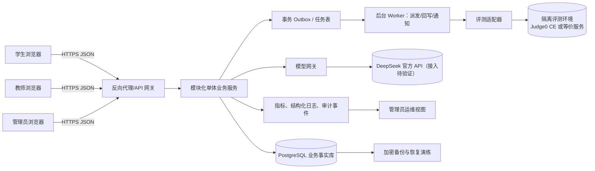

学生、教师和管理员只接触网关暴露的业务 API。数据库、Outbox、评测适配器和模型网关位于服务器端；隔离评测环境不与业务数据库共享宿主权限。模型只能获得经过白名单过滤的公开题面、本人代码、粗粒度判定和模板，不能调用工具或修改成绩。

### 2.2 分层与依赖方向

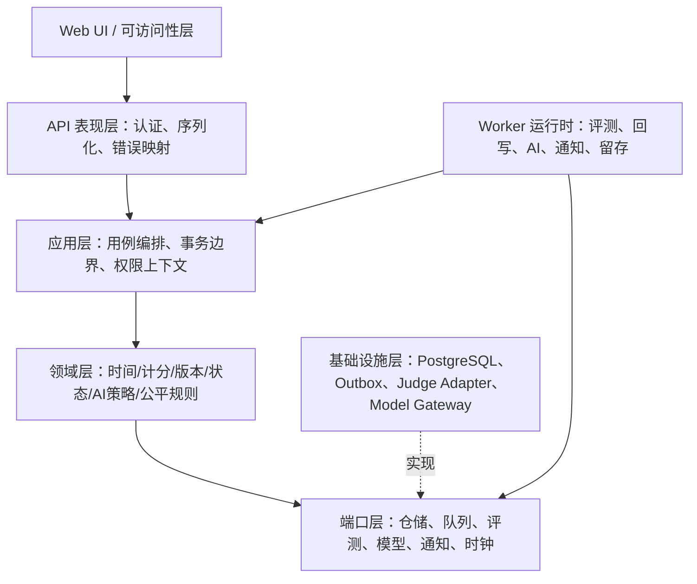

- 表现层只负责输入校验、身份解析和 DTO；不计算成绩、不决定正式／练习。
- 应用层把一个业务动作组织为事务和领域服务调用，例如 `AcceptSubmission`、`ActivateRejudge`。
- 领域层保存可单元测试的规则；不依赖 HTTP、Judge0 或模型 SDK。
- 端口层定义可替换的接口；基础设施层实现数据库、任务投递和外部调用。
- Worker 使用同一应用层服务处理异步状态，避免把业务规则复制到脚本中。

### 2.3 组件职责与依赖

| 架构组件 | 主要职责 | 允许依赖 | 明确不承担的职责 |
| --- | --- | --- | --- |
| AD-01 API 网关与认证 | TLS 终止、请求 ID、会话解析、基础限流、版本路由 | Auth 模块、应用服务 | 不直接读隐藏测试、不判分 |
| AD-02 业务应用服务 | 课程、题目、作业、提交、成绩、AI、故障用例编排 | 领域服务、仓储端口、审计端口 | 不执行学生代码 |
| AD-03 领域规则内核 | BR-01—BR-17、状态迁移、比较器、计分器、错误码 | 纯值对象和策略 | 不访问数据库和网络 |
| AD-04 PostgreSQL | 权威业务数据、代码／测试小文件、版本和审计 | 数据库驱动、迁移工具 | 不作为学生直接访问的文件服务器 |
| AD-05 Outbox/任务 Worker | 从持久任务表派发、重试、回写、通知、留存 | 应用服务、端口实现 | 不绕过事务创建提交 |
| AD-06 评测适配器 | 转换内部任务、调用隔离执行器、返回受控结果 | Judge Port、mTLS/网络策略 | 不决定课程成绩和隐藏数据可见性 |
| AD-07 模型网关 | 执行 MOD-08 已授权请求的预算预占、白名单、传输、安全门和降级 | Model Port、审计、额度仓储 | 不授权 AI、不改分数、不执行工具 |
| AD-08 可观测性与审计 | 关联 ID、指标、敏感操作审计、告警 | 日志/指标存储、应用事件 | 不记录密码、令牌、隐藏正文 |
| AD-09 Web UI | 三角色页面、状态文字、编辑器草稿保护、轮询 | 版本化 API | 不用页面按钮代替授权 |
| AD-10 备份/恢复作业 | 每日备份、恢复演练、留存清理前置检查 | 数据库、对象/备份存储、审计 | 不静默删除争议数据 |

### 2.4 部署与运行视图

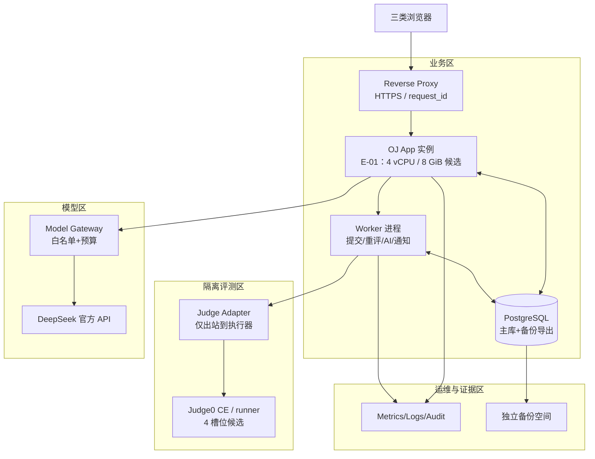

**实际开发环境与验收候选环境：** 作者确认使用笔记本电脑完成个人课程项目；CPU、内存、磁盘和虚拟化能力未登记。开发与演示可在笔记本上运行业务服务，并把评测放入独立虚拟机；不能在业务进程直接执行学生代码。资源不足时可减小演示并发并明确标记“功能演示”，不据此声称通过 E-01/W-01—W-04。E-01 仍是原基线的候选验收资源，不要求在设计阶段已购齐设备；不降低原 NFR 指标。笔记本无法容纳隔离环境时先使用模拟端口演示业务，正式评测功能保持关闭。备份与原库同盘只能演示备份流程，不能据此验证故障恢复目标。

**最小开发/演示拓扑与E-01验收拓扑对照（均为设计，未表示已部署）：**

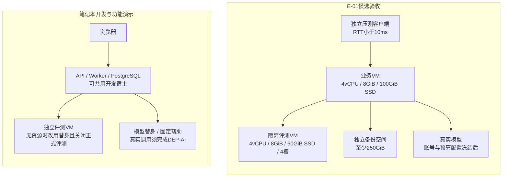

左图只支持功能与契约演示；右图资源来自SRS§10.1，两个VM可共用足额物理机，但不得超售。二者都保留业务/评测信任边界。笔记本能否承载右图须以V-09的资源登记及测量判断；同盘备份不满足独立恢复条件。NT/W/V的具体执行条件见§13.3。

**部署约束：**

- 业务区与评测区至少有网络策略、不同运行账号和不同挂载边界；评测区不能访问业务数据库和 Docker 控制接口。
- PostgreSQL 连接由应用账号使用最小权限；评测服务只能通过适配器获得单个任务需要的输入，不能拿数据库凭据。
- `c=4` 仅是 E-01 候选槽位。NFR-02、NFR-03 和 W-04 通过前必须记录 CPU、内存、磁盘、虚拟化、镜像摘要和实际并行数。
- 生产式运行至少有一个 API 进程和一个 Worker；开发环境可以合并进程，但测试报告必须说明拓扑差异。

### 2.5 运行时关键约束

1. **受理账本（AD-01/02/03/04/05；MOD-01/03/04）：** 依§3.4锁顺序完成身份/已有键查找、权限、作业时刻、容量判断；事务一次写入 submission、首个 attempt、queue_job 和 Outbox，提交成功后返回202。正式性取锁内时刻，不取评测或HTTP响应完成时刻。
2. **任务粒度（AD-05/06；MOD-05/10）：** 一个 `queue_job` 对应一个 attempt 的整套测试（1—10点），占用一个执行槽位；内部按 `order` 串行调用 IF-07，每点有独立 token。首个非AC即停止。本层没有“每个隐藏点一个公平队列任务”，避免改变4:1含义。若后端每次单点调用都编译代码，编译计入本轮360秒；不假定有编译一次多点执行API。
3. **公平派发（AD-03/05；MOD-05/09）：** 一个逻辑调度器在短事务内锁 `scheduler_control`，检查全局截止保护窗口、可用槽位和两个队列，以 `(ready_at,created_at,job_id)` FIFO选择可派发任务。两队列持续非空时游标循环 NNNNR；只有一队列时持续派发且不产生另一队列欠债，重新同时非空从 NNNNR 开始。保护窗口只派普通任务、退出后重新开始周期。领取时同时更新游标、槽位和租约，网络调用在事务外。`SKIP LOCKED` 仅用于并行处理技术性扫描，不单独承担FIFO或4:1保证。
4. **结果边界（AD-02/04/05/06；MOD-05/06）：** 回写必须同时匹配 `(submission_id, result_basis_id, attempt_id, generation, lease_epoch)`；当前有效基线和待激活重评批次各有自己的目标。待激活结果允许入库，但不能提前参与正式分数；旧轮次/旧租约结果仅归档审计。不能以“不是当前有效版本”为由丢弃待激活重评结果。
5. **成绩与隐私（AD-02/03/04/07/08；MOD-01/06/07/08）：** GradeCalculator按当前已激活结果基线重算，不累加易失总分。SE/未终结正式提交/未决公平事件阻止最终发布；隐藏数据只进入受控评测路径，学生、AI和普通日志均使用白名单投影。

租约每5秒续期、15秒失联触发恢复检查是调度设计值（AD-05/06/08；MOD-05/09/10），不是新的BR超时阈值。关键数值及跨节位置统一登记于§11.5。租约到期不等于执行器已停止：先由执行区监督进程证明任务退出并清理，再释放槽位和新建重试；无法确认时隔离该槽位并告警，禁止在同一槽位叠加执行。系统不可用的探测/展示目标仍是60秒；监督机制能否达到清理后5秒释放按V/NT实测。

## 3. 模块设计

### 3.1 模块边界

| 模块 | 入口用例 | 内部结构 | 依赖与输出 |
| --- | --- | --- | --- |
| MOD-01 身份与权限 | FR-01—FR-04 | `SessionService`、`RolePolicy`、`MembershipPolicy`、密码哈希适配 | 用户/课程仓储；输出 `Principal` 和 401/403/404 |
| MOD-02 题目与版本 | FR-05—FR-08 | `ProblemDraftService`、`VersionSnapshot`、`TestcaseValidator`、`PreflightChecker` | 题目仓储、评测端口；输出不可变 `version_id` |
| MOD-03 作业与时间 | FR-04、FR-09、FR-10、FR-29 | `AssignmentService`、`ServerClock`、`DeadlinePolicy`、`ArchivePolicy` | 作业/版本仓储；输出 assignment view、409/403 |
| MOD-04 提交受理 | FR-11、FR-12 | `AcceptSubmission`、`IdempotencyStore`、`CapacityGuard`、`SubmissionIntentPolicy` | 提交仓储、任务表、审计；输出 `202 + submission_id` |
| MOD-05 评测编排 | FR-07、FR-13、FR-14、FR-16 | `DispatchScheduler`、`JudgeAdapter`、`VerdictMapper`、`RetryPolicy` | 独立评测区、attempt 仓储；输出处理状态及独立verdict |
| MOD-06 历史与成绩 | FR-08、FR-15、FR-17、FR-18、FR-23、FR-25、FR-26、FR-28 | `GradeCalculator`、`GradeSnapshot`、`RejudgeService`、`ExportService`、`ReviewList` | 成绩仓储、CSV 导出、审计；输出版本化成绩 |
| MOD-07 确定性反馈与推荐 | FR-19、FR-21、FR-26、FR-28 | `FeedbackCatalog`、`FeedbackRenderer`、`RecommendationPolicy`、`TemplateCatalog` | DB-16、题目标签、MOD-06 错题投影与 MOD-01 授权；输出版本化固定帮助及最多5题 |
| MOD-08 AI 提示 | FR-20—FR-22 | `AiPolicyGate`、`QuotaLedger`、`BudgetReservation`、`PromptBuilder`、`SafetyFilter` | 模型网关、AI 仓储、审计；输出 READY/FAILED/BLOCKED |
| MOD-09 公平与运维 | FR-02、FR-09、FR-10、FR-14、FR-16、FR-18、FR-24、FR-27、FR-29 | `IncidentService`、`HealthService`、`AuditQuery`、`NotificationService`、`RetentionService` | 事件/审计/通知/备份；输出故障状态与公告 |
| MOD-10 适配端口 | 跨模块 | `JudgePort`、`ModelPort`、`ClockPort`、`NotificationPort`、`BackupPort` | 外部系统实现；不包含业务判定 |

### 3.2 关键模块内部结构

**MOD-04 提交受理。** `AcceptSubmissionCommand` 只接受 `assignment_id/problem_id/language_key/code/idempotency_key/intent` 和当前 `Principal`。它依次执行：字段与字节校验 → 读取幂等记录 → 权限和成员校验 → 锁作业并取服务器时间 → 判断正式／练习 → 容量与个人间隔 → 写提交、首次轮次和整轮任务 → 写审计／Outbox。任一步失败都不产生逻辑提交；同键同内容返回原响应。

**MOD-05 评测编排。** `DispatchScheduler` 只领取状态为 `READY` 的任务；普通/重评队列共享全局NNNNR游标。`JudgeAdapter` 经submitCase/pollCase返回标准化 `JudgeCaseResult`，`VerdictMapper` 按 BR-06 先判基础设施、再判真实阶段与运行资源、最后比较输出。`RetryPolicy` 只对基础设施错误最多自动重试一次，学生错误不重试。

**MOD-06 成绩与重评。** `GradeCalculator` 读取当前已激活result_basis的有效轮次并生成新的grade_version快照，按题目全 AC 给题分；`RejudgeService` 先生成范围快照和批次，所有结果非 SE 后在同一事务中激活；任何未决事件或版本冲突阻止激活。导出只能读取已发布快照，不能从当前表临时拼接另一版本。

**MOD-08 AI 提示。** `AiPolicyGate` 根据 canonical_problem_id、学生所属课程的所有相关开放作业和截止状态作出允许/拒绝；`QuotaLedger` 原子预占北京时间接纳日额度；`PromptBuilder` 只接受允许字段；`SafetyFilter` 做长度、安全提示、完整解答、隐藏信息和工具调用检查。失败释放READY次数预占；费用未知转UNCERTAIN继续占预算，确认未发生费用才释放费用预占。

### 3.3 状态模型

#### 3.3.1 作业状态与附加标志

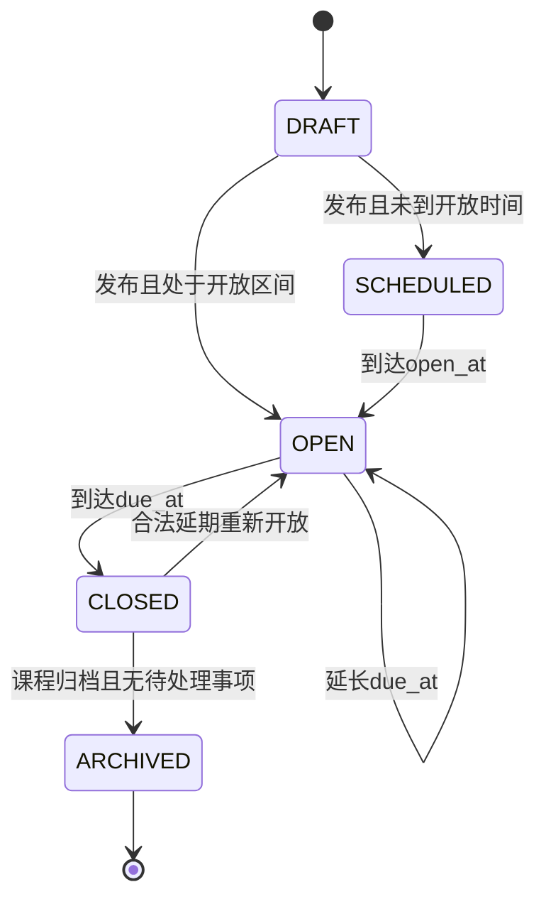

状态由服务器时刻、发布与课程归档标志计算，不依赖定时器恰好执行。`fairness_review=NONE/PENDING/RESOLVED` 与 `active_rejudge_batch_id` 为独立字段；REJUDGING只用于成绩展示状态，不是作业状态。未决事件阻止发布/归档/清理；有未激活重评批次时先取消批次并保留结果才可延期。延期不改变open_at，不追认旧练习。

#### 3.3.2 提交处理状态、轮次判定与正式性

与冻结基线§7.2一致，逻辑提交的 `state` 只表示处理进度；`verdict`只表示最终判定，`mode`只表示正式性。

| 字段 | 枚举/约束 | 所属对象 |
| --- | --- | --- |
| state | QUEUED、JUDGING、RETRY_WAIT、FINISHED | submission的当前结果基线投影；attempt使用其中QUEUED/JUDGING/FINISHED |
| verdict | null、AC、WA、CE、TLE、RE、SE | 非FINISHED为null；FINISHED必须为六种判定之一 |
| mode | FORMAL、PRACTICE | submission受理时冻结，不随重试/重评变化 |
| phase | COMPILE、RUN、INFRA、UNKNOWN | engine_meta实际阶段，不代替处理状态；无证据为UNKNOWN |
| generation | 正整数，submission内单调递增 | 每次自动重试、人工重试和重评新建attempt；不得复用 |
| result_basis_id | 原始基线或重评批次结果基线 | 区分已激活与暂存结果；每个基线都有current_attempt_id |

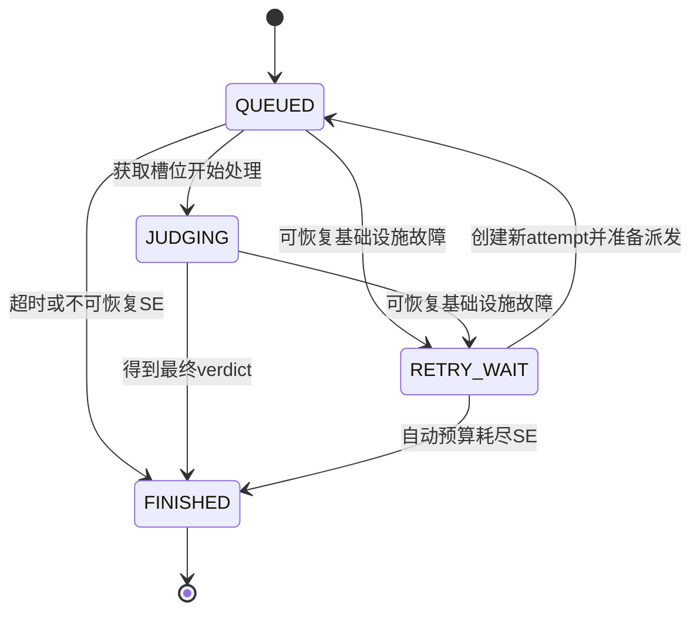

图表示同一自动处理周期的逻辑状态。失败attempt先以 `FINISHED+SE` 关闭；有重试资格时逻辑提交为 `RETRY_WAIT+null`，等待清理确认、健康恢复且重试预算允许后创建新attempt进入QUEUED。该周期最终SE才使逻辑提交 `FINISHED+SE`。人工重试开启新周期；旧FINISHED记录不回退，查询当前指针才显示新周期状态。重评同样新建结果基线和轮次；旧有效结果继续可追溯。

| 时限 | 起点与截止条件 | 超限结果/恢复 |
| --- | --- | --- |
| 单轮360秒 | attempt首次从QUEUED变JUDGING的 `started_at` 起，覆盖全部单点派发/编译/运行/回写协调 | FINISHED+SE / ATTEMPT_DEADLINE；可以在自动总预算内消耗剩余一次重试；清理后5秒释放槽位目标 |
| 自动流程15分钟 | 初次周期 `cycle_started_at=accepted_at`，包含排队、失败、清理和最多一次自动重试；重试不重置 | 逻辑提交FINISHED+SE / WORKFLOW_DEADLINE；停止派发，不自动重试；物理清理未确认的槽位隔离 |
| 人工重试/重评 | 人工重试受理或重评范围成员首次创建result_basis及任务的事务时刻为新周期起点；各自15分钟，派发后仍受360秒限制 | 同上；批次范围等待尚未创建轮次时显示WAITING，不冒充已经受理/完成；不改原accepted_at、mode或正式提交次数 |

每点CPU/墙钟触发TLE；协调360秒或总流程15分钟触发SE。数据库完全不可写时无法承诺及时持久化终态，监督进程先停派/清理并向健康页报告；恢复账本后立即补记超时，保留实际检测和落库时间，计入NT-10失败/偏差而非隐瞒。

### 3.4 并发、锁与一致性

关系库采用 READ COMMITTED 配合显式行锁。全局固定顺序为 `course → assignment(按ID) → submission/admission_user → capacity_control → result_basis/attempt → grade/batch → incident → audit/outbox`；同类多行按ID排序。已有键在身份验证后先读取；新键路径在用户受理锁内再次检查。只锁本动作需要的对象；调度器只持有 scheduler/slot/job 短锁，结果回写另开事务遵守上述顺序。

| 场景 | 锁／约束 | 失败处理 |
| --- | --- | --- |
| 幂等与个人间隔 | 用户受理锁、UNIQUE(user_id,idempotency_key)，摘要覆盖body和intent；至少保留24h | 同键同内容返回原响应；异内容409；不因截止或容量再次拒绝已有成功请求 |
| 截止边界 | 作业锁后用ClockPort读取DB真实当前时间（如clock_timestamp），不使用事务开始时间 | 受理整体2秒预算内最多重试一次；超出明确503，不伪造早先accepted_at |
| 全局/个人容量 | capacity_control与admission_user原子计数；按有进行中周期的逻辑提交去重计，不按测试点/attempt数计 | 新提交超限429/503；同周期自动重试不双占位；人工重试重新占位；重评范围一次冻结，按100/3剩余容量窗口创建成员周期，不同时为同submission创建两个周期 |
| 重评/延期/归档 | course/assignment锁、expected_revision、单作业一个未激活批次 | 冲突409；重评窗口满只延迟尚未创建周期的范围成员，不丢成员；激活仍要求整批全部完成，不选择性生效 |
| 结果回写 | 当前结果基线指针、attempt行锁、generation与lease_epoch、CASE_RESULT唯一键 | 重复消息no-op；旧代数仅存审计；计数在逻辑周期终结时释放一次 |
| 激活/发布 | assignment/batch/incident与成绩版本锁，复核必要结果、截止和公平门禁 | 任一SE/未完成/过期返回409；未发布快照与已发布替换见§4.4 |
| 清理 | 课程锁、retention_holds、引用检查 | 未到期限或争议/活动批次拒绝；教师确认与审计后逻辑清理 |

数据库锁中不调用执行器或模型。死锁/锁超时回滚整个事务；客户端重试沿用原幂等键。计数可由账本对账修复，修复必须停新受理、锁计数、重算并审计，不把缓存计数当作唯一事实。

## 4. 关键业务流程设计

### 4.1 WF-01 教师发布作业

**参与者：** 教师、MOD-02、MOD-03、MOD-05、数据库。  
**前置：** 教师是课程所有者；题目草稿有版本、配对测试和每种允许语言参考程序；API-03 先异步完成预检。预检外部调用不占用作业数据库锁，发布事务只检查证据与当前内容摘要一致。

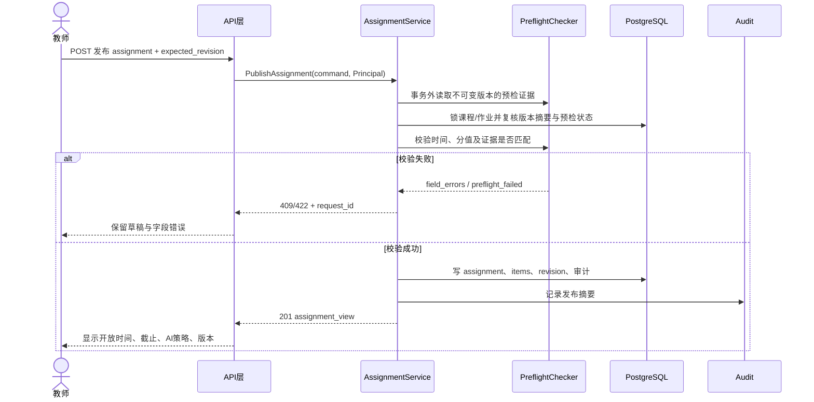

- 正常路径：锁内检查 `open_at < due_at`、分值合计 100、题目版本已自检；根据当前时间进入 SCHEDULED 或 OPEN。
- 分支：AI_POLICY=DISABLED/HINT；题目版本可被多个作业引用但快照不可变；一般延期走API-04并留理由，故障补偿走WF-06/IF-09。
- 异常：旧 `expected_revision`、缺少测试、参考程序失败、时间倒置、归档课程、重复题目返回 409/422，不写半成品。
- 写入：`assignments`、`assignment_items`、DB-04的`preflight_runs`证据引用、`audit_events`；接口 IF-04 只负责重评，不复用发布动作。
- 对应：FR-05—FR-09、FR-29；BR-04/07/16；AC-05—AC-09、ST-12。

### 4.2 WF-02 学生正式提交与幂等受理

**参与者：** 学生、MOD-01、MOD-03、MOD-04、MOD-09、数据库、Outbox。

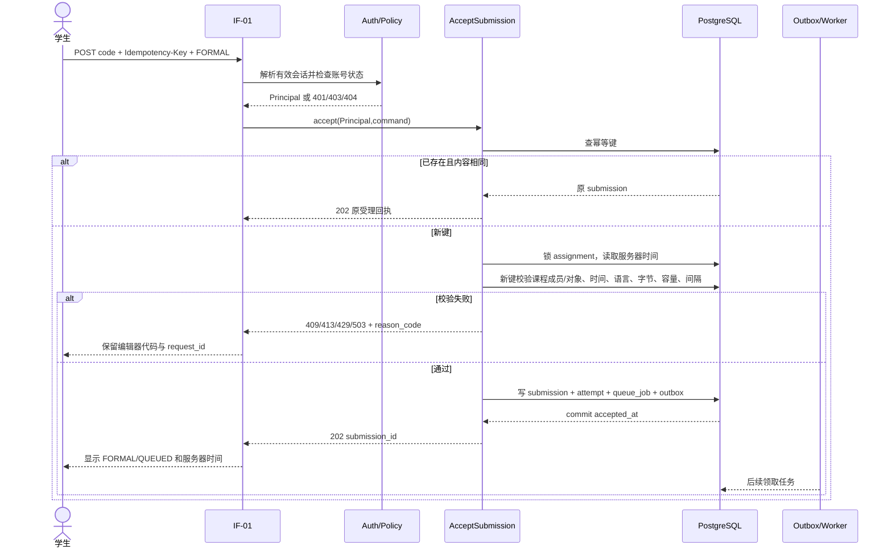

- 正常路径的受理完成点是数据库事务提交，不是按钮点击、浏览器动画或评测完成。
- 正式/练习分支由 `X-Submission-Intent` 与锁内服务器时间共同决定；意图与状态不一致返回 409，不静默转换。
- 幂等分支：截止后相同键同内容仍找回原提交；同键不同内容 409；幂等重放不增加容量计数。
- 异常分支：个人间隔 `STUDENT_INTERVAL`、个人积压 `STUDENT_PENDING_LIMIT` 返回 429；全局容量、评测不可用、持久化不可用分别返回 503 原因码；数据库未提交不能返回成功。
- 对应：FR-01/03/04/10—FR-12、FR-24；BR-01—BR-03/10/16/17；NFR-01/03/09/12/14；AC-01/03/04/10—AC-12、ST-01—ST-03/ST-13/ST-14。

### 4.3 WF-03 评测、回写与成绩暂态

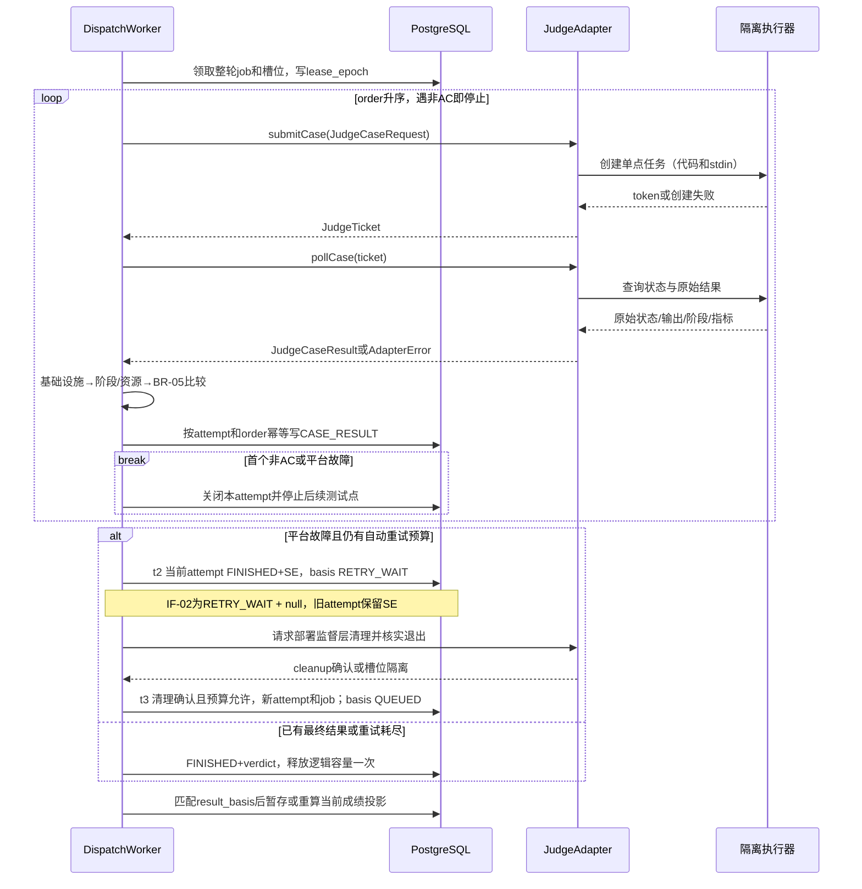

IF-07是异步单点端口：创建返回token、查询取得结果。adapter只提供规范化执行事实，比较器在MOD-05按BR-05决定AC/WA；`expected_output`不交给第三方默认比较器。首个失败后未运行的点没有虚构结果。整体CPU统计为已执行点之和、内存为峰值；任一必要指标缺失时对应总指标为null，已知点数据仍保留。

自动重试新轮次从第1点开始，不与旧轮次拼接AC集合；旧case_results不覆盖。平台错误映射与是否可重试见§5.4.3，AI失败不进入本流程。重复/迟到回写须同时满足结果基线、generation和lease_epoch，待激活批次只写暂存结果。关联FR-13—FR-19/23/24，BR-05—BR-12，ST-04—ST-09，TD-02/03/08。

**WF-03逐时刻状态对照（同一已激活basis；t为示意顺序，不是实测时间）：**

| 时刻/图中位置 | attempt存储(state,verdict) | result_bases存储 | IF-02逻辑投影(state,verdict)及计分 |
| --- | --- | --- | --- |
| t0 WF-02受理提交 | a1=(QUEUED,null) | processing_state=QUEUED；current_attempt_id=a1；cycle_started_at=accepted_at | (QUEUED,null)；占1个逻辑容量，不发布最终分 |
| t1 WF-03领取整轮job | a1=(JUDGING,null)，started_at写一次 | processing_state=JUDGING；指针仍a1 | (JUDGING,null)；360秒从a1.started_at起，15分钟继续从周期起点算 |
| t2 可恢复平台故障 | a1=(FINISHED,SE)，写finished_at/reason | 同事务processing_state=RETRY_WAIT，指针仍a1；尚未确认清理 | (RETRY_WAIT,null)；a1的SE保留在轮次历史；容量不释放/不双占，槽位未确认退出则隔离 |
| t3 监督清理确认且余下重试可用 | a1保持(FINISHED,SE)；新a2=(QUEUED,null) | current_attempt_id=a2；processing_state=QUEUED；auto_retry_count增至1，cycle_started_at不变 | (QUEUED,null)；新generation，整轮从测试点1开始 |
| t4 新轮次派发 | a2=(JUDGING,null)，新started_at | processing_state=JUDGING | (JUDGING,null)；a2有自己的360秒，仍受原15分钟总界限 |
| t5 正常终结（示例AC） | a2=(FINISHED,AC) | processing_state=FINISHED；指针a2 | (FINISHED,AC)；释放逻辑容量一次，MOD-06重算成绩；若还有其他门禁仍不发布 |
| tx 任一非终态达到总界限或无重试资格 | 当前attempt若未终结则写(FINISHED,SE)；旧终态不覆盖 | processing_state=FINISHED；记录WORKFLOW_DEADLINE或最终reason | (FINISHED,SE)；逻辑容量释放一次，物理槽位仍须清理确认才释放 |

不变量：逻辑state由DB-08.result_bases读取，历史attempt由其自身记录读取；未激活重评basis不替换IF-02的已激活结果。TD-02/08核对每个事务提交点和重复回写，不从a1的SE错误推断整个逻辑提交已结束。

### 4.4 WF-04 统一重评与原子激活

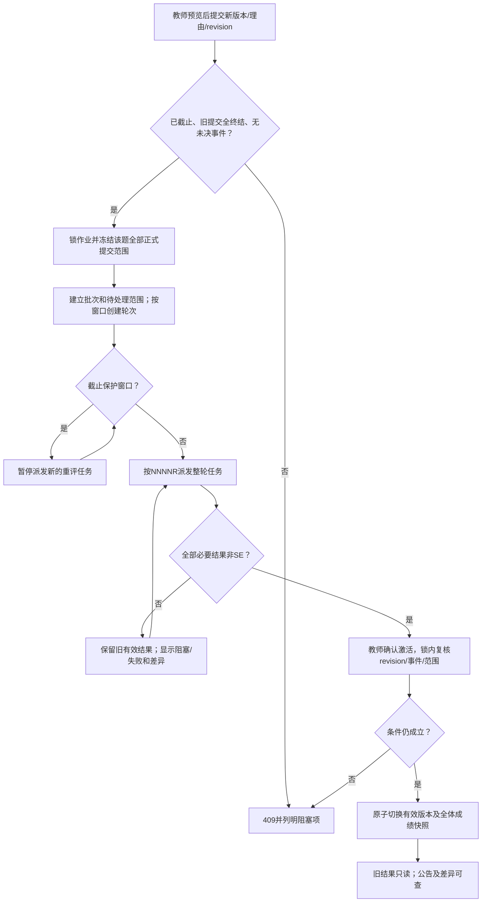

1. IF-04只接受新版本、理由和revision，不接受学生名单过滤。新版本必须是该作业原题的新版本并已自检；范围为该题所有正式提交，原SE也纳入，练习除外。范围快照同时保存提交集合与校验值。批次可先冻结全部范围，后台按容量窗口逐组准备任务，不改变范围或部分激活。
2. 新结果进入批次result_basis；旧生效结果保留。若旧成绩已发布，展示REJUDGING标志，但旧发布快照内容不改。无法恢复的SE使批次BLOCKED；图中回到执行需要管理员带理由人工重试，不能无限自动循环。准备或激活前发生延期需要先取消未激活批次。
3. IF-05锁内复核批次范围完整性、所有必要结果非SE、当前revision、作业已截止及全部公平事件已解决；成功切换assignment_items的有效版本指针，并为全作业所有学生生成同一grade_version下的grade_students/grade_items。仅被纠错题使用新基线，其他题沿用原已激活基线。
4. 原成绩尚未发布时，激活生成PROVISIONAL快照，存在其他题SE/待处理时为PENDING，教师另经API-11通过门禁后发布。原成绩已发布时，替换动作复核全作业发布门禁，成功即原子产生新PUBLISHED快照和published_at；不得只更新部分学生、只增不减或保留失效版本最高分。旧版本可查看但不标为当前。
5. 事务冲突、持久化失败或任何门禁不满足时整批回滚；不移动生效指针，保留暂存结果供重试/取消。通知失败不回滚已生效事务。

关联FR-08/15/17/18/23/29，BR-04/08/09/16/17，IF-04/05，DB-08/10/12/13，AC-08/15/17/18/23/29、ST-08/09/12—14、TD-02/09。

### 4.5 WF-05 AI 学习提示与降级

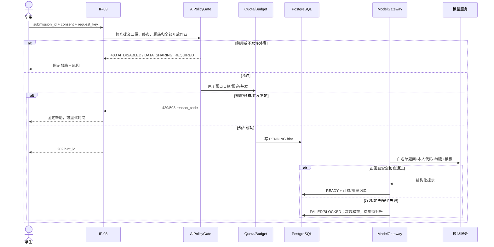

- AI 不影响提交、评测和成绩；模型输出不直接写入成绩或题目。
- 结果必须带“AI 建议，需自行验证”，不完整解答、不虚构隐藏测试；不合格输出降级为确定性帮助。
- `request_key` 以用户维度幂等；跨日执行仍记入接纳日；真实供应商费用按 DEP-AI 记录，不能因为失败响应自动记零。
- 对应：FR-19—FR-22、FR-26/28；BR-12—BR-14；NFR-05/08/18/19/24；AC-19—AC-22/26/28、ST-06/ST-10/ST-11/ST-15—ST-17。

### 4.6 WF-06 截止高峰故障、公平事件与恢复

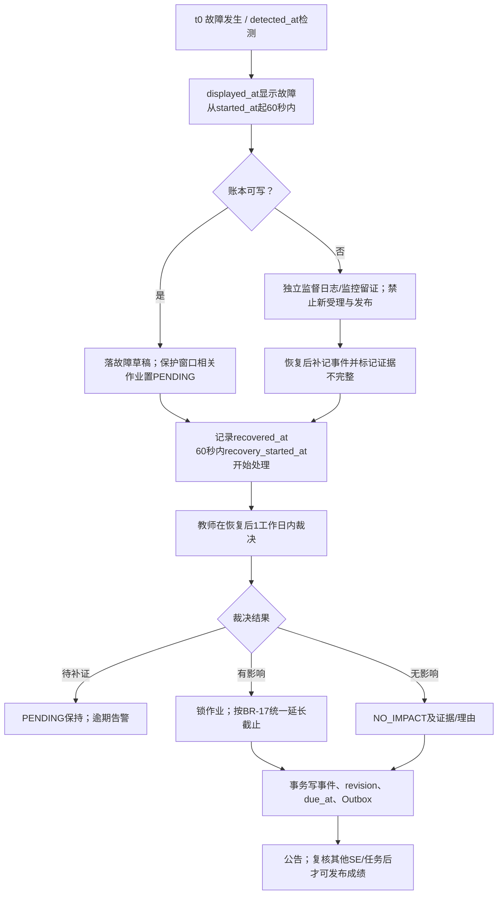

60秒是NFR-10的不可用探测与显示目标，不是“数据库损坏时仍保证60秒成功写事件”的承诺。账本可写时同一探测处理事务创建草稿，若故障与截止前10分钟保护窗口相交则置相关作业fairness_review=PENDING；账本不可写时依赖独立监督日志/健康显示，恢复后60秒内启动补记和待处理恢复扫描，先重建发布门禁再开放业务。全断电无日志可由管理员补监控/部署证据，并显式注明不完整；NT-10/ST-13保留检测、展示、写入三个时间戳，并另记故障起点、恢复时刻及实际开始处理时刻，计算口径见本节时序表。

正式资格仍按锁内服务器时间判断，无法持久受理返回失败并保留客户端代码。只违反5秒间隔、非法请求或个人断网不自动认定平台影响；平台积压造成持续占满个人3个名额则纳入事件。拒绝计数按request_id去重，不能把容量拒绝隐入学生错误。

教师用IF-09在恢复后1个工作日内选择PENDING/EXTEND/NO_IMPACT。有影响时对全班统一：`new_due=max(old_due,recovered_at,approved_at)+max(相交故障时长,10分钟)`；相交时长严格取连续故障区间与该作业原开放区间 `[open_at,old_due)` 的交集，相邻故障合并登记，不能把它缩成仅截止前10分钟。时间单位毫秒，计算依据与原截止快照入库。多个事件逐项裁决并保留各自old_due，不重复消费同一incident决定。new_due由服务端计算，客户端不可填写。活动重评批次须先取消；旧练习不追认，学生重新正式提交。若此前已有已发布成绩，延期后当前成绩投影回PROVISIONAL，新截止后再发布新版本，旧快照只读。统一补偿公告直接随作业详情生效，不依赖中优先级站内通知是否已实现。

PENDING、补偿尚未生效、仍有正式SE/待处理任务时，激活/发布/归档/清理分别执行对应门禁。关联BR-17、FR-09/11/18/24/27/29、IF-09、DB-13/14/15、UI-08/09/12、ST-13/14与TD-05。

**WF-06按时刻的状态、判定与恢复目标（与NT-10对应）：** 公平事件不是评测attempt。表内“—”表示不适用，不新增verdict。没有成功受理的503请求也没有submission/attempt；已受理记录才按WF-03恢复。

| 时刻/图中位置 | 持久状态与(state,verdict) | 用户逻辑投影/门禁 | NT-10证据与计时 |
| --- | --- | --- | --- |
| t0 故障起点→检测F | 记started_at、detected_at；已受理attempt不因出现incident即改判 | 健康状态准备切换；禁止把平台故障写成学生WA | 受控故障注入给t0=started_at；检测耗时=detected_at-started_at |
| t1 显示D，账本可写I | 写detected_at/displayed_at/persisted_at；相关作业fairness_review=PENDING；受影响attempt可按WF-03为(FINISHED,SE)且basis=RETRY_WAIT | 健康页不可用；逻辑可为(RETRY_WAIT,null)，最终发布受公平事件阻止 | displayed_at-started_at≤60秒；持久化耗时单独记录，不混作显示耗时 |
| t1' 账本不可写L | 数据库保留故障前状态；监督侧记录检测/展示证据，persisted_at尚无值 | IF-02不能可靠读取则503，缓存只展示“上次状态+不可用”，不伪造FINISHED或声称已落PENDING | 显示目标仍从started_at计；无观测证据时标不可判定/偏差，不能宣称通过 |
| t2 恢复R/R2 | recovered_at为恢复探测通过时刻；先补DB-13事件和PENDING门禁，再恢复任务 | 新业务开放前门禁已重建；逻辑投影按实际basis状态 | recovery_started_at为首次实际扫描并处理持久待办的时刻；两者差≤60秒；仅启动进程不算开始处理 |
| t3 恢复处理中 | 仍在预算内按WF-03重试；超15分钟则basis=FINISHED、当前有效verdict=SE，旧终态不回退 | 已受理任务显示当前逻辑状态；过期轮次迟到消息仅审计 | 保存补记persisted_at及实际超时检测/落库时差，不倒填为故障发生时刻 |
| t4 教师裁决T/E/N/A | incident_assignments.decision更新；EXTEND写new_due/revision；attempt/state/verdict不由裁决改写 | 其他未决事件仍PENDING；延期后作业OPEN、当前成绩PROVISIONAL；旧练习仍PRACTICE | recovered_at→approved_at按1工作日规则核对；NT-10两项60秒目标不因此重置 |

外部监督日志以incident_id关联，重放补记按incident_id幂等；DB-13新增recovery_started_at为设计证据字段。只有存在持久待办的恢复场景才核验“开始处理”目标；无待办另报空扫描，不冒充业务恢复样本。

## 5. 接口设计

### 5.1 统一 API 约定

- Base URL：`/api/v1`；所有业务载荷 UTF-8 JSON，时间使用带时区 ISO 8601，服务端内部保存 UTC 毫秒。
- 身份：HTTPS 会话 Cookie 或等价短期令牌；后端从会话建立 `Principal`，拒绝请求体中的 `user_id/role` 覆盖。
- 请求头：`X-Request-Id` 可由客户端提供但服务端必须校验/重写；提交必须 `Idempotency-Key` 和 `X-Submission-Intent: FORMAL|PRACTICE`；AI 使用 `request_key`。
- 成功响应：列表稳定排序、默认分页 20、最大 100；异步创建使用 202 并返回可查询 ID。
- 统一错误：

```json
{
  "code": "STUDENT_PENDING_LIMIT",
  "message": "当前有 3 个未终结提交，请等待结果后再提交。",
  "request_id": "req_01J...",
  "retryable": true,
  "retry_after_seconds": 8
}
```

`message` 面向用户，不含堆栈、SQL、绝对路径、隐藏数据或令牌。429/503 在可重试时附 `Retry-After`；未知字段、未知枚举和越权对象默认拒绝。

### 5.2 外部与业务接口

| 编号／方法 | 用途与输入 | 成功输出 | 失败约定与调用限制 |
| --- | --- | --- | --- |
| IF-01 `POST /submissions` | `assignment_id, problem_id, language_key, code`；请求头幂等键和提交意图 | 202：`submission_id, accepted_at, mode, state, request_id` | 400/401/403/404/409/413/429/503；代码 1—64 KiB、非全空白；同一学生新受理间隔≥5s、未终结≤3；同键重放不占位。 |
| IF-02 `GET /submissions/{id}` | 路径 ID + 会话 | 200：授权投影的 DD-06、DD-07、case 摘要 | 学生看不到隐藏输入/输出、隐藏 stdout/stderr、内部凭据；跨课程按 BR-01 返回 404。 |
| IF-03 `POST /ai-hints` | `submission_id, question?, data_sharing_consent, request_key` | 202：`hint_id, status=PENDING`；重放/查询按§5.4.4返回已存状态 | 策略、归属、同题族、预算或额度失败分别 403/409/429/503；每人同时 1 个、平台并发 2、等待≤10s、执行≤20s。 |
| IF-04 `POST /assignments/{id}/rejudge` | `new_version_id, reason, expected_revision` | 202：`batch_id, affected_count, state` | 开放、旧任务未终结、活动批次、版本冲突或公平事件返回 409；只允许截止后的全题范围。 |
| IF-05 `POST /rejudge-batches/{id}/activate` | `expected_revision, reason` | 200：新 `grade_version` 和差异摘要 | 任一必要 SE/未终结/批次过期返回 409；不部分激活；新成绩可升可降。 |
| IF-06 `GET /assignments/{id}/grades.csv` | `grade_version`、稳定过滤条件 | 200：UTF-8 CSV 固定列、状态和版本 | 仅任课教师；5 秒目标见 NFR-21；字段以公式危险前缀转义；不含源码。 |
| IF-07 业务→评测适配器 | `JudgeCaseRequest`：attempt、代数、单测试输入、代码、语言和 profile | `JudgeTicket`，之后 poll 得 `JudgeCaseResult`；详见 §5.4.2 | 私网鉴权；每 attempt 串行测试点；失败映射 §5.4.3；token 不给学生。 |
| IF-08 业务→模型网关 | `AllowedHintContext`：公开题面、本人代码、可见判定、粗粒度原因、模板版本 | `ModelReply` → `HintResult`：sections、model_version、usage、safety_flags | DeepSeek 官方 API 配置见 §13.2；映射 §5.4.4；无隐藏数据/工具；不改变 attempt/成绩。 |
| IF-09 `POST /assignments/{id}/fairness-decisions` | `incident_id, decision, reason, expected_revision` | 200：新 revision、old_due/new_due、状态 | 仅任课教师；EXTEND 要有恢复时间与证据；过期 revision 409；PENDING 阻止成绩发布。 |

### 5.3 补充业务 API（设计级接口）

阶段一的 IF-01—IF-09 覆盖了提交、结果、AI、重评、导出、评测和公平裁决。为使题目、课程、发布和会话也可直接实现，补充以下业务 API；它们不改变 FR/BR，只把已有能力具体化。

| 编号／方法 | 用途与关键输入 | 成功输出 | 错误与限制 |
| --- | --- | --- | --- |
| API-01 `POST /auth/login`、`POST /auth/logout`、`POST /auth/password` | 登录名/密码；改密需当前会话和新密码 | 会话摘要/204；改密后新会话 | 错误密码不泄露账号存在；连续失败冷却；密码 12—128 字符；401/429 |
| API-02 `POST /courses`、`GET /courses/{id}`、`PUT /courses/{id}/members/{user_id}` | 教师课程元数据、已有账号、成员状态 | 课程/成员视图 | 仅课程教师或管理员对应操作；重复成员幂等；跨课程 404/403 |
| API-03 `POST /problems`、`POST /problem-versions`、`POST /problem-versions/{id}/testcases`、`POST /problem-versions/{id}/preflight` | 题面、标签、canonical_problem_id、文本测试文件、语言 profile | 草稿/版本/预检结果 | 草稿阶段才可写；文件和配对校验；发布后 409；隐藏 blob 不回给学生 |
| API-04 `POST /assignments`、`POST /assignments/{id}/publish`、`PATCH /assignments/{id}/deadline`、`GET /assignments/{id}` | 课程、版本、分值、open/due、AI策略、expected_revision | 作业视图、revision、公告摘要 | 分值/时间/预检失败 422；旧 revision 409；归档后只读；延期必须理由 |
| API-05 `GET /assignments/{id}/submissions`、`GET /grades/{grade_version}` | 教师过滤条件或学生本人视图 | 稳定分页的授权投影 | 教师限本人课程，学生限本人；不返回隐藏正文；分页≤100 |
| API-06 `GET /rejudge-batches/{id}`、`GET /incidents/{id}` | 批次/公平事件 ID | 影响范围、状态、差异、证据摘要 | 只读授权投影；PENDING/SE 状态必须可见；不暴露测试正文 |
| API-07 `GET /ai-hints/{hint_id}` | hint_id + 会话 | PENDING/READY/FAILED/BLOCKED 的提示投影 | 仅本人提交/任课教师适当摘要；输出长度≤DD-08；轮询需退避 |
| API-08 `GET /notifications`、`POST /notifications/{id}/read` | 分页和通知 ID | 稳定通知列表/204 | 仅本人；事件唯一键去重；通知失败不回滚业务事务 |

| 编号／方法 | 用途与关键输入 | 成功输出 | 错误与限制 |
| --- | --- | --- | --- |
| API-09 `POST /feedback-catalogs`、`PUT /feedback-catalogs/{id}/draft`、`POST /feedback-catalogs/{id}/publish`、`GET /feedback-catalogs/{id}/versions/{version}` | 课程/判定/语言/标题/说明/清单；修改需expected_revision；发布需reason | 201/200：catalog_id、version_id、revision、内容摘要；GET返回固定版本 | 任课教师限本课，管理员仅全局种子；400/403/404/409/413；正文≤8KiB/2000码点、清单≤10项、禁止隐藏数据 |
| API-10 `GET /submissions/{id}/feedback`、`GET /review-items`、`GET /recommendations`、`POST /ai-hints/{id}/feedback` | 授权提交或本人错题；提示反馈为USEFUL/NOT_USEFUL/ERROR及comment（0—500码点） | 固定帮助与feedback_version_id；错题分页；至多5题和规则原因；反馈200 | 无模型也可用；同族/开放状态过滤见FR-28；反馈只允许本人READY提示、每hint每用户一条可修订，不改变原提示或分数 |
| API-11 `POST /assignments/{id}/grades/publish` | expected_revision、reason | 200：grade_version、published_at、状态 | 任课教师；未截止/SE/未完任务/公平事件/活动批次409；同revision重复请求查原发布事件，不生成第二快照 |
| API-12 `POST /submissions/{id}/retry`、`POST /rejudge-batches/{id}/retry` | reason（10—500码点）、expected_revision；批次只能重试SE范围 | 202：新cycle/attempt或批次恢复摘要 | 仅管理员、只重试平台SE；禁止重试学生错误；容量不足429/503；旧代码/mode/accepted_at不变 |
| API-13 `POST /admin/users`、`PATCH /admin/users/{id}`、`POST /admin/users/{id}/reset-password`、`GET /admin/health`、`GET /admin/audit-events` | 管理员角色校验；账号字段/状态/reason；审计过滤和游标 | 201/200：账号安全投影、一次性重置流程、健康/审计分页 | 账号唯一409；密码不回显；审计只读、敏感字段不出响应；分页≤100 |
| API-14 `POST /courses/{id}/archive`、`POST /admin/retention/previews`、`POST /admin/retention/{id}/execute` | 课程revision/reason；清理预览ID、教师确认引用 | 200归档视图；202预览/清理任务ID | 教师归档/管理员执行清理；期限、hold、未终结或事件409；执行前再次核对预览摘要，禁止客户端任意指定磁盘路径 |
| API-15 `POST /hint-templates`、`PUT /hint-templates/{id}/draft`、`POST /hint-templates/{id}/publish`、`GET /hint-templates/{id}/versions/{version}` | scope/course_id、模板正文、允许占位符、schema_version、expected_revision/reason | 201/200：template_id、version_id、revision、checksum | 教师限本课程；全局安全框架由平台固定，模板不能改权限/输出上限；未知占位符或脚本422；修改已发布版409；正文≤8KiB |

上述新增API编号是阶段二实现入口，不新增阶段一IF编号。草稿的 `PUT` 输入/输出字段与DB-16一一对应；发布请求不接收新正文，只发布锁内已校验的draft_revision。API-09/API-15返回固定版本链接，历史查询不读取“最新草稿”。

这些接口统一使用第 5.1 节错误结构、request_id 和授权策略；数据库写操作在应用层事务内执行，外部预检/模型/执行器调用在事务外进行，不能由 UI 直接写表。

### 5.4 内部模块接口

#### 5.4.1 类型、签名与API逐字段映射

`Id=不可复用字符串`，`Instant=UTC毫秒整数`（HTTP输出转ISO8601），`Revision=正整数`，`Bytes=原始字节`，`Principal={user_id,role,course_scopes}`只来自服务端会话。`Result<T,E>`恰好为成功T或包含code/request_id/retryable/安全message的错误E。ID与revision校验失败400，业务冲突409，未授权按BR-01；所有可空指标显式null。

```text
AuthPort.authenticate(session) -> Result<Principal, AuthError>
PolicyPort.authorize(principal, action, resource) -> Result<Allow, Deny>
ClockPort.now_utc_ms(tx) -> Instant
SubmissionService.accept(principal, cmd: AcceptSubmissionCommand) -> Result<AcceptedSubmission, DomainError>
SubmissionService.get(principal, submission_id: Id) -> Result<SubmissionView, DomainError>
JudgeQueuePort.claim(worker_id: Id) -> Result<QueueLease?, StorageError>
JudgePort.submitCase(req: JudgeCaseRequest) -> Result<JudgeTicket, AdapterError>
JudgePort.pollCase(ticket: JudgeTicket) -> Result<JudgeCaseResult, AdapterError>
RunnerSupervisor.stopAndInspect(attempt_id: Id, lease_epoch: int) -> CleanupEvidence
VerdictPort.map(result: JudgeCaseResult, testcase: TestcaseSnapshot) -> CaseVerdict
GradePort.recompute(assignment_id: Id, result_basis_ids: List<Id>) -> GradeSnapshotDraft
GradePort.publish(principal, assignment_id: Id, expected_revision: Revision, reason: string) -> Result<GradeVersion, DomainError>
RejudgePort.prepare(principal, cmd: RejudgeCommand) -> Result<RejudgeReceipt, DomainError>
RejudgePort.activate(principal, batch_id: Id, expected_revision: Revision, reason: string) -> Result<GradeVersion, DomainError>
GradePort.exportCsv(principal, assignment_id: Id, grade_version: Id, filters: GradeFilter) -> Result<CsvStream, DomainError>
AiPort.request(principal, cmd: HintCommand) -> Result<HintReceipt, DomainError>
ModelPort.complete(context: AllowedHintContext, config: ModelConfig) -> Result<ModelReply, ModelError>
QuotaPort.reserve(subject: Id, accepted_date: LocalDate, request_key: UUID, cost_upper: Money) -> Result<Reservation, QuotaError>
FairnessPort.decide(principal, cmd: FairnessDecisionCommand) -> Result<FairnessReceipt, DomainError>
FeedbackPort.resolve(principal, submission_id: Id) -> FeedbackView
RecommendationPort.list(principal) -> List<AuthorizedProblemView>
CatalogPort.saveDraft(principal, cmd: CatalogDraftCommand) -> Result<CatalogDraft, DomainError>
CatalogPort.publish(principal, cmd: CatalogPublishCommand) -> Result<CatalogVersion, DomainError>
AuditPort.append(tx, event: AuditEvent) -> void
NotificationPort.enqueue(tx, event: DomainEvent) -> void
```

下表定义HTTP输入到端口DTO及已列响应的映射；只对表内明确列出的字段适用，不能据同名假设自动序列化整张表。复合响应与派生字段另按后表逐项组装；禁止由调用者提供内部推导字段。关联ID记日志但不记代码。

| API字段来源 | 内部DTO字段 | 类型与校验/生成规则 |
| --- | --- | --- |
| IF-01 body.assignment_id | AcceptSubmissionCommand.assignment_id | Id；MOD-01验证课程成员 |
| IF-01 body.problem_id | AcceptSubmissionCommand.problem_id | Id；必须是作业题目；version_id服务端由item解析 |
| IF-01 body.language_key | AcceptSubmissionCommand.language_key | string；版本profile白名单 |
| IF-01 body.code | AcceptSubmissionCommand.code | UTF-8 string→Bytes；1—64KiB、非全空白；计算sha256 |
| IF-01 header.Idempotency-Key | AcceptSubmissionCommand.idempotency_key | UUID；与user_id组成唯一键 |
| IF-01 header.X-Submission-Intent | AcceptSubmissionCommand.intent | FORMAL/PRACTICE；服务端验证后才写mode |
| IF-01 session | principal.user_id | 服务端身份；body不得覆盖 |
| IF-01 response.submission_id | AcceptedSubmission.submission_id | Id；持久记录主键 |
| IF-01 response.accepted_at | AcceptedSubmission.accepted_at | 锁内DB Instant→ISO8601；不能用客户端时间 |
| IF-01 response.mode | AcceptedSubmission.mode | 已受理时冻结的FORMAL/PRACTICE |
| IF-01 response.state | AcceptedSubmission.state | 新受理QUEUED；同键重放保留原受理响应，最新状态经IF-02读取 |
| IF-01 response.request_id | AcceptedSubmission.request_id | 本次链路Id；原提交Id不变 |
| IF-02 path.id | SubmissionService.get.submission_id | Id；先授权再取投影；输出SubmissionView=DD-06/07可见字段 |
| IF-03 body.submission_id | HintCommand.submission_id | Id；本人已完成提交；只读该代码快照 |
| IF-03 body.question | HintCommand.question | 可选string，0—500码点；无值转空串 |
| IF-03 body.data_sharing_consent | HintCommand.data_sharing_consent | boolean；外部模型要求显式true，并记录policy_version |
| IF-03 body.request_key | HintCommand.request_key | UUID；UNIQUE(user_id,request_key) |
| IF-03 response.hint_id | HintReceipt.hint_id | Id；对应DB-11 |
| IF-03 response.status | HintReceipt.status | 新受理PENDING；重放读ai_hints.status，API-07查询最终状态 |
| IF-04 path.id | RejudgeCommand.assignment_id | Id；任课教师且截止后 |
| IF-04 body.new_version_id | RejudgeCommand.new_version_id | Id；同题、已自检的新版本 |
| IF-04 body.reason | RejudgeCommand.reason | string，10—500码点 |
| IF-04 body.expected_revision | RejudgeCommand.expected_revision | Revision；匹配assignment.revision |
| IF-04 response.batch_id | RejudgeReceipt.batch_id | Id；批次主键 |
| IF-04 response.affected_count | RejudgeReceipt.affected_count | 非负整数；范围快照提交数，不是学生数 |
| IF-04 response.state | RejudgeReceipt.state | PREPARED/RUNNING/BLOCKED/READY/ACTIVE/CANCELLED；批次枚举 |
| IF-05 path.id | RejudgePort.activate.batch_id | Id；反查所属assignment进行授权 |
| IF-05 body.expected_revision | RejudgePort.activate.expected_revision | Revision；匹配所属assignment |
| IF-05 body.reason | RejudgePort.activate.reason | string，10—500码点 |
| IF-05 response.grade_version | GradeVersion.grade_version | Id；全作业统一快照标识；差异摘要不含隐藏正文 |
| IF-06 path.id | GradePort.exportCsv.assignment_id | Id；与快照assignment必须相同 |
| IF-06 query.grade_version | GradePort.exportCsv.grade_version | Id；必须已发布，可导出历史已发布版 |
| IF-06 query.student_id/status | GradeFilter.student_id/status | 可选本人课程学生Id/成绩枚举；不改变快照内容 |
| IF-09 path.id | FairnessDecisionCommand.assignment_id | Id；必须在事件影响作业集合中 |
| IF-09 body.incident_id | FairnessDecisionCommand.incident_id | Id；按事件和作业联合唯一裁决 |
| IF-09 body.decision | FairnessDecisionCommand.decision | PENDING/EXTEND/NO_IMPACT |
| IF-09 body.reason | FairnessDecisionCommand.reason | string，10—500码点 |
| IF-09 body.expected_revision | FairnessDecisionCommand.expected_revision | Revision；锁内检查 |
| IF-09 response.revision | FairnessReceipt.revision | 作业新revision |
| IF-09 response.old_due/new_due | FairnessReceipt.old_due/new_due | Instant→ISO8601；服务端公式计算；非EXTEND二者相同 |
| IF-09 response.fairness_review | FairnessReceipt.fairness_review | NONE/PENDING/RESOLVED；按该作业全部事件汇总 |

**复合响应的存储来源与派生边界：** “来源字段=表.列”指同一次授权读取/事务快照，任何未列字段不得自动透传。

| 响应字段 | 来源字段或确定性计算 | 边界与空值语义 |
| --- | --- | --- |
| IF-02 state / verdict | state=result_bases.processing_state；仅FINISHED时verdict=attempts.verdict（current_attempt_id关联） | 查询已激活basis；非终态verdict=null，即使旧attempt为SE；待激活重评结果只在批次授权视图中可见 |
| IF-04 affected_count | rejudge_batches.affected_count = COUNT(rejudge_members.submission_id)，按batch_id过滤 | 冻结范围的正式逻辑提交数，包含原SE；不是学生数、题数、attempt数或已创建basis数；0表示范围为空，不得假造处理结果 |
| IF-04 batch_id / state | rejudge_batches.batch_id / rejudge_batches.state | 状态指批次，不借用submission或grade状态；与范围校验值同一事务提交 |
| API-06 affected_student_count | COUNT(DISTINCT submissions.user_id)，经rejudge_members连接 | 单独显示受影响学生人数，与affected_count同时标注计数单位；不替代全范围校验 |
| IF-05 grade_version / 差异摘要 | grade_versions.grade_version；新旧grade_students.total按student_id连接，grade_items按学生/题连接 | 差异每项给old_total、new_total、delta=new-old；变动人数为delta非0人数；首次快照无旧分时old_total/delta=null，不能将未发布冒充0分 |
| IF-09 revision / old_due / new_due | assignments.revision；incident_assignments.old_due/new_due | EXTEND写服务端公式值；PENDING/NO_IMPACT不改变due，DTO new_due=old_due，即使存储new_due为空 |
| IF-09 fairness_review | assignments.fairness_review，锁内汇总该作业所有incident_assignments.decision | 有任一PENDING则PENDING；无事件NONE；已全部裁决且补偿已生效RESOLVED；解决一个事件不清空其余门禁 |
| API-09 / API-15 version_id、revision、checksum | feedback_versions或template_versions.version_id/checksum；对应catalog.draft_revision | 发布结果按明确DTO选字段；历史查询读不可变version，不读active指针指向的新正文 |

IF-06的CSV文本转义统一归ExportService，IF-06与NFR-21引用同一规则：文本单元格的危险公式前缀（包括前导空白/控制符后首个`= + - @`）按导出策略加单引号并完成CSV引号转义，原始数据库文本不改；分数等数值列保持类型。NT-21使用固定恶意文本、正常文本及两种表格应用的实际打开结果验证，不能仅凭字符串检查记为应用安全通过。

#### 5.4.2 IF-07 单点异步执行契约

`JudgeCaseRequest={attempt_id:Id,generation:int,lease_epoch:int,version_id:Id,testcase_id:Id,testcase_order:int,code:Bytes,stdin:Bytes,language_profile:FrozenProfile,limits:PhaseLimits,request_id:Id}`。来源依次为DB-08轮次/租约、DB-04版本、DB-05测试、DB-07源码；全部由服务端装配，不接受学生资源参数。result_basis_id是内部DTO对DB-08.basis_id的同义命名，存储字段统一为basis_id。`FrozenProfile`包含language_key、后端language_id、语言/镜像版本和摘要；`PhaseLimits`分别保存compile/run限制，不把两阶段混成一个cpu_ms。

`JudgeTicket={attempt_id,generation,lease_epoch,testcase_order,backend_token,submitted_at}`持久化于DB-09.adapter_runs。`JudgeCaseResult={ticket,status:PENDING/DONE,phase,raw_status,stdout:Bytes?,stderr:Bytes?,compile_output:Bytes?,cpu_ms:int?,memory_bytes:int?,exit_code:int?,resource_reason:string?,engine_meta}`；PENDING不含最终结果。以一次创建、1/2/4秒退避轮询到本轮或总流程deadline为限；轮询传输失败可在该期限内继续查询原token，不重新创建任务。

Judge0候选对接采用 `POST /submissions?base64_encoded=true&wait=false` 创建和 `GET /submissions/{token}?base64_encoded=true` 查询；源码与stdin编码后传入，`expected_output`不设置，返回输出解码后交本平台比较。运行限制中的毫秒换秒、字节换后端KB需按冻结版本核验单位与取整，原始值和规范值同时保存。官方说明只支持此API形态，并不能证明编译限制、集合内存、目录总额或线程总数已满足；实际部署须有分别探测的监督/配额机制。停止任务由RunnerSupervisor的部署实现完成，不宣称Judge0提供未核验的取消API。[Judge0 CE API文档](https://ce.judge0.com/)

创建请求超时且无token时标记 `CREATE_UNKNOWN` 并隔离槽位；仅在监督层核实任务已退出/清理后，才按重试规则创建新轮次。不能在不知道前次执行是否存在时盲目重复POST。

#### 5.4.3 IF-07 失败与判定映射

表中state/verdict指本次attempt，非终态verdict为空。`ONCE`表示只对可恢复平台故障，清理已确认、健康恢复且15分钟内尚余一次自动重试时新建attempt；不满足即逻辑FINISHED+SE。所有错误保留实际phase/raw_status/mapping_version，客户端只获安全reason_code。

| 输入类别 | attempt.state | verdict | reason_code | 自动重试 | 处理/用户语义 |
| --- | --- | --- | --- | --- | --- |
| RUN_PENDING | JUDGING | null | NONE | NO | 查询原token，不创建新任务 |
| EXIT_OK_MATCH | FINISHED | AC | ACCEPTED | NO | 所有测试点AC时整轮AC；单点AC仍继续循环 |
| EXIT_OK_MISMATCH | FINISHED | WA | OUTPUT_MISMATCH | NO | BR-05比较失败，停止后续点 |
| COMPILE_FAILURE | FINISHED | CE | COMPILE_ERROR | NO | 有编译阶段证据；Python按实际阶段映射 |
| RUN_CPU_OR_WALL_LIMIT | FINISHED | TLE | EXECUTION_TIME_LIMIT | NO | 是单点运行上限，非协调超时 |
| RUN_MEMORY_CONFIRMED | FINISHED | RE | MEMORY_LIMIT | NO | 需要集合计量/限额触发证据 |
| RUN_OUTPUT_CONFIRMED | FINISHED | RE | OUTPUT_LIMIT | NO | 有单文件/目录配额触发证据 |
| RUN_EXIT_ERROR | FINISHED | RE | RUNTIME_ERROR | NO | 有运行阶段证据；资源原因未知则UNKNOWN，不猜内存超限 |
| TRANSPORT_OR_BACKEND_5XX | FINISHED | SE | JUDGE_TRANSPORT | ONCE | 先核实原任务与清理；超时无token走CREATE_UNKNOWN |
| INVALID_BACKEND_JSON | FINISHED | SE | JUDGE_PROTOCOL | ONCE | 保留响应摘要，不能猜测AC/WA |
| IMAGE_MISSING | FINISHED | SE | JUDGE_IMAGE_MISSING | NO | 停用profile；管理员修复和V验证后人工重试 |
| LANGUAGE_PROBE_FAILED | FINISHED | SE | LANGUAGE_PROFILE_UNAVAILABLE | NO | 禁止对应语言新受理；已受理任务SE |
| LIMIT_CAPABILITY_MISSING | FINISHED | SE | JUDGE_CAPABILITY_MISSING | NO | 必要隔离/限制缺失，关闭正式评测入口 |
| TESTDATA_CORRUPT | FINISHED | SE | TESTDATA_CORRUPT | NO | 恢复经校验数据或新版本统一重评 |
| UNMAPPABLE_STATUS | FINISHED | SE | JUDGE_UNKNOWN_STATUS | NO | UNKNOWN阶段/状态不臆测学生责任；冻结映射修复 |
| ATTEMPT_360S | FINISHED | SE | ATTEMPT_DEADLINE | ONCE | 清理后按剩余自动预算处理 |
| CYCLE_15MIN | FINISHED | SE | WORKFLOW_DEADLINE | NO | 逻辑流程终结，允许管理员后续新周期 |

冻结映射版本须把实际后端status.id、phase证据与本表输入类别逐项记录。仅字符串含“timeout”或SIGKILL不足以映射TLE/内存RE。原token已返回重复结果且DB中已FINISHED则幂等忽略；不再次映射或扣减容量。

#### 5.4.4 IF-08 输入输出、失败映射与预算

`AllowedHintContext={hint_id,public_statement,public_samples,source_code,language_key,visible_verdict,coarse_reason,question,template_version_id,policy_version}`。public_*来自DB-04授权投影，代码来自DB-07本人快照，verdict/reason来自DB-08安全投影，question来自HintCommand，模板来自DB-16已发布版本。上下文含模板在内按24KiB限制；拒绝未知字段，绝不附hidden input/output、参考程序、学生真实姓名/学号、隐藏stdout/stderr或内部engine_meta。

ModelConfig由服务端读取§13.2的provider/model/base_url、max_tokens、价格版本、deadline与凭据引用；凭据不进入context或日志。DeepSeek响应的 `choices[0].message.content` 被解析为 `{error_category,location_clues,checks,next_steps}` 四段文本；模型回报版本和usage进入ModelReply内部字段。应用校验JSON对象、必需四段string、总2000码点/8KiB、截断标记和安全门，成功才写 `HintResult={hint_id,status:READY,sections,model_version,template_version_id,disclaimer}`。不得把供应商JSON模式等同业务schema或安全验证。[官方Chat Completions接口](https://api-docs.deepseek.com/api/create-chat-completion/)

| 输入类别 | attempt变更 | hint.status | reason_code | 自动重试 | 费用/恢复 |
| --- | --- | --- | --- | --- | --- |
| MODEL_SAFE_VALID | NONE | READY | NONE | NO | 确认READY次数；按usage结算并记录版本 |
| MODEL_QUEUE_10S | NONE | FAILED | AI_QUEUE_TIMEOUT | NO | 未外发，释放次数与费用预占 |
| MODEL_EXEC_20S | NONE | FAILED | AI_TIMEOUT | NO | 本地中止；次数释放，费用保留待对账 |
| MODEL_HTTP_429 | NONE | FAILED | AI_PROVIDER_RATE_LIMIT | NO | 固定帮助及可重试时间；新用户请求才重新占额 |
| MODEL_HTTP_5XX_NETWORK | NONE | FAILED | AI_PROVIDER_UNAVAILABLE | NO | 同上；费用未知不能记零 |
| MODEL_HTTP_401_403 | NONE | FAILED | AI_PROVIDER_AUTH | NO | 熔断接入配置并告警，不暴露供应商凭据 |
| MODEL_INVALID_JSON_SCHEMA | NONE | FAILED | AI_INVALID_RESPONSE | NO | 不展示原始输出；记录摘要与固定帮助 |
| MODEL_OUTPUT_TRUNCATED | NONE | FAILED | AI_OUTPUT_TRUNCATED | NO | finish_reason=length或正文超限；不展示半份提示 |
| MODEL_UNSAFE_OR_TOOL | NONE | BLOCKED | AI_UNSAFE_OUTPUT | NO | 不执行工具、不展示被拦截正文、审计 |
| MODEL_VERSION_DRIFT | NONE | BLOCKED | AI_MODEL_CHANGED | NO | 版本/能力变化暂停，CR及质量回归后恢复 |

AiPolicyGate拒绝时尚未创建hint：禁用/不同意外发403，配额429，预算不足503/AI_BUDGET_EXHAUSTED，配置未冻结503/AI_DEPENDENCY_UNREADY；返回固定帮助。所有AI失败都不改变attempt、verdict、grade或评测调度。重复request_key返回同一hint，无第二次调用；失败后用户主动重试用新键。次数额度和费用账本独立：FAILED/BLOCKED释放READY次数预占，未知费用转UNCERTAIN并继续占用日/总预算，供应商确认金额后才结算差额。

**异步首次回执与重放：** IF-03创建响应字段统一为`hint_id,status=PENDING`。同一request_key、同一摘要重放返回相同hint_id及当时已持久化的status，故可能为READY/FAILED/BLOCKED；不再次外发、不重复预占；异摘要409。IF-01仍沿用原受理回执state=QUEUED，实时进度查IF-02。两种重放响应语义分别固定，不能混用。

### 5.5 调用限制、版本与兼容

- 接口 URL 以 `/api/v1` 固定；响应增加字段必须向后兼容，删除/改义字段需 CR 并升主版本。
- 题目 `language_key` 是平台冻结 profile，不直接暴露第三方 `language_id`。适配器启动探测版本映射失败时停用对应语言，不静默替换。
- 所有异步资源支持查询：提交 `IF-02`、AI hint 通过 API-07 查询、重评通过批次查询。客户端网络失败只重放幂等请求，不盲目新建。
- 读接口默认按权限投影；导出按 `grade_version` 快照，不从未发布结果拼接。

## 6. 数据设计

### 6.1 逻辑数据模型

以下分图共享相同实体名；省略的辅助字段以§6.2为准。PK为主键、FK为外键、UK为唯一键；复合约束在表中明确列出。图中每个主要实体都有属性，不用无字段框代替定义。

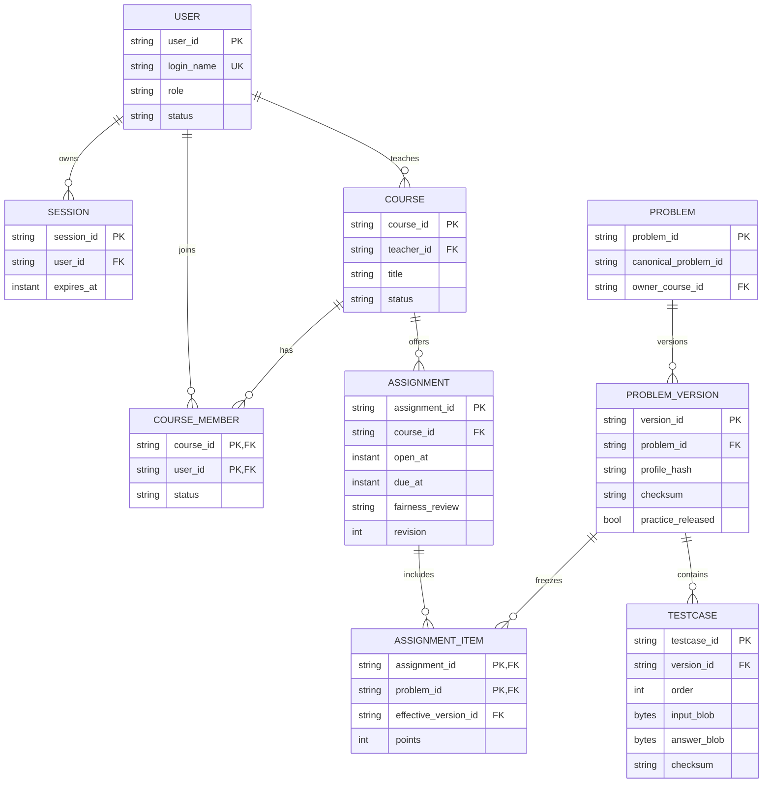

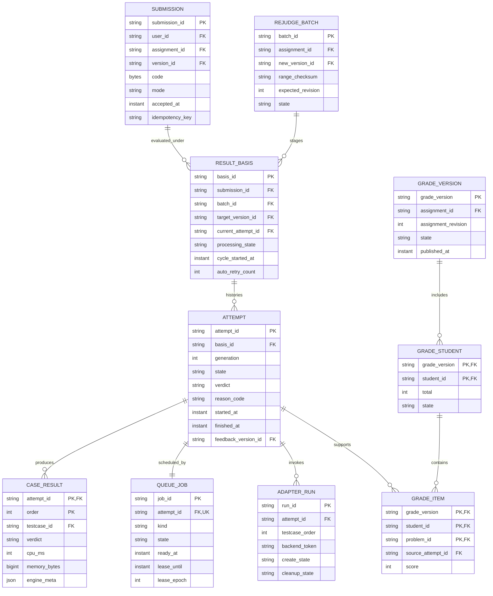

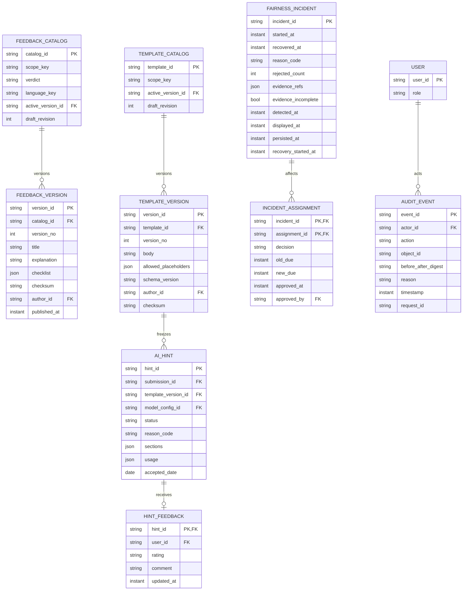

### 6.2 关系表与字段约束

通用存储约定：ID用TEXT/UUID映射，时刻用TIMESTAMPTZ（毫秒精度、UTC），正文UTF-8，二进制BYTEA，统计用非负BIGINT，金额NUMERIC(18,8)并附CNY币种。枚举用CHECK或枚举类型约束。以下PK/FK默认NOT NULL；明确标nullable的字段除外。FK默认RESTRICT，不能级联删除历史成绩和审计。多表计数、范围/分值合计等由锁内应用事务检查；不声称普通CHECK可跨表实现。DB-04还包含预检证据表 `preflight_runs(preflight_id PK,version_id FK,content_digest,profile_hash,language_key,state,report_ref,checked_at)`；同一版本所有允许语言和全部测试成功且摘要一致才允许发布，发布事务只写证据引用。

逻辑状态保存在 `result_bases.processing_state`（QUEUED/JUDGING/RETRY_WAIT/FINISHED），供IF-02映射为state；对外verdict仅在该逻辑状态FINISHED时读取当前attempt.verdict，其余为null。因此“失败attempt已FINISHED+SE而逻辑提交仍RETRY_WAIT”的情形有明确存储落点。转换时与attempt、容量、重试计数在同一事务更新；首次受理为QUEUED。历史attempt仍显示自身终态，不从逻辑投影反写历史。

| 数据元素 | 表、关键字段与约束 | 来源/索引/一致性 |
| --- | --- | --- |
| DB-01 | `users(user_id PK,login_name UNIQUE,display_name,role,status,password_hash,must_change_password)`；登录名3—32 ASCII字母数字下划线、显示名1—40码点；role三值 | DD-01、FR-01/02；密码12—128字符，慢哈希；停用/重置使session失效；不硬绑定学号 |
| DB-02 | `sessions(session_id PK,user_id FK,token_hash UNIQUE,created_at,last_seen_at,expires_at,revoked_at nullable)` | FR-01、NFR-07；user_id/有效会话索引；15分空闲、8h绝对期限 |
| DB-03 | `courses(course_id PK,teacher_id FK,title,status,revision)`；`course_members(course_id,user_id PK/FK,status)` | DD-02、FR-03/04；title1—100字符；成员停用不删历史；老师归属锁内检查 |
| DB-04 | `problems(problem_id PK,canonical_problem_id,owner_course_id FK)`；`problem_versions(version_id PK,problem_id FK,title,statement,samples,tags,profile,practice_released,source_ref,checksum,preflight_digest,published_at nullable)` | DD-03/FR-05/08/28；title1—100、题面≤32KiB、1—3样例各≤4KiB、标签≤5各≤20码点；practice_released默认false；发布版本禁止原位UPDATE；同族与标签索引 |
| DB-05 | `testcases(testcase_id PK,version_id FK,order,input_blob,answer_blob,input_sha256,answer_sha256)`；UNIQUE(version_id,order)，order1—10 | DD-04、FR-06/07；配对UTF-8文本各≤64KiB；发布事务校验数量1—10及编号连续；checksum是两文件摘要组合 |
| DB-06 | `assignments(assignment_id PK,course_id FK,open_at,due_at,ai_policy,revision,fairness_review,published_at nullable,active_grade_version nullable)`；`assignment_items(assignment_id,problem_id PK/FK,original_version_id FK,effective_version_id FK,points)` | DD-05、FR-09；1—20题、正整数分合计100；open<due；版本引用发布后只由重评激活切effective指针，不改原快照；course/time及problem关联索引 |
| DB-07 | `submissions(submission_id PK,user_id FK,assignment_id FK,problem_id FK,version_id FK,language_key,code,code_sha256,intent,mode,accepted_at,idempotency_key,request_digest)`；UNIQUE(user_id,idempotency_key) | DD-06、FR-10—12；代码1—64KiB非全空白；mode不可变；intent也进摘要；原受理回执保留至少24h；索引assignment/user/time |
| DB-08 | `result_bases(basis_id PK,submission_id FK,batch_id nullable FK,target_version_id FK,current_attempt_id nullable FK,processing_state,cycle_started_at,auto_retry_count)`；`attempts(attempt_id PK,basis_id FK,submission_id FK,generation,state,verdict nullable,reason_code,started_at nullable,finished_at nullable,time_ms nullable,memory_bytes nullable,engine_meta,feedback_version_id nullable FK)`；`case_results(attempt_id,order PK/FK,testcase_id FK,verdict,cpu_ms nullable,memory_bytes nullable,engine_meta)` | DD-07、FR-13—16；UNIQUE(submission_id,generation)，每submission仅一个原始basis、每batch/submission一条；state三值QUEUED/JUDGING/FINISHED，FINISHED等价verdict非null；case的testcase必须属于目标版本；按attempt/order唯一；原始输出受控短期存储不入学生投影 |
| DB-09 | `queue_jobs(job_id PK,attempt_id UNIQUE FK,kind,state,ready_at,created_at,lease_until nullable,lease_epoch,worker_id nullable)`；kind=NORMAL/REJUDGE，state=READY/LEASED/DONE；`adapter_runs(run_id PK,attempt_id FK,testcase_order,backend_token nullable,create_state,cleanup_state)`；`outbox_events(event_id PK,event_key UNIQUE,payload,state,tries,next_at)`；`scheduler_control(id PK,cursor)`、`execution_slots(slot_id PK,lease_epoch,state,attempt_id nullable)`、`admission_users(user_id PK,last_accepted_at,pending_count)`、`capacity_control(id PK,pending_count)` | FR-13/16、NFR-03/09/10；UNIQUE(attempt_id,testcase_order)；job为整轮，adapter_run为单点；kind/ready_at/created_at索引；CREATE_UNKNOWN需监督清理；自动重试计数只放result_bases；技术Outbox投递次数另记；槽位状态FREE/BUSY/QUARANTINED，Outbox状态READY/SENDING/SENT/FAILED |
| DB-10 | `grade_versions(grade_version PK,assignment_id FK,assignment_revision,state,published_at nullable,created_at)`；`grade_students(grade_version,student_id PK/FK,total,state)`；`grade_items(grade_version,student_id,problem_id PK/FK,points,score,source_attempt_id nullable FK,target_version_id FK)` | DD-09、FR-17/18/23/25；grade_version是全作业快照头，不是每学生生成；复合FK到grade_students；total0—100且等于item和，score为0或points；无提交source=null；发布后只读；assignment仅一个active_grade_version |
| DB-11 | `ai_hints(hint_id PK,user_id FK,submission_id FK,request_key,question,request_digest,accepted_date,status,reason_code,template_version_id FK,model_config_id FK,model_version,policy_version,consented_at,sections nullable,usage nullable,safety_flags)`；`hint_feedback(hint_id PK/FK,user_id FK,rating,comment,updated_at)`；`quota_ledger(user_id,accepted_date PK,ready,reserved)`；`budget_reservations(reservation_id PK,hint_id UNIQUE FK,price_version,cost_upper,actual nullable,state,accepted_date)`；`model_configs(config_id PK,provider,model_id,version_label,base_url,price_snapshot,token_caps,terms_review_ref,enabled)` | DD-08、FR-20—22；UNIQUE(user_id,request_key)；同键异内容409；READY/预占之和≤20、个人进行中≤1（事务锁约束）；question≤500、上下文≤24KiB、输出≤2000码点及8KiB；金额未知为null；预算状态RESERVED/SETTLED/UNCERTAIN/RELEASED；限额20元/日、500元累计 |
| DB-12 | `rejudge_batches(batch_id PK,assignment_id FK,new_version_id FK,expected_revision,state,reason,range_checksum,affected_count)`；`rejudge_members(batch_id,submission_id PK/FK,basis_id nullable FK)` | FR-08/23、BR-09/16；全部正式范围不可变；每作业至多一个未激活批次（条件唯一索引）；逐窗口创建basis不漏范围；激活校验range数与checksum |
| DB-13 | `fairness_incidents(incident_id PK,started_at,recovered_at nullable,reason_code,rejected_count,evidence_refs,evidence_incomplete,detected_at,displayed_at,persisted_at,recovery_started_at nullable)`；`incident_assignments(incident_id,assignment_id PK/FK,decision,old_due,new_due nullable,approved_by nullable FK,approved_at nullable,overlap_ms nullable,reason)` | DD-11、FR-09/18/24；事件与作业多对多；NO_IMPACT也需理由/证据；EXTEND必须recovered/approved/overlap及计算截止；拒绝请求以事件/request_id去重；未决任一条使作业PENDING |
| DB-14 | `audit_events(event_id PK,actor_id nullable FK,actor_kind,action,object_id,before_after_digest,reason,timestamp,request_id)` | DD-10、FR-24/29、NFR-17/20；actor_kind=USER/SYSTEM，系统事件可无user_id；敏感理由10—500字符；应用权限append-only；时间/对象/操作者索引；无密钥/源码/隐藏正文 |
| DB-15 | `notifications(notification_id PK,event_id FK,user_id FK,summary,created_at,read_at nullable)`；`retention_holds(hold_id PK,object_type,object_id,reason,opened_at,closed_at nullable)`；`retention_plans(plan_id PK,object_digest,teacher_confirmation_ref,approved_by,execute_after,state)` | FR-27/29、NFR-20；UNIQUE(event_id,user_id)；hold对申诉/重评/公平事件优先；动态对象引用由事务校验；清理预览与执行摘要一致 |
| DB-16 | `feedback_catalogs(catalog_id PK,scope_key,verdict,language_key,draft_payload,draft_revision,active_version_id nullable FK)`；`feedback_versions(version_id PK,catalog_id FK,version_no,title,explanation,checklist,author_id FK,published_at,checksum)`；`template_catalogs(template_id PK,scope_key,draft_payload,draft_revision,active_version_id nullable FK)`；`template_versions(version_id PK,template_id FK,version_no,body,allowed_placeholders,schema_version,author_id FK,published_at,checksum)` | FR-19/21、DD-07/08、UI-10；scope_key=GLOBAL或COURSE:id；UNIQUE(scope_key,verdict,language_key)、UNIQUE(catalog_id,version_no)、UNIQUE(template_id,version_no)；模板每scope一catalog；已发布行只读；发布带revision及审计，active指针必须属于同catalog |

#### 6.2.1 确定性反馈、模板和推荐的维护闭环

教师在UI-10经API-09/API-15维护本课草稿，`expected_revision`防覆盖；服务器检查长度、纯文本/安全渲染、允许占位符和无隐藏信息后预览。发布事务创建不可变version、记录作者/时间/checksum、原子移动active指针及写审计；旧版保留。GLOBAL固定帮助由管理员登记经教师维护的种子说明，课程教师不能更改其他课程或全局记录。

反馈解析优先课程+语言，再课程通用，再GLOBAL通用；键由最终verdict决定；通用language_key使用ALL而不是NULL，避免nullable唯一键引入重复。CE/WA/TLE/RE给解释清单，SE只给平台处理信息，AC给完成提示。每次attempt形成最终判定时保存feedback_version_id；历史页按该版本读取，发布新说明不改变旧判定的历史反馈。新帮助展示可另标“当前说明”及版本，不能替换历史引用。种子版本必须随迁移存在，AI不可用不影响固定帮助。

AI请求在接纳事务冻结template_version_id/model_config_id；更新模板只影响后续请求。模板仅可使用白名单占位符，平台固定安全框架及授权规则不由教师正文覆盖；新模板或模型版本正式启用前重新跑相关NT-18/19，不将文档发布当作质量验证。旧hint/用户反馈一直引用旧模板和代码快照。引用尚存或有hold时禁止物理删除这些版本。

FR-28由MOD-06提供“非SE且曾非AC、当前无有效AC”的个人错题投影，MOD-07按标签匹配数降序、problem_id升序稳定排序，选最多5题；必须已授权且practice_released=true，同族不得被该学生任何SCHEDULED/OPEN作业引用，无法确认同族则排除。索引使用course_members(user_id,course_id)、problem_versions标签、problems(canonical_problem_id)、assignment_items(problem_id,assignment_id)；授权过滤先于排序和截取，返回只含公开题面。固定帮助、推荐和AI模板是三个独立用途，不让模型替代推荐权限过滤。

#### 6.2.2 预算账本与锁顺序补充

DB-11补充`budget_accounts(scope_key PK,currency,limit_amount,settled_amount,reserved_amount,uncertain_amount,revision)`；scope_key为项目累计PROJECT或接纳日DAY:YYYY-MM-DD，currency固定CNY。金额非负且为NUMERIC(18,8)。预算计数可以从budget_reservations对账，但不能以异步缓存决定是否准入。

AI接纳在完成课程/作业权限检查后，按`用户额度quota_ledger → 项目budget_accounts → 接纳日budget_accounts → hint/reservation → audit/outbox`固定顺序加锁；已有request_key先查，锁内再次查。结算也按相同顺序，把一笔reservation从RESERVED或UNCERTAIN转为SETTLED或RELEASED并同步两个账户；同一结算事件幂等，未知费用不填0。项目累计不随日期重置，次数额度与费用账本独立。此表是§13.2已定义双预算事务的存储落点，不改变20元/500元限额；TD-08加入双账户并发预占及重复结算夹具。

### 6.3 数据格式与取值规则

- 所有 ID 使用不可复用字符串（建议 UUIDv7/随机前缀），不把可猜的自增序号直接作为对象授权依据。
- 代码、测试输入/输出、AI 上下文按 UTF-8 **字节**计数；题面长度按阶段一 DD-03 的 Unicode/字节约束分别实现并在错误中说明单位。
- `engine_meta` 至少包含 `backend_version, language_version, phase, raw_status, mapping_version, resource_reason`；未知值存 `UNKNOWN/null`，不凭错误文本猜测。
- `time_ms` 为已执行测试点 CPU 时间总和，`memory_bytes` 为峰值；缺失值为 null，不以 0 假装测得。
- `grade_version` 与 `assignment.revision` 同时保存；界面、API 和 CSV 通过同一版本快照读取。

### 6.4 一致性、事务与恢复

1. **受理事务（READ COMMITTED + §3.4 明确行锁）：** 验证幂等键、锁作业、读取数据库当前时间、计数、插入提交/轮次/任务/Outbox、审计。提交失败全部回滚；返回成功必须有数据库提交证据。
2. **评测回写事务：** 按§3.4顺序锁所需submission、result_basis与当前attempt，检查 generation 和任务租约，写 case_results、终态、指标、重试计数和 outbox；重复回写变成幂等 no-op。
3. **成绩快照事务：** 在 assignment、rejudge_batch、fairness_incident 上锁，读所有必要终态并计算；激活与有效版本指针一起提交；尚未发布成绩时新快照保持 PROVISIONAL/PENDING，教师经 API-11 发布。替换已发布成绩时重新校验发布门禁，并原子发布完整新快照。发布后的快照不更新，只生成新版本。
4. **Outbox 可靠投递：** 业务事务写入事件，Worker 标记 `SENDING/SENT/FAILED`；外部调用带 attempt/generation/request_id。进程崩溃后可恢复租约，评测自动重试最多一次由应用层强制；通知投递按事件唯一键去重，通知重试不消耗评测重试次数。
5. **备份与恢复：** 每日备份业务数据、代码、题目版本和配置；恢复到空环境后验证 100 个样本的引用和校验值。RPO≤24小时、RTO≤2小时是 NFR-11 目标，未执行前保持“候选”。

#### 6.4.1 TD-09-R 成绩合计与来源对账入口

迁移层必须建立DB-10主/外键、NOT NULL、正points和`score IN (0,points)`行约束。跨表合计由锁内GradeCalculator校验，并以以下只读对账查询提供可执行验证入口；普通CHECK不读取其他表。TD-09-R是TD-09的子场景，TD-02负责验证并发快照隔离。

查询覆盖当前与历史grade_version；题目分值及成员字段取该快照，不能用当前生效attempt指针校验旧成绩。assignment_items的题集/points按BR-04发布后不可原位改，故可用于完整题集复核。PostgreSQL实现应在一致读事务中运行；发布/激活前锁内执行相关版本检查，恢复/迁移后执行全量只读检查。返回任何行即拒绝发布或迁移切换，保留原快照与异常键，不自动改历史分数。

```sql
-- TD-09-R: expected result is zero rows for a consistent snapshot.
WITH totals AS (
  SELECT gs.grade_version, gs.student_id, gs.total,
         COUNT(gi.problem_id) AS item_count,
         COALESCE(SUM(gi.score), 0) AS item_total,
         COALESCE(SUM(gi.points), 0) AS points_total
  FROM grade_students gs
  LEFT JOIN grade_items gi
    ON gi.grade_version = gs.grade_version AND gi.student_id = gs.student_id
  GROUP BY gs.grade_version, gs.student_id, gs.total
), expected AS (
  SELECT gv.grade_version, COUNT(ai.problem_id) AS expected_count
  FROM grade_versions gv
  JOIN assignment_items ai ON ai.assignment_id = gv.assignment_id
  GROUP BY gv.grade_version
), violations AS (
  SELECT t.grade_version, t.student_id, 'TOTAL_OR_COMPLETENESS' AS violation
  FROM totals t LEFT JOIN expected e ON e.grade_version = t.grade_version
  WHERE t.total <> t.item_total OR t.points_total <> 100
     OR t.item_count <> COALESCE(e.expected_count, 0)
  UNION ALL
  SELECT gi.grade_version, gi.student_id, 'ITEM_OR_SOURCE' AS violation
  FROM grade_items gi
  JOIN grade_versions gv ON gv.grade_version = gi.grade_version
  LEFT JOIN assignment_items ai
    ON ai.assignment_id = gv.assignment_id AND ai.problem_id = gi.problem_id
  LEFT JOIN attempts a ON a.attempt_id = gi.source_attempt_id
  LEFT JOIN result_bases b ON b.basis_id = a.basis_id
  LEFT JOIN submissions s ON s.submission_id = a.submission_id
  WHERE ai.problem_id IS NULL OR gi.points <> ai.points OR gi.points <= 0
     OR gi.score NOT IN (0, gi.points)
     OR (gi.source_attempt_id IS NULL AND gi.score <> 0)
     OR (gi.source_attempt_id IS NOT NULL AND (
          a.attempt_id IS NULL OR b.basis_id IS NULL OR s.submission_id IS NULL
          OR b.submission_id <> s.submission_id
          OR s.user_id <> gi.student_id OR s.assignment_id <> gv.assignment_id
          OR s.problem_id <> gi.problem_id OR s.mode <> 'FORMAL'
          OR b.target_version_id <> gi.target_version_id
          OR a.state <> 'FINISHED'
          OR (gi.score > 0 AND a.verdict <> 'AC')
          OR (gi.score = 0 AND a.verdict = 'AC')))
)
SELECT DISTINCT grade_version, student_id, violation FROM violations;
```

本查询检验已存快照内部一致性及来源归属，不独自证明“已取所有有效正式提交最高分”或“可以发布”；BR-08最高分由TD-01重算对照，SE/公平/活动批次门禁由TD-02/05/09验证。对账记录至少含迁移版本、快照范围、异常数、异常键、处置与复验报告。

### 6.5 留存、删除与数据访问

- 归档 180 天、备份轮换 30 天、审计至少 180 天沿用 BR-15/NFR-20；争议、申诉、重评和公平事件通过 `retention_holds` 阻止清理。
- 清理作业先生成预览（对象清单、理由、批准人、预计释放空间），再在事务中写清理事件；可恢复副本保留 30 天。
- 学生、教师、管理员使用不同 SQL projection；管理员应急访问需工单号/理由并留下审计，管理员不默认拥有教师课程数据查看权限。

## 7. 界面与交互设计

### 7.1 学生界面

| 页面／组件 | 主要信息和操作 | 状态与错误设计 | 覆盖需求 |
| --- | --- | --- | --- |
| UI-01 我的课程/作业 | 课程成员状态、开放/截止（明确 UTC+8）、作业状态、未读通知 | SCHEDULED/OPEN/CLOSED/ARCHIVED 用文字标签；权限不足不暴露课程存在 | FR-03/04/10/27、NFR-12/15 |
| UI-02 题目与编辑器 | 题面、样例、语言 profile、CPU/内存/输出限制、版本、服务器时间、代码编辑器 | 本地草稿独立保存；401/断网/413/429/503 不清空文本；正式/练习标签不只靠颜色 | FR-10/11、NFR-13/14/15/24 |
| UI-03 提交确认 | 选择语言、提交意图、代码字节数、截止倒计时、提示“受理时间取作业锁内服务器时刻，事务成功才生效” | 提交前展示正式/练习和版本；服务端返回原因码、request_id、可重试时间 | FR-11/12、BR-02/03/10/17 |
| UI-04 提交详情/历史 | submission_id、accepted_at、mode、version、轮次、状态、已执行测试点、CPU/内存、确定性帮助 | 隐藏 stdout/stderr 和测试正文不显示；SE 显示平台故障与处理路径；轮询有退避 | FR-14/15/16/19、NFR-08/10/17 |
| UI-05 学习反馈与练习推荐 | 固定帮助版本、错题列表与最多5道已授权推荐题；AI来源提交、外发同意、问题、状态和模型/模板版本 | 明示“AI 建议，需自行验证”；禁用/额度/预算/超时给固定帮助；可标记有用/有误 | FR-19—FR-22、FR-26、FR-28、NFR-05/18/19 |

### 7.2 教师界面

| 页面／组件 | 主要信息和操作 | 保护与交互 | 覆盖需求 |
| --- | --- | --- | --- |
| UI-06 课程成员 | 创建课程、加入/停用已有账号、成员状态和历史记录 | 重复成员提示；停用不删成绩；所有操作显示课程范围 | FR-04、BR-01 |
| UI-07 题目版本 | 草稿编辑、样例/隐藏测试配对、标签、语言/资源 profile、预检结果 | 已发布版本只读；隐藏文件只显示数量/校验值；缺配对定位字段 | FR-05—FR-08、NFR-08 |
| UI-08 发布/延期 | 题目版本、分值、开放/截止、AI 策略、revision、预检摘要 | 发布/延期二次确认；延期必须填写理由；显示公平事件影响和新截止 | FR-09、BR-02/03/17、FR-27 |
| UI-09 成绩看板/重评 | 学生去重人数、题目分、状态、grade_version、SE/PENDING、重评影响范围 | 不允许直接手填成绩；重评先预览，激活显示升降分和阻塞原因；导出按版本 | FR-17/18/23/25、NFR-21 |
| UI-10 AI/通知管理 | API-09维护固定帮助、API-15维护模板草稿、预览、带revision发布；API-10查看提示反馈；管理通知 | 不读取学生隐藏输出；DB-16已发布内容不可改；新版本不覆盖历史引用；跨课程404；通知失败不回滚受理 | FR-19/21/27 |

### 7.3 管理员界面

| 页面／组件 | 主要信息和操作 | 安全约束 | 覆盖需求 |
| --- | --- | --- | --- |
| UI-11 服务健康/队列 | API/DB/适配器/模型心跳、普通/重评队列、槽位、SE 比例、P95 | 只显示必要业务摘要；健康操作不能修改成绩 | FR-24、NFR-10/17 |
| UI-12 失败任务/公平事件 | 失败原因、重试次数、受影响提交、incident 状态、证据引用 | 手动重试必须填写理由；不能把学生错误重试为平台成功 | FR-16/24、BR-11/17 |
| UI-13 账号/审计/留存 | 创建/停用/重置、审计查询、备份恢复预览、retention hold | 应急访问工单和理由必填；审计 append-only；不直接编辑分数 | FR-02/24/29、NFR-07/20/22 |

### 7.4 交互、可访问性与响应式规则

- 所有颜色状态同时显示文字和图标；焦点顺序与键盘提交路径可用；表单错误绑定到字段并提供可读原因。
- 1366×768 桌面不能遮挡主要控件；390×844 只保证查看作业、结果和分数，移动端不提供代码编辑承诺。
- 轮询默认 1s、2s、4s、8s 退避并受页面可见性限制；网络失败显示上一次安全状态和“刷新/复制代码”操作。
- 服务器时间、截止状态、正式/练习、SE、PENDING 等关键语义使用明确文本；不能只用倒计时或颜色暗示。

## 8. 非功能设计

### 8.1 原基线质量目标与设计应对

| NFR | 设计应对（NFD） | 可度量目标与验证 |
| --- | --- | --- |
| NFR-01 交互性能 | API 网关连接池、索引查询、DTO 投影；提交受理不等待评测 | W-01：列表/题面/状态 P95≤1s，受理 P95≤2s，失败率≤1%；NT-01 全量计时 |
| NFR-02 评测性能 | 4 槽位候选、持久队列、普通任务优先且重评按4:1 | W-02：accepted_at→终态 P95≤60s，20突发≤120s；NT-02 不以SE冒充 |
| NFR-03 容量/限流 | `CapacityGuard` 原子计数、个人间隔和待办上限；BR-17 保护窗口独立于限流 | 全局≤100、个人≤3、重复键不占位、拒绝≤2s；NT-03/W-04/ST-13/14 |
| NFR-04 执行边界 | 适配器给每阶段传资源 profile，执行后清理工作目录并确认槽释放 | CPU/墙钟/内存/输出/线程限制；释放≤5s；NT-04/V-01—V-10 |
| NFR-05 AI响应降级 | AI worker 与评测 worker 隔离；总预算计时器；确定性反馈独立可用 | 无排队真实模型 P95≤20s；等待≤10s+执行≤20s；NT-05/W-03 |
| NFR-06 执行隔离 | 独立评测 VM/主机、学生执行身份无特权、禁网、只读基础镜像、临时工作目录、无 DB/Docker 挂载 | 受控样例不能访问宿主哨兵/网/他任务；NT-06/V-06；有限样本不等于绝对安全 |
| NFR-07 身份安全 | HTTPS、Argon2id 候选参数、HttpOnly/SameSite 会话、失败冷却和改密失效 | 空闲15分/绝对8小时失效；5次失败冷却10分；NT-07 |
| NFR-08 权限与保密 | 每个查询使用 `Principal+resource` policy；学生/AI/日志 SQL 投影；隐藏字段单独端口 | 30个越权和哨兵检索，泄露0；NT-08/ST-06 |
| NFR-09 持久性/幂等 | 提交事务写账本+任务+Outbox；attempt generation 去重；恢复租约 | 进程崩溃不丢已返回成功提交，同有效版本最多计一次；NT-09/ST-03/09 |
| NFR-10 故障收敛 | 心跳/失败率告警；重试预算；恢复扫描 READY/LEASE_EXPIRED；SE 终止 | 不可用≤60s显示，恢复≤60s开始处理；NT-10 |
| NFR-11 备份恢复 | 每日全量/增量策略、加密备份、空环境演练和样本校验 | RPO≤24h、RTO≤2h、100样本校验一致；NT-11；未执行前为目标 |
| NFR-12 时间一致性 | DB UTC、NTP/授时监控、锁内 now；时钟越界进入维护状态 | 偏差≤1s为正常，>1s告警，>5s暂停正式提交；ST-01/12/NT-12 |
| NFR-13 易用性 | 任务导览、服务器时间、明确标签、保持草稿、键盘路径；不靠颜色 | 5名学生≥4人/10分完成核心流程且能区分正式/练习/SE；NT-13 |
| NFR-14 失败可恢复 | 前端草稿/复制、错误字段映射、重试按钮只重放幂等请求 | 覆盖断网/401/413/429/503，代码不丢；NT-14 |
| NFR-15 兼容可访问 | 标准 HTML 表单、键盘焦点、浏览器矩阵和状态文本 | Chrome/Edge/Firefox 当前及前一稳定版；1366×768；NT-15 |
| NFR-16 可维护追踪 | 领域规则纯函数、端口适配、迁移锁定、需求/测试 ID 在代码和报告中保留 | 高优先级均有测试；规则分支边覆盖≥80%，口径见§8.2；NT-16 |
| NFR-17 可观测性 | request_id/submission_id/attempt_id/hint_id 全链路；指标和 append-only audit | 队列、SE、P95、重试、敏感操作100%审计；NT-17 |
| NFR-18 AI提示质量 | 模板版本、首请求固定样本、D/A/S量表、安全门和双评审记录 | 30例 D≥24、A≥27、S全通过；无法解决分歧计失败；NT-18/§13 |
| NFR-19 AI攻击面 | 白名单上下文、无工具/写权限、输出过滤、注入样例回归集 | 20例无越权、改分、泄露、工具执行；不合格降级；NT-19 |
| NFR-20 留存清理 | retention hold、预览、审批、延迟删除和备份轮换作业 | 审计≥180天、争议不删、备份30天窗口；NT-20 |
| NFR-21 导出一致性 | 从已发布 `grade_version` 只读快照生成流式 CSV，危险前缀加单引号 | 100人/20题≤5s，界面/API/CSV逐项相等；NT-21 |
| NFR-22 存储容量 | 代码/测试上限、磁盘水位指标、写入闸门；不删除已受理数据腾空间 | 80%告警、90%停止新增写入并明确失败；NT-22 |
| NFR-23 移动查看 | 响应式只读布局，表格可折叠为卡片；不承诺移动编辑 | 390×844 可看作业/结果/分数无主要横滚；NT-23 |
| NFR-24 内容安全 | React/模板默认转义、CSP、禁止脚本/内联事件/自动外链；AI输出当非可信文本 | 20个脚本/外链载荷均不执行或外发；NT-24 |

NFR-01—NFR-24 的实际通过状态必须在实现后的测试报告中填写；本表只定义设计应对和验收路径。

### 8.2 NFD-EXT 可扩展性与可维护性验证目标

以下是作者U-08接受的设计验证目标，归属NFR-09/16/22及D-03/05/08，不增加或重编号阶段一NFR；不扩大E-01原验收规模、不承诺线性提速。真实环境不具备时保持未执行，模拟只能验证协议/算法。

| 目标 | 测量场景与阈值 | 设计应对/证据 |
| --- | --- | --- |
| NFD-EXT-01 4→8槽位 | 同一100份固定任务、普通/重评混合、可重复的预定故障注入；扩容前后各运行一轮，再中途扩容一轮；已受理任务丢失=0、重复计分=0、非故障样本判定一致率100%；记录吞吐与P95，不要求2倍 | 新槽注册需profile/镜像/隔离验证；持久租约、全局调度游标、结果代数去重；TD-10/NT-09。下调槽位先排空，禁止强杀正常任务 |
| NFD-EXT-02 跨课程AI策略 | 由10→100课程、1000→10000题目版本，含同族跨课程和SCHEDULED/OPEN混合；每规模1000次固定授权查询，预热100次后统计；参考全量扫描结果一致率100%、绕过数0，服务端策略查询P95≤100ms为设计预算 | 先按user_id找成员课程，再按canonical_problem_id与状态索引查；有禁用开放作业即拒绝；权限变更事务后不得读取过期授权缓存；TD-11/ST-10/15。记录实际硬件、执行计划、失败分母 |
| NFD-EXT-03 存储迁移 | 10万条代码记录与1000题目版本的测试文件迁往候选对象存储；逐对象校验引用和SHA-256，完整率100%、校验一致率100%；故障注入后可恢复或回滚，原数据不可丢 | 先复制并校验→版本化manifest→短维护窗口锁定引用切换→回滚指针；迁移未结束保留原BYTEA；TD-12/NT-11/22。不在首版强制引入对象存储 |

触发容量评审的条件：磁盘水位持续7天≥70%，或根据最近7天增长速率预计30天内达到80%，或超过E-01基线数据规模后仍需维持原性能目标。先清点容量与索引，再以CR选择扩盘/迁移；80%告警、90%停写规则不变，不能用清除已受理数据解决容量问题。70%和预测阈值是提前评审触发点，不是新增业务拒绝条件。

NFR-16的“规则分支覆盖≥80%”专指BR-01—BR-17对应领域规则代码的**分支边覆盖率**：`被执行的可达分支边数 / 工具识别且确认可达的全部分支边数`。if两分支、循环进入/退出及异常路径按所选工具统一口径；不将行覆盖、条件覆盖或MC/DC混称分支覆盖。报告登记工具版本、纳入文件、分子/分母；不可达代码排除需逐项理由及审阅记录，不为提高数值随意剔除。80%不免除截止边界、授权拒绝、重评原子性等明确必测场景。

## 9. 异常与故障处理设计

### 9.1 异常矩阵落地

| FD | 对应 EX | 检测点 | 用户可见处理 | 恢复、数据与审计 |
| --- | --- | --- | --- | --- |
| FD-01 输入非法 | EX-01 | API schema + 字节/语言校验 | 字段级 400/413，编辑器代码保留 | 不创建 submission、不占 quota；记录 request_id，不记录整段代码 |
| FD-02 截止竞态 | EX-02 | assignment 锁内读取 DB now | 正式关闭，可切换练习 | 以 accepted_at 为准；冲突重试一次；审计边界判断 |
| FD-03 重复/丢响应 | EX-03 | 幂等唯一键与内容摘要 | 原 submission_id 或 409 | 不重复入账/计分；幂等查询可跨截止 |
| FD-04 学生程序错误 | EX-04 | engine phase、资源计量、比较器 | CE/WA/TLE/RE + 固定帮助 | 不自动重试；隐藏输出不出投影；保存 engine_meta |
| FD-05 容量/限流 | EX-05 | CapacityGuard、适配器健康、队列 | 429/503 原因码、request_id、Retry-After | 未受理不算成功；平台原因创建 incident；公平裁决前阻止发布 |
| FD-06 评测节点崩溃 | EX-06 | 租约超时、心跳、传输异常 | 恢复中，最终必要时 SE | 自动最多1次，人工重试新 generation；accepted_at 不变；迟到不覆盖 |
| FD-07 DB/磁盘不可用 | EX-07 | 事务错误、磁盘水位 | 503/PERSISTENCE_UNAVAILABLE或STORAGE_CAPACITY，提示复制代码稍后重试 | 未 commit 不返回202；旧数据不删除；告警并审计 |
| FD-08 题目/校验损坏 | EX-08 | checksum、版本完整性检查 | 题目暂不可评测/SE，教师告警 | 阻止成绩发布和重评激活；恢复备份或新版本重评 |
| FD-09 AI异常 | EX-09 | 超时、429、JSON/schema、安全门 | 固定帮助、稍后重试、状态 FAILED/BLOCKED | 释放次数预占；费用未知保持占用，记录供应商用量；不阻塞评测 |
| FD-10 提示注入/泄题 | EX-10 | 输入白名单、输出安全门、CSP | 拒绝/受限提示，保持确定性反馈 | 无隐藏数据/工具/写权限；安全事件审计 |
| FD-11 并发编辑 | EX-11 | expected_revision 乐观锁 | 409，要求刷新并显示差异摘要 | 不静默覆盖、不部分激活；保留操作者/理由 |
| FD-12 恢复/时钟异常 | EX-12 | NTP、恢复点、对账任务 | 维护状态，必要时暂停正式提交 | 先恢复账本/轮次再开放；校验 accepted_at 和任务 generation |

### 9.2 故障恢复顺序

1. **保护：** 停止新重评派发；如数据库/时钟/隔离边界不满足，暂停新正式提交；不强杀已执行学生任务。
2. **观测：** 生成 request/incident ID，记录开始时间、影响作业、队列、槽位、拒绝原因和健康证据；日志脱敏。
3. **恢复：** 修复适配器、数据库或模型连接；重新扫描 queue_jobs 的 READY/LEASED（租约过期）及 result_bases.processing_state 的 QUEUED/JUDGING/RETRY_WAIT（submissions本身不存state）；验证版本、镜像和配置指纹。
4. **收敛：** 重试一次或人工新 generation；超过 15 分钟/360 秒预算转 SE；迟到消息只写审计。
5. **公平裁决：** 补齐恢复时间和证据；教师通过 IF-09 选择 PENDING/EXTEND/NO_IMPACT；EXTEND 原子更新 due/revision 和通知。
6. **开放与复核：** 通过健康检查后恢复受理；验证成绩发布门禁、未决 SE 和事件状态；保留故障报告供 ST-13/ST-14 复盘。

### 9.3 安全故障优先级

隐藏数据泄露、跨用户授权绕过、错误计分、已受理提交丢失、评测逃逸属于阻塞缺陷。它们不能由“总体通过率”抵销；发布前必须关闭相关功能或通过 CR 明确改变范围并重新验收。

## 10. 设计决策与权衡

| 决策 | 备选方案 | 选择与理由 | 被否决原因／影响 |
| --- | --- | --- | --- |
| D-01 模块化单体 + 独立评测边界 | 全微服务；单进程直接运行学生代码 | 选择模块化单体、评测独立 VM/服务。课程规模下部署和事务更简单，同时把不可信代码隔离出去。 | 全微服务会增加分布式事务、部署和排障；业务进程执行学生代码违反 NFR-06。 |
| D-02 PostgreSQL 作为事实库 | Redis/内存队列作主账本；NoSQL | 选择关系库保存提交、版本、成绩和审计，利用 FK/唯一键/事务落实 BR-09/10/16。 | Redis/内存重启会丢受理事实；NoSQL 需要额外实现一致性和关系约束。 |
| D-03 Outbox + DB任务表 | 仅消息队列；同步调用评测 | 选择事务内任务表+Outbox，Worker 持久领取；能在 DB 成功后恢复任务，并容忍至少一次投递。 | 仅队列无法证明已受理；同步调用把评测时延带入 IF-01 并放大故障。 |
| D-04 Judge0 CE/等价适配器 | 自研沙箱；直接 Docker SDK | 选择受控适配端口复用成熟执行服务，并在 V-01—V-10 测量实际限制。 | 自研沙箱超出个人课程范围；直接暴露 Docker API 会扩大攻击面；第三方默认比较/资源值不能直接当本平台规则。 |
| D-05 PostgreSQL BYTEA 小文件 | 对象存储/外部文件系统；浏览器直传 | 题面、代码和每个测试文件有明确上限，BYTEA 简化原子版本和备份；所有读取经应用权限。 | 外部对象存储需双写/一致性协议和额外权限；直传可能绕过隐藏数据审计。若规模超过 E-01，按 CR 迁移并保留 checksum。 |
| D-06 轮询结果查询 | WebSocket/SSE；长连接推送 | 首版使用 IF-02/查询和退避轮询，兼容性和故障恢复简单；可选 SSE 仅作传输优化。 | 长连接增加代理、断线恢复和权限刷新复杂度；不改变领域状态和查询契约。 |
| D-07 服务端 UTC + 锁内 now | 客户端时间；事务开始时预取时间 | 选择 DB UTC 毫秒、锁作业后取当前时间，严格实现 `[open_at,due_at)`。 | 客户端时间可篡改且时区不一致；事务外/开始时刻会产生截止竞态。 |
| D-08 受控 AI 网关 | AI 直接从浏览器调用；模型自动决定权限；禁用全部 AI | 选择服务端策略、白名单上下文、预算/额度预占和安全门；保留确定性反馈降级。 | 浏览器直连泄露密钥且可绕过禁用；模型不能成为授权器；全禁用无法覆盖 FR-20—22 的高优先级基线。 |
| D-09 版本化成绩快照 | 直接更新学生总分；保留旧分取最大值 | 选择 `grade_versions + grade_students + grade_items` 只读快照，重评原子激活且可降分。 | 直接更新不可追溯且会误保留失效版本；与 BR-08/09 矛盾。 |
| D-10 领域比较器自有实现 | 采用 Judge0 默认比较器；浮点容差/数值转换 | 选择固定 CRLF/LF、ASCII 空白 token 和字节比较，适配器只返回原始输出。 | 默认比较器可能跨版本变化；容差和归一化不在首版需求，改变 WA 语义。 |

每个决策都可以被替换，但必须先提出 CR，说明对接口、数据、流程、NFR 和测试的影响；“更换技术栈”本身不是需求变化的豁免。

## 11. 需求追溯矩阵

### 11.1 功能需求到设计元素

下表把 29 项 FR 连接到架构/模块、流程、接口、数据和至少一个验证入口。`MOD`、`WF`、`IF`、`DB`、`UI`、`TD` 均可在本文对应章节定位。

| 需求 | 架构/模块 | 流程/接口 | 数据/界面 | 验证入口 |
| --- | --- | --- | --- | --- |
| FR-01（高） | AD-02；MOD-01 | 登录/会话；AuthPort | DB-01/02；UI-01/02 | AC-01、NT-07/13/14/15 |
| FR-02（高） | AD-02；MOD-01/MOD-09 | 账号管理；管理员接口 | DB-01/02；UI-13 | AC-02、NT-07/08 |
| FR-03（高） | AD-03；MOD-01 | `PolicyPort.authorize`；WF-02 | DB-03/07；UI-01/04 | AC-03、ST-06、NT-08 |
| FR-04（高） | MOD-01/MOD-03 | 课程成员；课程 API | DB-03；UI-06 | AC-04、NT-08 |
| FR-05（高） | MOD-02 | 题目草稿 API；WF-01 | DB-04；UI-07 | AC-05、NT-14/24 |
| FR-06（高） | MOD-02 | 测试文件校验；WF-01 | DB-05；UI-07 | AC-06、ST-06、NT-08/24 |
| FR-07（高） | MOD-02/MOD-05 | `PreflightChecker`；WF-01 | DB-04/05；UI-07 | AC-07、ST-04/05、NT-04/06 |
| FR-08（高） | MOD-02/MOD-06 | 版本快照/重评；IF-04/05 | DB-04/06/12；UI-07/09 | AC-08、ST-08、NT-09/16 |
| FR-09（高） | MOD-03/MOD-09 | 发布/延期；IF-09；WF-01/06 | DB-06/13；UI-08 | AC-09、ST-01/13、NT-12/17 |
| FR-10（高） | MOD-03/MOD-09 | 作业查询；IF-02 | DB-06；UI-01/02 | AC-10、ST-01、NT-13/14/15 |
| FR-11（高） | MOD-04 | 受理；IF-01；WF-02 | DB-07/09；UI-03 | AC-11、ST-01/02/13/14、NT-01/03/09/12 |
| FR-12（高） | MOD-04 | 幂等策略；IF-01 | DB-07/09；UI-03/04 | AC-12、ST-03/09/14、NT-03/09 |
| FR-13（高） | MOD-05 | 派发/比较；IF-07；WF-03 | DB-08/09；UI-04/11 | AC-13、ST-04/05/14、NT-02/04/06 |
| FR-14（高） | MOD-05/MOD-09 | 结果查询；IF-02 | DB-08；UI-04 | AC-14、ST-06、NT-01/08/14/15 |
| FR-15（高） | MOD-06 | 历史查询；IF-02 | DB-07/08/12；UI-04 | AC-15、ST-03/08/09、NT-08/09/16 |
| FR-16（高） | MOD-05/MOD-09 | 恢复顺序；IF-07 | DB-08/09；UI-11/12 | AC-16、ST-03/04/09/14、NT-09/10 |
| FR-17（高） | MOD-06 | 计分重算；GradePort | DB-10；UI-09 | AC-17、ST-02/07/08、NT-09 |
| FR-18（高） | MOD-06/MOD-09 | 成绩发布/门禁；API-11；IF-05 | DB-10/13；UI-09 | AC-18、ST-07/12/13、NT-09/12 |
| FR-19（高） | MOD-07 | API-09；FeedbackPort | DB-08/16；UI-04/05/10 | AC-19、ST-04、NT-14 |
| FR-20（高） | MOD-08 | AI 请求；IF-03/08；WF-05 | DB-11；UI-05 | AC-20、ST-06/10/16/17、NT-05/08/18/19/24 |
| FR-21（高） | MOD-08/MOD-07 | 策略门禁/反馈；IF-03；API-09/10/15 | DB-06/11/16；UI-05/10 | AC-21、ST-10/17、NT-08/18/19 |
| FR-22（高） | MOD-08 | 额度/降级；IF-03/08 | DB-11；UI-05 | AC-22、ST-11/16、NT-05/18 |
| FR-23（高） | MOD-06 | 重评；IF-04/05；WF-04 | DB-12/10；UI-09 | AC-23、ST-08/09、NT-09/17 |
| FR-24（高） | MOD-09 | 健康/审计；IF-09 | DB-13/14；UI-11/12/13 | AC-24、ST-13、NT-10/17 |
| FR-25（中） | MOD-06 | CSV；IF-06 | DB-10；UI-09 | AC-25、NT-08/21 |
| FR-26（中） | MOD-06/MOD-07 | 错题投影 | DB-08/10；UI-05 | AC-26、ST-07、NT-08 |
| FR-27（中） | MOD-09 | Outbox 通知 | DB-15；UI-01/10 | AC-27、ST-13、NT-17 |
| FR-28（低） | MOD-06/MOD-07 | RecommendationPort；API-10 | DB-04/08；UI-05 | AC-28、ST-15、NT-08 |
| FR-29（高） | MOD-03/MOD-09 | 归档/留存 | DB-06/14/15；UI-13 | AC-29、ST-12/13、NT-11/20 |

### 11.2 非功能需求到设计元素

| 需求 | 设计元素 | 主要验证 |
| --- | --- | --- |
| NFR-01（高） | AD-01、MOD-04、DB索引、§8.1 NFR-01应对 | W-01/NT-01 |
| NFR-02（高） | MOD-05、四槽位候选、WF-03 | W-02/NT-02 |
| NFR-03（高） | CapacityGuard、任务表、WF-02/06 | W-04/NT-03/ST-13/14 |
| NFR-04（高） | Judge Adapter 资源 profile、FD-06 | V-01—V-10/NT-04 |
| NFR-05（高） | MOD-08 独立 worker、降级 | W-03/NT-05 |
| NFR-06（高） | JudgeZone 独立边界、最小权限 | V-06/NT-06 |
| NFR-07（高） | MOD-01、sessions、HTTPS/Argon2id | NT-07 |
| NFR-08（高） | PolicyPort、projection、FD-10 | NT-08/ST-06 |
| NFR-09（高） | 受理事务、generation、Outbox | NT-09/ST-03/09 |
| NFR-10（高） | 心跳、租约、恢复扫描 | NT-10 |
| NFR-11（高） | 备份/恢复作业、样本校验 | NT-11 |
| NFR-12（高） | ClockPort、锁内 now、维护状态 | ST-01/12/NT-12 |
| NFR-13（高） | UI-01—05、草稿保护、任务导览 | NT-13 |
| NFR-14（高） | UI错误映射、幂等重放、草稿 | NT-14 |
| NFR-15（高） | UI可访问性、兼容矩阵 | NT-15 |
| NFR-16（高） | 领域纯函数、端口、迁移、追溯表；§8.2 NFD-EXT | NT-16；TD-10/11/12 |
| NFR-17（高） | request/attempt/hint ID、AuditPort | NT-17 |
| NFR-18（高） | PromptBuilder、安全门、双评审记录 | NT-18/ST-17 |
| NFR-19（高） | 白名单、无工具、SafetyFilter | NT-19/ST-10/16 |
| NFR-20（高） | retention_holds、预览和延迟删除 | NT-20/ST-12 |
| NFR-21（中） | grade_version 快照 CSV | NT-21 |
| NFR-22（高） | 存储水位闸门、容量指标 | NT-22 |
| NFR-23（低） | 移动只读布局 | NT-23 |
| NFR-24（高） | 转义/CSP/外链策略/AI安全门 | NT-24 |

### 11.3 设计元素的反向依据

- AD-01—AD-10 均由 FR/NFR 追溯表支持；其中独立评测边界还由技术安全原因（学生代码是不可信输入）支持。
- MOD-01—MOD-10 至少由一项 FR 支持；MOD-10 是跨需求的端口抽象，理由是替换外部依赖、隔离信任边界和可测试性。
- WF-01—WF-06 分别覆盖发布、受理、评测、重评、AI、故障公平；每个流程都列出正常、分支、异常和写入对象。
- DB-01—DB-16 映射 DD-01—DD-11；`queue_jobs`、`outbox_events`、`rejudge_batches` 以及固定帮助/模板版本表等新增表是为实现 FR-19/21、 BR-09/10/11/16 的技术结构，不新增用户需求。
- UI-01—UI-13 由三类角色和 FR-01—FR-29 支持；NFR-13/14/15/23/24 提供交互约束。

### 11.4 业务规则及跨功能测试定位

下表替代单纯的编号出现声明；每条BR明确定位设计与验证入口。所有ST预期沿用冻结基线，新增TD用于细化方法。

| 业务规则 | 设计位置/对象 | 验证入口 |
| --- | --- | --- |
| BR-01 | MOD-01；§5.1 Principal；DB-03；UI三角色 | ST-06；NT-08；TD-04 |
| BR-02 | §3.4锁内时刻；WF-02；IF-01 | ST-01；NT-12；TD-01 |
| BR-03 | §3.3.1延期；WF-06；API-04 | ST-01；ST-12；ST-13 |
| BR-04 | DB-04/06不可变版本；WF-01/04 | ST-08；TD-09 |
| BR-05 | VerdictPort；D-10比较器 | ST-04；ST-05；TD-03 |
| BR-06 | §5.4.3判定/失败映射；DB-08 | ST-04；ST-05；TD-08 |
| BR-07 | §3.3.2时限；IF-07；PhaseLimits | V-01—V-10；NT-04；TD-03 |
| BR-08 | GradePort；DB-10；API-11 | ST-02；ST-07；TD-01 |
| BR-09 | WF-04；IF-04/05；DB-12 | ST-08；ST-09；TD-09 |
| BR-10 | IF-01幂等；DB-07/08；generation | ST-03；ST-09；TD-02 |
| BR-11 | §3.3.2；§5.4.3；FD-06；DB-09 | ST-09；ST-14；TD-07/08 |
| BR-12 | §5.4.2/4；授权投影；TD-04 | ST-06；ST-16；NT-08 |
| BR-13 | AiPolicyGate；IF-03/08；UI-05/10 | ST-10；ST-15；ST-17 |
| BR-14 | §5.4.4；DB-11；§13.2预算 | ST-11；ST-16；NT-05；TD-08 |
| BR-15 | §6.5；DB-15；API-14 | ST-12；NT-20；TD-07 |
| BR-16 | §3.4；revision；原子激活/归档 | ST-08；ST-09；ST-12 |
| BR-17 | WF-06；IF-09；DB-13；发布门禁 | ST-13；ST-14；TD-05 |

反向技术依据：DB-16/API-09/API-15落实FR-19/21的教师维护与可追溯；API-10落实FR-21/26/28；API-11/12/13/14补全FR-18/16/02/24/29入口；NFD-EXT-01/02/03分别细化NFR-09/16/22的扩容、一致性与迁移；result_bases、adapter_runs和execution_slots用于BR-09/10/11及单点异步适配，不新增用户角色或评分规则。

### 11.5 跨节同规则与关键阈值总表

本表是跨节维护入口，不覆盖原需求：业务/验收规则以冻结SRS为准，预算以U-08为准，租约等设计值单独标明。若发现不一致，暂停相关配置启用并更正文档；需要改需求时走CR，不能在实现中自行挑选较宽松阈值。发生位置列覆盖正文中重复写出本行数值或规则的章节（含流程图、示例及销号表，不含本表自身）；同节重复合并。语义同名不代表同一时钟或计数器。

| 索引 | 阈值、单位与作用域 | 出现章节 | 对应BR/NFR及验证依据 |
| --- | --- | --- | --- |
| TH-01 | 单轮≤360秒；attempt.started_at起；含逐点编译/执行/协调；到界无终态按SE，不用TLE代替 | §2.5、§3.3.2、§4.3、§5.4.3、§9.2、§12.2、§13.3.4 | SRS BR-07；NFR-04；V-07/TD-08 |
| TH-02 | 自动周期≤15分钟；自动重试≤1次；初次从accepted_at起，自动重试不重置；人工重试/重评新周期；到界SE | §3.2、§3.3.2、§4.3、§4.6、§5.4.3、§6.4、§9.1、§9.2、§12.2、§13.3.4 | SRS BR-11；NFR-04/09/10；V-07/TD-08 |
| TH-03 | 提交幂等至少24h；键为(user_id,idempotency_key)；已成功请求跨截止仍可重放；与备份RPO的24h无关 | §1.5、§3.4、§6.2 | SRS BR-10；NFR-09；ST-03/TD-02 |
| TH-04 | 每账号每日20个READY（含未释放预占）；北京时间接纳日；跨日不转账；重放不再计数；失败释放次数，费用单独对账 | §6.2、§12.2、§13.2、§13.3.2、§13.3.3 | SRS BR-14；NFR-05；ST-11/TD-08 |
| TH-05 | 20元/日；500元项目累计；CNY定点金额；结算+预占+未决费用+新上界不超过双限额；累计不按日重置 | §1.3、§6.2、§6.2.2、§13.1、§13.2、§13.3.1 | U-08实施条件；BR-14费用边界；NFR-05；DEP-AI/TD-08 |
| TH-06 | 全局100/个人3个；新受理间隔≥5秒；超限≤2秒拒绝；按进行中逻辑提交去重；非测试点/attempt数；容量与执行槽位不同；同键不双占 | §3.4、§4.6、§5.1、§5.2、§8.1、§13.3.2、§13.3.3 | SRS NFR-03；BR-10/11/17；NT-03/W-04 |
| TH-07 | 普通:重评=4:1（NNNNR）；两队列持续非空按整轮派发数；空队列不记债；保护窗口暂停新重评，退出重启周期 | §1.5、§2.5、§3.2、§4.4、§8.1 | SRS FR-13/AC-13、NFR-02；BR-17例外；ST-14 |
| TH-08 | 截止前10分钟保护；补偿至少10分钟；恢复后1工作日裁决；保护影响全局新重评派发；补偿相交时长按原开放区间，公式见WF-06 | §4.6、§13.1 | SRS BR-17；NFR-03；ST-13/14、TD-05 |
| TH-09 | 故障发生→显示≤60秒；恢复→开始处理≤60秒；started_at/displayed_at与recovered_at/recovery_started_at分别计时；persisted_at单独记录 | §2.5、§4.6、§8.1、§13.3.2 | SRS NFR-10；BR-11/17；NT-10/V-10 |
| TH-10 | 续租5秒/失联15秒；清理后槽释放≤5秒；前两项为调度设计值；槽释放为原验收目标；未证实物理退出则隔离槽位 | §2.5、§3.3.2、§8.1、§12.2 | 设计AD-05/06；SRS NFR-04/10；V-07/TD-08 |
| TH-11 | AI个人1进行中；平台2并发/10等待；等10秒/执行20秒；与评测worker独立；未外发与已外发失败分别处理费用；无排队P95≤20秒 | §5.2、§5.4.4、§8.1、§13.2、§13.3.3 | SRS BR-14；NFR-05；W-03/NT-05 |
| TH-12 | 测试1—10点；C++ CPU2/墙钟5秒，Python CPU4/墙钟10秒；编译20秒/512MiB；运行256MiB、输出文件1MiB、目录32MiB；编译进程线程候选30/运行总数1；以BR-07及核验profile落实 | §2.5、§6.2、§13.3.4、§A.1 | SRS BR-07；NFR-04/06；V-01—08 |
| TH-13 | 代码1—64KiB；AI上下文≤24KiB；输出≤2000码点且≤8KiB；字节与码点分别检查；24KiB业务上下文与模型token上界同时成立，不互换单位 | §5.2、§5.3、§5.4.1、§5.4.4、§6.2、§13.2 | SRS DD-06/08、BR-14；NFR-05/24；TD-04/08 |
| TH-14 | 会话空闲15分钟/绝对8小时；10分钟内5次失败后冷却10分钟；会话时限不等于评测周期；失败窗口、阈值和冷却分开记录 | §6.2、§8.1 | SRS NFR-07；NT-07 |
| TH-15 | 时钟偏差≤1秒正常；>1秒告警；>5秒停新正式提交；取服务器授时偏差，不取客户端；截止边界仍为[open_at,due_at) | §8.1 | SRS BR-02/03；NFR-12；NT-12/TD-01 |
| TH-16 | 每日备份；RPO≤24h/RTO≤2h；归档180天/备份30天/审计≥180天；100恢复样本；hold优先；独立备份与同盘演示区分；24h不是幂等期 | §1.5、§2.3、§6.4、§6.5、§8.1、§12.2、§13.1、§13.3.2 | SRS BR-15；NFR-11/20；NT-11/20、TD-07 |
| TH-17 | 磁盘80%告警/90%停新增代码与测试写入；70%持续7天或预计30天达80%只触发设计评审，不能提前变成拒绝条件 | §8.1、§8.2、§13.3.2 | SRS NFR-22；设计NFD-EXT-03；NT-22/TD-12 |
| TH-18 | 成绩100人/20题导出≤5秒；界面/API/CSV同版一致；公式前缀处理统一见§5.4.1；数值列不改型，文本转义不改原库 | §3.1、§5.2、§5.4.1、§6.3、§8.1、§11.1、§11.2、§12.2、§13.3.2 | SRS NFR-21；BR-08/09；NT-21/TD-09 |

维护规则：变更先检查来源，再同步本表列出的章节、配置、接口示例与测试边界；文档核查脚本重新生成出现位置并检测关键句偏离。脚本检查不能证明实际运行配置一致，实现阶段另导出配置快照随测试报告保存。性能/样本指标完整定义仍见§8与SRS§10，不能用本表替代原负载分母。

## 12. 测试与验证考虑

### 12.1 测试层次

| 层次 | 目标 | 代表范围与证据 |
| --- | --- | --- |
| T1 领域单元测试 | 在无数据库/网络下验证时间、比较、计分、状态、权限策略、AI量表 | BR-01—BR-17、AC-09/13/17/18/22/23；JUnit/Pytest 等输出和覆盖率 |
| T2 仓储/迁移测试 | 验证 FK、唯一键、锁、revision、视图投影和留存 hold | DD-01—DD-11、ST-03/08/09/12；迁移版本、SQL日志、样本快照 |
| T3 接口契约测试 | 验证 JSON、状态码、错误码、权限、幂等和分页 | IF-01—IF-09、AC-01—AC-29；OpenAPI/契约测试报告 |
| T4 适配器集成测试 | 用固定 runner/模拟 Judge0 和真实隔离环境分别测资源、阶段、比较、迟到结果 | ST-04/05/06/09、V-01—V-10；原始响应、镜像摘要、任务日志 |
| T5 业务端到端 | 用三类虚构账号走发布、提交、成绩、AI、重评、归档和故障补偿 | UC-01—UC-06、ST-01—ST-17；提交/attempt/grade/audit 关联 ID |
| T6 安全与隐私 | 越权、隐藏数据、提示注入、脚本、网络、宿主访问和公式注入 | NT-06/08/19/24、ST-06/10/15/16；敏感泄露计数必须为0 |
| T7 性能与恢复 | W-01/W-02/W-03/W-04、进程终止、服务恢复、备份恢复、磁盘阈值 | NT-01—NT-05、NT-09—NT-12、NT-21/22；完整分母和环境指纹 |
| T8 可用性与兼容 | 五名目标用户、键盘、浏览器/分辨率、移动只读 | NT-13—NT-15/23；参与者任务记录和版本号 |
| T9 AI质量评审 | 30例 D/A/S 双评审和20例攻击面样本 | NT-18/19、ST-17；首次响应、分歧记录、模型/模板版本 |

### 12.2 关键测试设计

1. **时间与计分性质测试（TD-01）：** 生成 19:59:59.999、20:00:00.000、20:00:00.001 三组受理；验证 `[open_at,due_at)`、锁内当前时间、截止后练习隔离和跨截止幂等重放。再用 WA→AC、SE→重试、重评降分、练习 AC 组合验证 GradeCalculator 不累加错误结果。
2. **状态/幂等并发测试（TD-02）：** 10 个并发同键同内容只留一个 submission；同键异内容 409；两个 Worker 同时回写同 generation 只有一次有效转换；重评激活与延期/归档并发必须有一方 409。
3. **评测边界测试（TD-03）：** 固定比较器样例 `1 2`/`1\n2`、`1.0`/`1`、`Ab`/`ab`、`01`/`1`、空/纯空白；编译/运行阶段映射；第2测试点失败时第3点不执行；长任务释放槽位≤5秒。
4. **安全投影测试（TD-04）：** 在隐藏输入中放置哨兵字符串，代码回显 stdout/stderr；调用 IF-02、AI、管理员查询和普通日志搜索，哨兵不得出现。构造跨用户/跨课程/改 URL/伪造 role 的 30 个用例，所有越权请求拒绝。
5. **高峰与公平测试（TD-05）：** 执行 W-04(a)—(d)，记录成功/拒绝/超时全部分母、原因码、队列和槽位；故障恢复后通过 IF-09 计算统一 new_due，旧练习不追认，PENDING 阻止成绩发布。
6. **AI安全与质量测试（TD-06）：** 先冻结 30 例输入、题面和允许提示范围，测试账号和日期不绕过20次额度；两位审核者独立评分 D1—D3/A1—A3/S；任何完整可运行答案或未解决安全分歧都失败。
7. **恢复与备份测试（TD-07）：** 受理后强制终止 API/Worker、恢复服务、投递迟到结果；验证提交不丢、旧 generation 不覆盖、新任务从持久表恢复；从备份恢复空环境并比对100条引用/checksum。

8. **边界端口契约测试（TD-08）：** 从§5.4.3/4每一映射行生成输入类别与预期状态/reason/retry向量。适配器替身逐项注入网络超时、非法JSON、缺镜像、语言探测失败、时间/内存/输出原因、未知状态；每项断言attempt状态与verdict、逻辑重试次数、槽位隔离/释放和审计。AI十类响应逐项断言hint状态、次数预占、费用待对账、固定帮助及attempt/grade逐字节不变。另做POST成功丢响应/无token、重复poll、超时边界359999/360000ms、899999/900000ms测试。只有字段/向量生成检查能在本次文档中执行，适配器实际运行仍待实现。
9. **内容版本与成绩快照（TD-09）：** 教师A不能更新B课程；已发布帮助不可修改；旧attempt仍引用旧反馈，新attempt引用新版本；模板变更不改旧hint；两个同revision发布请求只成功一个。构造2学生×2题的完整成绩快照，IF-05/11、UI和CSV总分/题分/版本全相同；暂停激活事务并发延期、取消或故障事件，必须完整成功或全部回滚。重评范围少一项时拒绝激活。TD-09-R按§6.4.1执行对账：有效快照0异常；依次注入总分篡改、零分题缺行、重复题、错points、部分分、跨学生来源、练习来源、错目标版本、正分无来源，必须由迁移约束拒绝或对账检出；每次保存异常键与SQL版本。TD-02另外验证同一事务快照中读取，避免读到半批状态；SQLite参考夹具不能替代PostgreSQL迁移/并发测试。
10. **槽位扩容（TD-10）：** 按NFD-EXT-01执行4/8槽位及中途变更；任务ID集合前后对账，结果按版本/generation去重；无资源只跑替身时报告“协议模拟”，不能记为隔离/吞吐通过。
11. **跨课查询扩展（TD-11）：** 按NFD-EXT-02生成固定seed数据和参考全表扫描判定，记录每次结果/耗时、执行计划及1000次分母；同族标记未知默认拒绝推荐，更新AI策略后立即验证不得使用旧授权。
12. **迁移演练（TD-12）：** 按NFD-EXT-03在复制中途断连/摘要校验失败/切换前后中断，必须能回滚或续传；全量引用数、字节数和SHA-256均对账。性能、RPO/RTO与迁移成功分别报告。

### 12.3 通过门禁与证据格式

每个测试记录：`test_id、requirements、commit/build、环境指纹、配置摘要、fixture/checksum、开始/结束时间、样本分母、原始日志路径、结果、偏差、处置`。性能报告必须包含失败、拒绝、超时，不能只报成功请求。所有“未执行”保持未执行，不能用演算、模拟服务或官方文档替换真实证据。

首版发布门禁：

- 高优先级 FR/NFR 全部有通过的 AC/NT/ST 证据；
- 隔离、越权、隐藏测试泄露、错误计分、已受理提交丢失任一阻塞缺陷都不通过；
- NFR-18 的 D/A/S 门禁全部通过，AI 未通过时关闭 AI 并标记整体验收未通过；
- 重评、公平事件、备份恢复和时钟边界均有可追溯记录；
- 依赖、语言 profile、镜像摘要、数据库迁移和配置可重建。

## 13. 假设、外部依赖与未决项

### 13.1 确认状态与后续验证责任

| 编号 | 当前事实/设计选择 | 尚待核验 | 处理与责任 |
| --- | --- | --- | --- |
| A-01 | 三角色、课程归属、现有范围继续沿用 | 无新增角色请求 | 改角色走CR，责任人为覃锐谦 |
| A-02 | 学生个人课程项目，使用笔记本开发/演示 | CPU/RAM/SSD、可用虚拟化、隔离VM/独立备份、实际槽位 | P1登记真实资源；E-01仍是候选验收配置，按实际结果决定资源调整或CR，不要求设计阶段已有服务器 |
| A-03 | Judge0 CE或等价执行器为候选适配实现 | 编译/运行独立限额、集合内存、目录配额、禁网、进程线程计数、清理证据 | V-01—V-10逐项实测；失败不开正式评测；负责人覃锐谦，技术复核者未指定 |
| A-04 | DeepSeek官方API、当前V4.1-Flash；20元/日、500元累计已确认 | 账号权限/区域、API适用数据规则、实时价格冻结、真实延迟和D/A/S质量 | §13.2登记；P4接入前完成DEP-AI，当前enabled=false |
| A-05 | 演示题自编或有授权；归档180天/备份30天/审计至少180天 | 每题实际来源凭证、清理与恢复演练 | 版本发布记录source_ref；无来源不发布 |
| A-06 | BR-17补偿和1工作日裁决已确认 | 实际故障归因、时钟/高峰实验 | WF-06与ST-13/14；教师裁决，管理员留证，未决不自动解决 |
| A-07 | 个人完成，语言/工期未强制冻结；模块化单体为设计方案 | 后续实现语言、编译器/镜像版本、独立AI审核者、5名目标用户 | 实施决策登记配置；缺参与者时NT-13/18不执行、不杜撰通过 |

### 13.2 DEP-AI 选型、价格与启用门禁

作者选择DeepSeek官方API而非第三方转发。2026-10-13核对官方文档：展示模型为 **DeepSeek-V4.1-Flash**，调用标识为 **`deepseek-flash`**，base_url为 `https://api.deepseek.com`。该标识可能随供应商升级路由，不能据名称声称精确权重已锁定；model_configs记录声明版本、请求ID、返回model、核对日期、配置摘要，若供应商未提供不可变revision则写“未提供”。[官方首次调用文档](https://api-docs.deepseek.com/zh-cn/)

| 登记项 | 本轮值与状态 |
| --- | --- |
| 服务商/接入方式 | DeepSeek；官方HTTPS `POST /chat/completions`；服务端Bearer凭据；不把密钥写文档/前端 |
| 项目预算 | 人民币CNY，B_day=20元（北京时间自然日，按接纳日）、B_total=500元（本课程项目累计，不每日重置）；U-08已确认 |
| 价格快照 | 核对日2026-10-13，单位人民币元/百万token：输入缓存命中闲时0.02/峰时0.04；输入未命中闲时1/峰时2；输出闲时4/峰时8。只作为当前文档快照，接入时重新核对并记录price_version |
| 本项目调用配置 | 纯文本、非流式、thinking.type=disabled、max_tokens=2048；response_format=json_object；不注册tools；系统提示要求四段JSON，仍执行本地schema/安全检查 |
| 本地限额 | 沿用BR-14：个人1个进行中、全局2并发/10等待、等待10秒/执行20秒、每日20个READY含预占；这些比供应商能力独立且更保守 |
| Token上界 | 模型输入（含固定安全框架/模板/消息封装）候选上限32768 token、输出2048；24KiB业务上下文限制同时成立；接入时需验证实际token计数器或保守上界，超界在外发前拒绝 |
| 账号/区域/账单 | 未登记；需要接入时由负责人确认账号许可范围、服务可用区域、实际币种和账单权限；文档选型不证明账号已经开通 |
| 条款/隐私来源 | 已定位官方开放平台服务协议（页面更新2026-04-22、生效2026-04-29）和隐私政策，核对日2026-10-13；尚未完成作者针对本项目API代码留存/训练用途/删除规则的适用性确认 |
| 当前启用状态 | enabled=false；本次没有付费调用、采购或真实模型质量测试；固定帮助可独立实现 |

价格快照依据[官方模型与价格](https://api-docs.deepseek.com/zh-cn/quick_start/pricing/)。本项目预占始终按未命中峰时输入2元/百万、输出8元/百万计算，不依赖缓存或闲时折扣；输入上界32768、输出上界2048时，单次预占 `0.08192元`。这是带前提的预算上界演算，不是实测账单、调用次数保证或性能结果；计数器/模型配置或价格变化时重算，否则禁用请求。实际CNY账单按usage与冻结价格结算，优惠差额可释放；若账号采用其他币种，须登记换算与预占裕量后再启用。

预算事务锁定项目总账与接纳日账本，只有 `已结算+预占+费用未决+本次上界≤对应限额` 同时满足才允许外发。金额使用定点小数。超时/被拦截不等于供应商未收费，UNCERTAIN继续占额度直到对账；账户余额不足也停止新增请求，不自动充值。

官方[开放平台服务协议](https://cdn.deepseek.com/policies/zh-CN/deepseek-open-platform-terms-of-service.html)说明开发者应保护API密钥并处理终端用户数据告知等事项；[隐私政策](https://cdn.deepseek.com/policies/zh-CN/deepseek-privacy-policy.html)已列为接入核对来源。本设计不宣称供应商“绝不留存/绝不训练/零留存”，项目自己的180/30天规则也不等于外部供应商规则。DEP-AI剩余登记由覃锐谦在首次调用前完成：账号/区域与许可、API场景的数据留存/训练用途和退出/删除途径、当日价格及token计数、作者确认。无需在设计阶段为未知条款填入推测结论。

模型更新按CR-AI流程：记录新旧provider/model标识与价格/条款/能力差异→默认关闭新配置→契约与30例D/A/S、20例攻击面回归→通过后激活配置；旧hint仍引用旧model_config_id/template_version_id。若供应商对同一别名静默更新且没有可观测版本，不保证自动侦测所有漂移；接入/重新启用时核对官方变更，运行期按每日检查配置公告并保留固定回归样例，发现变化暂停外发、重新核验。

#### 13.2.1 外部事实与项目条件的证据边界

本轮公开资料复核日期为2026-10-13。下表记录核对范围，不把文档查询等同账号测试、付费调用或适用条款批准；公开页后续可能变化，首次真实调用前须再次冻结。当前enabled=false不变。

| 资料编号 | 官方来源与本轮可核对项 | 未由该资料证明的项目条件 |
| --- | --- | --- |
| SRC-01 | [模型价格页](https://api-docs.deepseek.com/zh-cn/quick_start/pricing/)及[首次调用页](https://api-docs.deepseek.com/zh-cn/)：模型展示名、deepseek-flash标识、base_url及价格快照与§13.2一致 | 项目账号可用性、未来价格、不可变权重版本、实际token数/账单/性能 |
| SRC-02 | [Chat Completions接口](https://api-docs.deepseek.com/zh-cn/api/create-chat-completion/)：请求和响应字段；非流式/JSON等候选契约 | 四段业务schema、安全过滤和本项目延迟目标必须实测 |
| SRC-03 | [开放平台服务协议](https://cdn.deepseek.com/policies/zh-CN/deepseek-open-platform-terms-of-service.html)及[隐私政策](https://cdn.deepseek.com/policies/zh-CN/deepseek-privacy-policy.html)：原文入口；服务协议页更新2026-04-22、生效2026-04-29 | 对本项目API代码留存、训练用途、退出/删除方式的适用性仍待负责人逐项确认，不据网页可读即记通过 |
| SRC-04 | [Judge0 CE API](https://ce.judge0.com/)：该文档标示v1.13.1；异步创建返回token及查询形态，运行参数单位与描述 | 实际部署版本、编译限额、集合内存、目录配额、终止清理与隔离能力，须V-01—V-10 |

资料核对记录应保存URL、读取日期、页面标示版本、相关字段摘要及存档摘要值；重新接入时保留新记录，不覆盖旧配置引用。账号与用户确认只记真实来源，不以平台评分代替。

### 13.3 当前未执行清单与执行前置条件

以下NT-01—NT-24、W-01—W-04、V-01—V-10、TD-01—TD-12共50项系统/实现验证均未执行。文档结构、参考SQL夹具、公式与图表检查属于文档自检，不将对应TD整项或NT记为通过。每项的环境编号、账号/被试、阶段、证据槽位在下表明确；NT与对应W/V/TD可以引用同一次真实报告，不重复制造“通过次数”。

#### 13.3.1 共用执行条件与销号规则

| 条件组 | 必须先具备的资源/账号/人员 | 当前状态 |
| --- | --- | --- |
| ENV-01 开发集成 | 登记笔记本CPU/RAM/磁盘/OS；可构建应用与PostgreSQL迁移；本地HTTPS/三角色虚构账号及2课程；隔离测试库可重建 | 规格与实现环境待登记 |
| ENV-02 隔离评测 | 独立VM/主机或等效隔离边界、冻结C++17/Python profile和镜像；监督清理/计量/网络挂载读权限；专用受控样例 | A-03能力待V逐项核验；不先假定V已通过 |
| ENV-03 容量验收 | E-01足额资源：业务4vCPU/8GiB/100GiB SSD、评测4vCPU/8GiB/60GiB SSD与4槽、独立备份≥250GiB；独立压测客户端RTT<10ms；合成数据/账号 | 候选配置，真实资源未登记；缩小演示不能等同验收 |
| ENV-04 真实模型 | DeepSeek官方测试账号及有效凭据、账号/区域/条款适用性确认、CNY价格/token计数冻结、20元/日及500元预算账本；授权外发的合成材料 | DEP-AI待完成；enabled=false；无付费调用证据 |
| ENV-05 恢复/迁移 | 独立备份及空恢复目标、密钥引用/恢复权限、目标测试存储账号、足额空间与可回滚源数据；引用和摘要清单 | 环境、权限和恢复材料待登记 |
| ENV-06 人员评审 | 5名未参与开发且有基础编程知识的学生；AI质量2名审核者，其中独立审核者需实际招募；任务书、知情说明、匿名编号与原始评分表 | 被试及审核者未登记；作者不可虚构独立评审 |

执行负责人统一为覃锐谦；涉及被试、第二审核者或教师裁决时，在执行前实名/角色登记，不能以作者同时扮演所有角色作为真实用户证据。P阶段见§14。

销号顺序为“未执行→条件已具备→执行中→通过/失败”；条件不足填写缺项，不能转通过。缺证据不销号，失败修复后保留旧报告并另记复验。NT-23等低优先级未启用项仍保留未执行并写范围决定；如需豁免原高优先级验收只能走CR。

每行后续填写`执行日期、环境/配置摘要、账号或匿名被试编号、原始报告路径与SHA-256、样本分母、结论、偏差、复核人、复验引用`。表内“证据待填”是明确未执行状态，不是声称已有附件。

#### 13.3.2 NT 非功能验收逐项核对

| 编号 | 验证范围/依据 | 执行前置条件（资源、账号、被试） | 负责人/阶段 | 状态与证据 |
| --- | --- | --- | --- | --- |
| NT-01 | W-01交互P95/失败率；NFR-01 | ENV-03；W-01背景数据和50已登录虚拟用户，独立客户端RTT<10ms | 覃锐谦；P5 | 未执行；证据待填 |
| NT-02 | W-02评测60/120秒目标；NFR-02 | ENV-02/03；180份两语言短程序+20账号突发，先完成V-01—09 | 覃锐谦；P5 | 未执行；证据待填 |
| NT-03 | 100/3容量、5秒间隔、拒绝与补偿；NFR-03 | ENV-01/03；至少300个合成账号，计数可观测，W-04及教师裁决入口可用 | 覃锐谦；P5 | 未执行；证据待填 |
| NT-04 | 资源及清理边界；NFR-04 | ENV-02；冻结两语言profile、阶段计量/监督清理权限和V-01—08夹具 | 覃锐谦；P1/P5 | 未执行；证据待填 |
| NT-05 | 真实AI延迟及故障降级；NFR-05 | ENV-02/03/04；W-01/02/03、真实模型及故障替身，两类证据分开 | 覃锐谦；P4/P5 | 未执行；证据待填 |
| NT-06 | 禁网/宿主/跨任务隔离；NFR-06 | ENV-02；受控哨兵和网络端点、隔离配置读权限；无真实敏感数据 | 覃锐谦；P1 | 未执行；证据待填 |
| NT-07 | 认证/会话/失败冷却；NFR-07 | ENV-01；HTTPS测试站、虚构账号、可查哈希参数和可控测试时钟 | 覃锐谦；P2/P3 | 未执行；证据待填 |
| NT-08 | 30越权用例和隐藏哨兵；NFR-08 | ENV-01/02；两课程各学生/教师和管理员账号，响应/模型载荷/日志审计权限 | 覃锐谦；P2/P4 | 未执行；证据待填 |
| NT-09 | 20次进程故障不丢受理；NFR-09 | ENV-01/02；持久磁盘正常，可终止/重启API和Worker，保存受理ID全集 | 覃锐谦；P2/P5 | 未执行；证据待填 |
| NT-10 | 检测显示/恢复处理分别≤60秒；NFR-10 | ENV-01/02；独立监督日志、授时；可注入账本可写/不可写故障且预置持久待办 | 覃锐谦；P2/P5 | 未执行；证据待填 |
| NT-11 | RPO/RTO及100样本；NFR-11 | ENV-05；独立备份和空恢复环境、解密/恢复权限、完整引用与校验清单 | 覃锐谦；P5 | 未执行；证据待填 |
| NT-12 | UTC/截止/时钟漂移；NFR-12 | ENV-01；隔离测试时钟或ClockPort注入、授时证据、多时区客户端；不修改日常宿主时钟 | 覃锐谦；P2/P5 | 未执行；证据待填 |
| NT-13 | 5学生核心任务与识别率；NFR-13 | ENV-01/06；5名未参与开发的基础编程学生、同一任务书/计时表；不口头指导 | 覃锐谦；P5 | 未执行；证据待填 |
| NT-14 | 断网/401/413/429/503草稿保护；NFR-14 | ENV-01；可操作浏览器、失效会话/网络故障注入与已填写代码夹具 | 覃锐谦；P2/P5 | 未执行；证据待填 |
| NT-15 | 三浏览器两版本/键盘；NFR-15 | ENV-01；验收当日Chrome/Edge/Firefox当前及前一稳定版，1366×768，版本记录 | 覃锐谦；P5 | 未执行；证据待填 |
| NT-16 | 追溯与分支边≥80%；NFR-16 | ENV-01；可构建代码/锁定依赖、测试及覆盖工具，BR范围清单、排除理由可审查 | 覃锐谦；P3/P5 | 未执行；证据待填 |
| NT-17 | 关联ID与敏感审计100%；NFR-17 | ENV-01/02；三角色账号、日志/指标只读入口，敏感操作事件清单及预期分母 | 覃锐谦；P3 | 未执行；证据待填 |
| NT-18 | 30例D/A/S与双评审；NFR-18 | ENV-04/06；CE10/WA8/TLE8/RE4首次响应，2名审核者；账号/日期安排不绕过20次/日 | 覃锐谦；P4 | 未执行；证据待填 |
| NT-19 | 20例真实模型攻击面；NFR-19 | ENV-04；已授权合成代码、冻结模板/20例攻击集，外发与输出日志；先通过替身契约检查 | 覃锐谦；P4 | 未执行；证据待填 |
| NT-20 | 180/30天与hold；NFR-20 | ENV-01/05；测试时钟、教师确认和管理员测试账号、带争议数据、可回收副本 | 覃锐谦；P3/P5 | 未执行；证据待填 |
| NT-21 | 100人/20题≤5秒及同版CSV；NFR-21 | ENV-01/03；完整已发布快照、教师账号、固定危险文本、登记的两种表格应用 | 覃锐谦；P3/P5 | 未执行；证据待填 |
| NT-22 | 容量及80%/90%磁盘水位；NFR-22 | ENV-03；W-01数据、限额测试卷及监测权限；只在专用测试卷注入满盘 | 覃锐谦；P5 | 未执行；证据待填 |
| NT-23 | 390×844移动只读；NFR-23 | ENV-01；启用低优先级移动优化后，2类移动浏览器/设备与本人课程账号 | 覃锐谦；P5 | 未执行；证据待填 |
| NT-24 | 20脚本/事件/外链载荷；NFR-24 | ENV-01；固定20例载荷、浏览器网络/控制台证据，题面/代码/AI各展示入口 | 覃锐谦；P4/P5 | 未执行；证据待填 |

#### 13.3.3 W 负载场景逐项核对

| 编号 | 验证范围/依据 | 执行前置条件（资源、账号、被试） | 负责人/阶段 | 状态与证据 |
| --- | --- | --- | --- | --- |
| W-01 | SRS§10.1业务背景与请求混合 | ENV-03；300学生/10教师/10课/1000版本/10万提交，50虚拟用户；预热2分/持续30分 | 覃锐谦；P5 | 未执行；证据待填 |
| W-02 | SRS§10.1正常及突发评测 | ENV-02/03；W-01运行；两语言各90份、3测试点固定短程序，另20不同学生账号 | 覃锐谦；P5 | 未执行；证据待填 |
| W-03 | SRS§10.1真实AI与替身故障 | ENV-04；固定30输入/模板、最多2并发、正常与故障分开，安排账号/日期遵守20次/日 | 覃锐谦；P4 | 未执行；证据待填 |
| W-04 | SRS§10.3高峰(a)—(d) | ENV-02/03；100/300合成账号、截止时钟/长任务/停服注入、教师与管理员账号；a目标300秒 | 覃锐谦；P5 | 未执行；证据待填 |

#### 13.3.4 V 执行器验证逐项核对

| 编号 | 验证范围/依据 | 执行前置条件（资源、账号、被试） | 负责人/阶段 | 状态与证据 |
| --- | --- | --- | --- | --- |
| V-01 | 两语言CPU/墙钟限制 | ENV-02；忙循环/休眠受控样例、独立计时、CPU宽限配置读权限 | 覃锐谦；P1 | 未执行；证据待填 |
| V-02 | 集合内存256MiB | ENV-02；实际触碰内存夹具、cgroup/进程集合计量、参考程序；不能仅凭SIGKILL | 覃锐谦；P1 | 未执行；证据待填 |
| V-03 | 单文件1MiB/目录32MiB | ENV-02；独立文件/目录配额、可清理测试卷、多文件边界夹具 | 覃锐谦；P1 | 未执行；证据待填 |
| V-04 | 编译20秒/512MiB/线程进程30 | ENV-02；C++标准库及受控复杂编译样例，编译脚本和阶段资源计量权限 | 覃锐谦；P1 | 未执行；证据待填 |
| V-05 | 运行进程线程总数1 | ENV-02；两语言正常单线程基准和受控额外进程/线程样例；主实体计数可见 | 覃锐谦；P1 | 未执行；证据待填 |
| V-06 | 编译及运行隔离 | ENV-02；哨兵路径、受控网络端点、任务隔离与挂载/网络策略可检查 | 覃锐谦；P1 | 未执行；证据待填 |
| V-07 | 360秒/15分钟/清理后5秒 | ENV-02；可控时间的替身与真实超时样例各一套，退出确认及槽释放时间戳 | 覃锐谦；P1/P5 | 未执行；证据待填 |
| V-08 | 测试数量/首错/冻结语言 | ENV-01/02；0/1/10/11组题、第二点失败样例、真实语言列表/版本/镜像摘要 | 覃锐谦；P1 | 未执行；证据待填 |
| V-09 | E-01资源与4槽并行 | ENV-03；真实宿主及VM规格/资源预留可查，4长任务+第5任务，独立250GiB备份 | 覃锐谦；P1/P5 | 未执行；证据待填 |
| V-10 | 性能/恢复/公平综合 | ENV-02/03/05；V-01—09、W-01/02/04及NT-09/10/11实现可运行；教师裁决入口 | 覃锐谦；P5 | 未执行；证据待填 |

#### 13.3.5 TD 实现测试设计逐项核对

| 编号 | 验证范围/依据 | 执行前置条件（资源、账号、被试） | 负责人/阶段 | 状态与证据 |
| --- | --- | --- | --- | --- |
| TD-01 | 时间与计分性质；§12.2 | ENV-01；ClockPort/GradeCalculator实现、边界和最高分夹具；单元层不需外部账号 | 覃锐谦；P0 | 未执行；证据待填 |
| TD-02 | 状态/幂等/并发；WF-03时间线 | ENV-01；真实PostgreSQL迁移、两个Worker/并发客户端、事务屏障和三角色测试账号 | 覃锐谦；P0/P2 | 未执行；证据待填 |
| TD-03 | 比较器与评测边界；§12.2 | ENV-01/02；比较器可先单元测，首错/清理需实际适配器与隔离执行器 | 覃锐谦；P0/P1 | 未执行；证据待填 |
| TD-04 | 越权与投影；§12.2 | ENV-01/02；30例权限矩阵、隐藏哨兵、跨课程账号和外发/日志可观测入口 | 覃锐谦；P2/P4 | 未执行；证据待填 |
| TD-05 | 高峰公平；WF-06时间线 | ENV-02/03；W-04(a)—(d)、可控故障和恢复证据、教师裁决账号 | 覃锐谦；P5 | 未执行；证据待填 |
| TD-06 | AI质量及安全；SRS§10.4 | ENV-04/06；冻结30例与两审核者、同意外发的合成数据；须记录首次响应和分歧 | 覃锐谦；P4 | 未执行；证据待填 |
| TD-07 | 恢复/备份；§12.2 | ENV-01/02/05；可控崩溃和迟到投递、独立备份/空环境，100引用样本 | 覃锐谦；P2/P5 | 未执行；证据待填 |
| TD-08 | 端口/预算映射；§5.4.3/4 | ENV-01；可执行端口替身、费用账本/双账户并发与重复结算夹具；真实映射另需ENV-02/04 | 覃锐谦；P1/P4 | 未执行；证据待填 |
| TD-09 | 版本/成绩/TD-09-R对账；§6.4.1 | ENV-01；实际迁移与一致读事务、2学生×2题快照、SQL异常夹具和并发屏障 | 覃锐谦；P3 | 未执行；证据待填 |
| TD-10 | 4→8槽位扩容；NFD-EXT-01 | ENV-02/03；足额8槽资源且各槽隔离/profile核验，100固定任务及中途扩容控制 | 覃锐谦；P5 | 未执行；证据待填 |
| TD-11 | 10→100课程策略查询；NFD-EXT-02 | ENV-01/03；1000→10000版本数据、固定seed/参考扫描、查询计时及执行计划权限 | 覃锐谦；P4/P5 | 未执行；证据待填 |
| TD-12 | 10万代码/1000版本迁移；NFD-EXT-03 | ENV-05；足额候选目标存储及测试账号/读写权限、SHA-256清单、断连和回滚条件 | 覃锐谦；P5 | 未执行；证据待填 |

## 14. 后续实现顺序

1. **P0 领域内核与迁移：** ID/时间/权限/比较器/计分/状态/错误码，完成 TD-01—TD-03。
2. **P1 隔离适配器：** 固定 C++17/Python profile，完成 V-01—V-10、judge 版本和镜像摘要登记。
3. **P2 提交—评测—成绩闭环：** IF-01/02、Outbox、Worker、GradeSnapshot，完成 ST-01—ST-09。
4. **P3 课程与教师操作：** 题目发布、重评、成绩发布、导出、审计、通知，完成 ST-12/13 和 NT-16/17/20/21。
5. **P4 AI 与安全：** 模型条款/预算冻结、AI 网关、降级、30+20 例评审，完成 ST-10/11/15—17、NT-05/18/19/24。
6. **P5 容量与可用性：** W-01/W-02/W-04、恢复/备份、五名学生任务、浏览器/移动只读，完成 NT-01—04/09—15/22/23。

每个阶段输出代码版本、数据库迁移、配置、测试报告和风险/CR；没有证据的阶段不能把“设计完成”写成“系统验收通过”。

## 15. 结论与交付边界

本设计把阶段一的智能 OJ 需求落为一个可实现的模块化单体、独立评测区、持久任务与成绩快照体系。接口、数据、流程、界面和测试使用同一组 FR/BR/NFR/DD/IF 编号，截止竞态、重评降分、AI降级、隐藏数据保密和高峰公平事件都有明确的状态与恢复路径。

本设计文档（SDD v0.3）与[需求基线说明](02_需求基线说明.md)、[第三次提交改进说明](03_第三次提交改进说明.md)、[冻结需求原文](基线/01_需求分析文档_v1.0-冻结.md)共同组成阶段二第三次提交内容。没有对阶段一需求作语义变更，实施条件补充已在基线说明中列明。系统实现后的硬件、沙箱、模型、性能和可用性验证按第12节登记证据。

## 附录 A：核心对象示例

### A.1 整轮队列任务与单点调用

整轮持久任务只含引用，无testcase_order；Worker读取不可变测试集合后产生单点调用。以下是结构示例，ID为虚构，省略的源码/测试字节不构成可直接执行的fixture。limits数值沿用BR-07的候选部署配置（含编译wall_ms=20000）；实际运行以按BR-07核验并冻结的profile为准。冻结是确认实现能执行既定限制，不授权暗改资源阈值；若需改变需求阈值须走CR。

```json
{
  "job_id": "job_demo_1",
  "attempt_id": "att_demo_1",
  "generation": 1,
  "kind": "NORMAL",
  "state": "READY",
  "lease_epoch": 0
}
```

```json
{
  "attempt_id": "att_demo_1",
  "generation": 1,
  "lease_epoch": 1,
  "version_id": "pv_demo_3",
  "testcase_id": "tc_demo_2",
  "testcase_order": 2,
  "language_profile": {"language_key": "cpp17_frozen_profile_1", "backend_language_id": null, "image_digest": null},
  "limits": {
    "compile": {"wall_ms": 20000, "memory_bytes": 536870912, "process_threads_total": 30},
    "run": {"cpu_ms": 2000, "wall_ms": 5000, "memory_bytes": 268435456, "process_threads_total": 1},
    "output_file_bytes": 1048576,
    "workdir_bytes": 33554432,
    "network_enabled": false
  },
  "request_id": "req_demo_1"
}
```

backend_language_id/image_digest为null表示文档尚未完成V核验；真实调度必须拒绝未冻结profile。code/stdin按§5.4.2内部Bytes契约补入，本示例不列出隐藏内容。重试新attempt从order=1开始；旧order=2的结果不复用。

### A.2 学生可见结果投影

```json
{
  "submission_id": "sub_demo_1",
  "attempt_id": "att_demo_1",
  "generation": 1,
  "accepted_at": "2026-10-13T11:59:59.900Z",
  "mode": "FORMAL",
  "state": "FINISHED",
  "verdict": "WA",
  "reason_code": "OUTPUT_MISMATCH",
  "case_results": [{"order": 1, "verdict": "AC"}, {"order": 2, "verdict": "WA"}],
  "time_ms": 183,
  "memory_bytes": 7340032,
  "feedback_version_id": "fv_wa_1"
}
```

不含隐藏输入/答案/stdout/stderr、参考程序、内部token或路径。非终态用verdict=null。示例中的数值仅为JSON格式例，不是测得性能。

### A.3 同一成绩版本下的学生快照

```json
{
  "grade_version": "gv_demo_2",
  "assignment_id": "asg_demo_1",
  "student_id": "stu_demo_1",
  "state": "PENDING",
  "item_scores": [
    {"problem_id": "prob_1", "points": 30, "score": 30, "source_attempt_id": "att_9"},
    {"problem_id": "prob_2", "points": 40, "score": 40, "source_attempt_id": "att_10"},
    {"problem_id": "prob_3", "points": 30, "score": 0, "source_attempt_id": null}
  ],
  "total": 70,
  "pending_reasons": ["UNRESOLVED_FAIRNESS_INCIDENT"],
  "published_at": null
}
```

题分合计100、得分合计70；这是完整3题投影。PENDING不作为最终分发布。全体学生共享快照头gv_demo_2，导出相同版本按student_id展开，不生成每人不同的grade_version。

## 附录 B：设计检查索引

| 设计要素 | 本文位置 |
| --- | --- |
| 架构设计、职责、依赖、部署/运行视图 | §2.1—§2.5 |
| 模块边界和关键模块内部结构 | §3.1—§3.4 |
| 主要流程正常/分支/异常 | §4.1—§4.6 |
| 内部与外部接口、格式、错误、限制 | §5.1—§5.5 |
| 数据模型、字段、约束、一致性 | §6.1—§6.5 |
| 三类角色界面与交互 | §7.1—§7.4 |
| 性能、可靠性、安全、扩展、维护目标 | §8 |
| 异常模式、处理路径、恢复策略 | §9 |
| 设计决策和权衡 | §10 |
| FR/NFR/BR追溯及跨节同规则索引 | §11.1—§11.5 |
| 测试、对账入口及可销号前置条件 | §6.4.1、§12、§13.3 |
| 需求来源、编号对照与未决项 | §1.2、§13、[需求基线说明](02_需求基线说明.md) |
