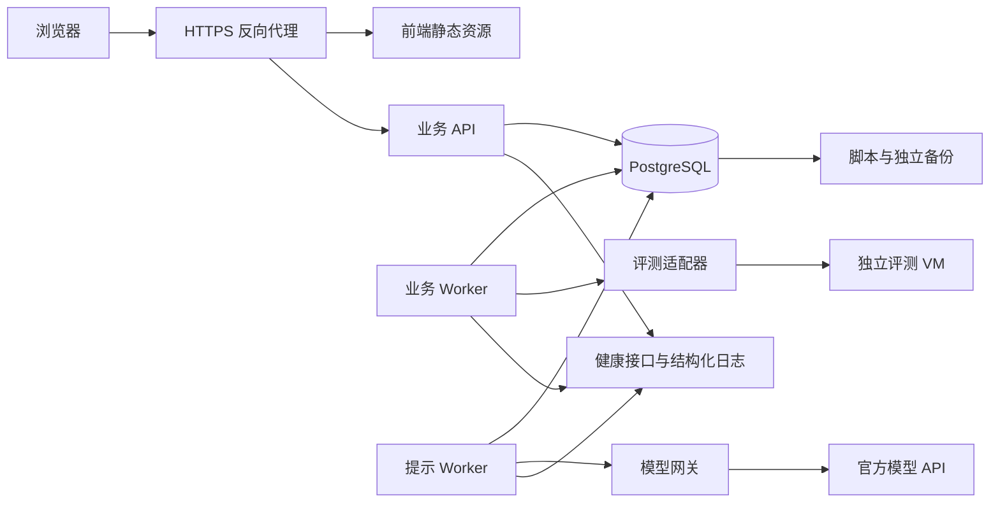

# 架构设计

## 1. 总体结构

采用模块化单体业务服务，API 与 Worker 共享领域规则和数据库，通过不同进程运行。评测执行部署在独立 Linux 虚拟机；模型访问通过受控网关。业务数据库、执行器和模型端口均不直接暴露给浏览器。

业务区只向评测管理入口发送单任务必要输入；评测 VM 不持有业务库凭据。评测 VM 的管理入口与学生程序网络命名空间隔离。禁止将宿主 Docker socket、源代码仓库或业务数据盘挂载给学生程序。

## 2. 层次与模块

依赖方向：`HTTP/Worker → application → domain`；基础设施实现 application 定义的端口。domain 仅依赖纯类型和规则，不访问数据库、网络、系统时间或环境变量。时间通过 ClockPort 注入。

| 模块目录（server/app/modules 下） | 职责 | 主责 | 允许的业务依赖 |
| --- | --- | --- | --- |
| identity | 账号、会话、权限、一次性密码 | A | 无 |
| courses | 课程、成员、归档入口 | A | identity |
| problems | 家族、版本、测试、预检发布 | A | identity、courses；通过 PreflightPort 请求预检 |
| assignments | 作业、发布、截止、策略、公告 | A | courses、problems |
| submissions | 受理、幂等、容量、代码快照 | B | identity、courses、assignments |
| judging | 预检执行、轮次、队列、调度、执行映射与恢复 | B | submissions；通过 JudgePort 执行 |
| grades | 计分、快照、重评、差异、发布 | B | submissions、judging、assignments |
| learning | 固定帮助、错题、推荐、模板、提示与额度 | A | identity、assignments、submissions、grades 的查询端口 |
| reporting | 按指定成绩快照生成CSV | B | grades 的授权查询端口 |
| operations | 公平事件、健康、审计、留存和备份协调 | B | 公共审计端口；经应用服务调用其他模块 |
| notifications | Outbox 消费、收件人授权和已读 | B | 只消费已提交的业务事件 |

复杂模块按 domain、application、infrastructure、api 分层，小模块按实际复杂度合并文件，禁止为每个字段建立无意义抽象。跨模块写入由用例编排调用各模块应用服务；顶层 UnitOfWork 统一提交，同一事务传递给参与服务，内部服务不得自行提交。禁止直接修改其他模块 ORM 表绕过规则。跨模块读使用明确的查询接口，可在同一数据库事务完成授权与一致性校验。

跨模块用例的唯一编排负责人：题目发布由 problems/A 调用 judging/B 的预检端口；重评与成绩由 grades/B 编排；公平裁决、归档和清理由 operations/B 编排，调用 assignments/courses 的受控写端口，B负责相关操作页及路由授权；CSV由 reporting/B 调用 grades/B 的只读快照端口。共享端口先审查再并行实现，禁止模块间互相回调或重复实现同一规则。

`server/app/shared` 仅放 ID、时钟、错误、事务、审计与基础端口；不放业务逻辑。前端按 features 划分 auth、courses、problems、assignments、submissions、grades、learning、admin；共享视觉组件集中于 components/ui，API 类型由契约生成。A维护应用壳、令牌和基础组件；B负责submissions、grades、admin、notifications的页面/查询/测试，A负责其余教学与learning页面。编辑器由A嵌入B的结果组件，B的结果页嵌入A的固定帮助组件；接口与props先约定，禁止各写一套或将组件内部实现转交集成人。

## 3. 状态模型

| 对象 | 状态与意义 |
| --- | --- |
| 作业 | DRAFT、SCHEDULED、OPEN、CLOSED、ARCHIVED；已发布状态由数据库时间和归档标记计算，不依赖定时器准点执行 |
| 逻辑结果基线 | QUEUED、JUDGING、RETRY_WAIT、FINISHED；对应查询中的 state |
| 单次 attempt | QUEUED、JUDGING、FINISHED；只有 FINISHED 有 verdict |
| 判定 | AC、WA、CE、TLE、RE、SE；非终态 verdict=null |
| 正式性 | FORMAL、PRACTICE；受理时冻结，不随重试、重评或延期改变 |
| 成绩视图 | PROVISIONAL、PENDING、PUBLISHED、REJUDGING；PENDING 表示未处理完成，REJUDGING 表示活动重评 |
| 重评批次 | QUEUED、RUNNING、READY、FAILED、CANCELLED、ACTIVATED；FAILED 可按条件重试 SE 成员 |
| 提示 | PENDING、READY、FAILED、BLOCKED；BLOCKED 表示本地安全门拦截 |
| 公平裁决 | PENDING、EXTEND、NO_IMPACT；作业 fairness_review 汇总为 NONE/PENDING/RESOLVED |
| 执行槽 | FREE、BUSY、QUARANTINED；物理退出未确认时不能复用 |

重评结果和当前生效结果分开存储，每个提交在每个 result_basis 下有自己的 current_attempt。失败 attempt 可为 FINISHED+SE，而逻辑基线仍为 RETRY_WAIT；不得把两者混为一个字段。

## 4. 提交受理

1. 校验会话，查找该用户已有幂等键；再次检查对象可见性后，同内容重放返回既有记录，异内容 409。
2. 开启事务并锁课程、作业、用户受理行；锁内复查幂等键、课程成员、归档、题目版本与语言。
3. 锁作业后读取数据库实际当前时刻，检查意图及 `[open_at,due_at)`；不得使用事务开始时间。
4. 校验代码、服务健康、时钟、个人间隔和逻辑任务容量。锁容量行，原子增加计数。
5. 一次写入 submission、原始 result_basis、processing_cycle、attempt、整轮 queue_job、Outbox；提交事务后返回 202。
6. 响应丢失时客户端保留原键重放；不得为网络重试生成新键。

新受理事务总预算 2 秒，锁冲突可在预算内重试一次；超出返回可重试 503。数据库失败不调用执行器。拒绝原因区分个人频率/名额与平台容量/持久化/执行不可用，后者进入公平事件流程。

## 5. 调度和执行

一个 queue_job 是一个 attempt 的整套测试，占一个槽位。单点执行通过 JudgePort；每点顺序执行，首个非 AC 停止。重复编译开销计入该轮 360 秒预算。预检也使用受控执行和资源额度，独立标记为 PREFLIGHT，不参加普通/重评 4:1 比例，不得抢占已运行任务；截止保护窗口不启动新预检。

逻辑调度器锁 `scheduler_control → execution_slots → queue_jobs`，以 `(ready_at,created_at,job_id)` 选最早可派发任务。普通和重评持续非空时按 NNNNR；只有一个队列时持续派发该队列，不累积欠债；恢复同时非空或退出保护窗口时从 NNNNR 开始。预检仅在两个学生队列均无待派发任务且有空槽时派发。

领取事务同时写槽位、租约和游标，网络调用在事务外。5 秒续租，15 秒未续租进入恢复检查。失联不等于程序停止，监督进程确认退出并清理后才能释放槽位；不能确认时隔离槽位并告警。

JudgePort 的创建超时可能已在执行器产生任务。适配器记录 CREATE_UNKNOWN，查询/取消/清理确认前不重复创建。相同 attempt、测试点和租约的重复轮询可重放，旧租约结果仅归档。

结果回写匹配 `submission_id + result_basis_id + attempt_id + generation + lease_epoch`。结果只写对应基线；待激活批次允许持久化但不提前参与正式分数。逻辑周期终结时只释放一次计数。错误映射、输出比较与聚合由领域规则完成，不能直接使用执行器默认分数。

## 6. 重评与成绩

教师先预览影响范围，创建批次时再次在作业锁内冻结全部正式 submission_id 和摘要。两次均核对目标版本所属题目、已发布/预检证据、历史语言集合及目标 profile；缺语言返回 REJUDGE_LANGUAGE_MISMATCH 和 missing_languages，不能入队。按全局/个人剩余逻辑容量分批创建结果周期，尚未创建者标 WAITING；从各成员周期创建开始计算 15 分钟，不把全批等待时间算作单提交运行超时。

批次只有全部成员非 SE 终结且范围摘要一致才 READY。教师确认激活时重新检查批次与作业各自 revision、截止、公平事项和原范围：切换 assignment_item 的有效版本与提交结果指针、重算所有学生全部题目、生成成绩快照、更新活动快照指针、审计、Outbox 在同一事务提交。任一步失败整体回滚。

分数来自当前有效正式结果的最大值；选出得分来源时以得分降序、accepted_at 升序、submission_id 升序确定稳定来源。快照保存 source_attempt_id。初始未发布的作业仍为暂定；已发布作业激活新批次后生成替代发布版本。历史版本保持只读。

## 7. 提示请求

身份、归属、提交终态、同族开放策略、外发同意、幂等摘要通过后，依序锁个人额度、项目预算、接纳日预算，预占一次次数与费用，冻结模板和模型配置，写入提示任务。网络调用由独立提示 Worker 执行，不占用评测槽位。

Worker外发前以当前数据库时间重算同族开放策略、成员和来源权限，取得一次外发许可后立即调用；许可事务与策略写入串行，记录 authorized_at 和 dispatch_policy_digest，网络不在事务内。许可前已生效的收紧必须阻止外发；许可后已发出的请求无法撤回。候选转 READY 前再次复核，失效转 BLOCKED、释放次数，已发生或未知费用仍记账。每次读取也复核当前权限/策略；受限历史结果只返回 BLOCKED投影与固定帮助，不返回原正文、不篡改历史收费记录。

输入按白名单构造，模型不能访问其他服务。输出经 JSON schema、长度和内容规则校验后才 READY；失败或安全拦截提供固定帮助并释放次数预占。已外发且费用不明的请求记 UNCERTAIN，待对账前保持费用预占。模型调用不自动重试；用户新操作使用新键，计入新预算。旧请求重复查询不重复调用。

## 8. 事务、锁与事件

使用 PostgreSQL READ COMMITTED 与显式行锁。提示策略/家族/课程成员/身份停用及作业发布等会改变提示授权的事务，先锁单行policy_guard；提示授权检查也锁该行并在锁内取当前时间，防止并发新增作业或成员变化穿透检查。授权后网络调用不持锁。

业务锁固定顺序为：`policy_guard(涉及提示授权时) → course → assignments(按ID) → submission/admission_user → capacity_control → basis/attempt → grade/batch → incident → audit/outbox`。同类多行按 ID 排序，只取本操作需要的锁。提示额度事务在权限对象锁后按 `quota → PROJECT budget → DAY budget → hint/reservation → audit/outbox`；结算复用同序。调度短锁与业务回写事务分离，不能同时反向持锁。

唯一键、外键、CHECK 保障单行不变量；跨行总和、范围和权限在事务中验证。死锁整体回滚并在预算内重试，不能局部提交。

Outbox 与业务事实同事务写入；消费者按 event_key 幂等。通知失败不回滚已受理提交。队列真值在 PostgreSQL，内存仅作优化；过期租约、未发送事件、容量计数有对账任务。对账修复先暂停相关新写入，记录前后差异和原因。

## 9. 架构约束与扩展

首版不引入微服务、Redis 事实队列、消息中间件或对象存储。小型代码和测试文件使用数据库 BYTEA，简化原子版本与恢复。后续更换存储须双读校验与可回退迁移；不能先删除原件。

结果查询使用退避轮询：初始 1 秒，逐步增至 5 秒，页面后台暂停高频轮询，终态停止；会话失效停止请求并保留草稿。SSE 可作为后续传输优化，不改变查询真值。

[PostgreSQL 事务文档](https://www.postgresql.org/docs/current/transaction-iso.html)与 [Judge0 接口文档](https://ce.judge0.com/)用于实现核对，不能代替项目并发与隔离测试。
