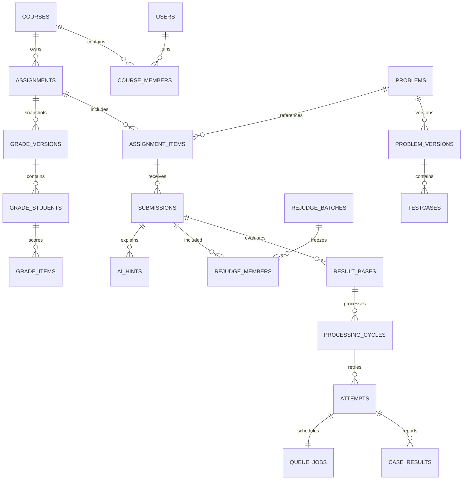

# 数据设计

## 1. 存储约定

PostgreSQL 为业务唯一事实库。ID 使用 UUID；时刻 `timestamptz(3)`，连接时区 UTC；计数和资源统计用非负 bigint；金额 `numeric(18,8)`、币种 CNY；正文 text，源码/测试原字节 bytea。所有可编辑聚合有正整数 revision 和 created_at/updated_at。

下表 PK 为主键、FK 为外键、UQ 为唯一键，`?` 表示可空；其余字段非空。引用默认 RESTRICT，不能级联删除成绩与审计。关系型字段不可仅藏在 JSONB；profile、公开样例、事件非敏感摘要允许 schema 校验后的 JSONB。数组长度、字节数与枚举均由数据库可行约束和应用校验共同保证。

## 2. 核心关系

图展示主要关系；预检任务不属于学生提交，使用独立预检执行记录，详见后续表。

## 3. 实体与约束

### 3.1 身份与教学（A 维护，迁移由 B 审核）

| 表 | 主要字段 | 关键约束/索引 |
| --- | --- | --- |
| users | user_id PK、login_name、display_name、role、status、password_hash、must_change_password、revision | login_name UQ；role=STUDENT/TEACHER/ADMIN；账号字段上限见需求；停用不物理删 |
| sessions | session_id PK、user_id FK、token_hash、csrf_hash、created_at、last_seen_at、expires_at、revoked_at? | token_hash UQ；用户/有效期索引；不存明文 token |
| login_attempts | attempt_id PK、login_digest、source_digest、succeeded、attempted_at | 登录名摘要/时间索引；实现失败窗口，不泄露账号存在性 |
| courses | course_id PK、teacher_id FK、title、status、archived_at?、revision | teacher_id/status 索引；ARCHIVED 对应 archived_at 非空 |
| course_members | course_id FK、user_id FK、status、joined_at | PK(course_id,user_id)；反向(user_id,course_id)索引 |
| problem_families | canonical_problem_id PK、owner_teacher_id FK、label | 同题/衍生题统一家族；跨课关联要求同一教师权限或显式授权 |
| problems | problem_id PK、canonical_problem_id FK、owner_course_id FK、practice_released、practice_version_id FK?、revision | 家族/课程索引；practice_released默认false；开启时practice_version_id非空且属于本题已发布版本 |
| problem_versions | version_id PK、problem_id FK、version_no、title、statement、samples、tags、profile、source_ref、checksum、published_at?、revision | UQ(problem_id,version_no)；发布后内容不可变；profile 包含语言实际版本和镜像摘要 |
| testcases | testcase_id PK、version_id FK、order、input_blob、answer_blob、input_sha256、answer_sha256 | UQ(version_id,order)；order 1—10；每份≤64 KiB；发布时校验连续且配对 |
| reference_programs | reference_id PK、version_id FK、language_key、code、code_sha256 | UQ(version_id,language_key)；仅教师/预检可读；纳入预检内容摘要 |
| preflight_runs | preflight_id PK、version_id FK、content_digest、profile_hash、state、created_by FK、started_at?、finished_at? | 状态 QUEUED/RUNNING/PASSED/FAILED；内容改动后旧结果不能用于发布 |
| preflight_cases | preflight_id FK、language_key、case_kind、case_order、state、verdict?、engine_meta | PK(preflight_id,language_key,case_kind,case_order)；case_kind=SAMPLE/HIDDEN；全部语言全部点通过 |
| preflight_jobs | job_id PK、preflight_id FK、state、ready_at、lease_epoch、lease_until?、slot_id? | 独立预检队列；不得参与普通/重评 NNNNR 比例 |
| assignments | assignment_id PK、course_id FK、title、open_at、due_at、ai_policy、published_at?、revision、grade_epoch、fairness_review、active_grade_version?、active_rejudge_batch_id? | open_at<due_at；(course_id,due_at)索引；状态按时间计算 |
| assignment_items | assignment_id FK、problem_id FK、original_version_id FK、effective_version_id FK、points | PK(assignment_id,problem_id)；points>0；锁内验证1—20题总和100；版本属于该题 |

发布题目冻结内容及语言环境，练习开放与家族关联放在 problems，避免为访问策略改动复制全部测试数据。家族调整不得绕过活动作业约束；历史审计记录调整前后关联。练习发布只授权该题明确发布的版本，未发布草稿不可因题目策略开启而被读取；推荐公开读取固定practice_version_id，每次经过课程与同族过滤；仅提供题面浏览。作业练习仍引用assignment_items.effective_version_id，不自动切换到最新版本。

### 3.2 提交、执行与调度（B 维护）

| 表 | 主要字段 | 关键约束/索引 |
| --- | --- | --- |
| submissions | submission_id PK、user_id FK、assignment_id、problem_id、version_id FK、language_key、code、code_sha256、intent、mode、accepted_at、idempotency_key、request_digest、original_receipt、active_basis_id FK?、revision | FK(assignment_id,problem_id)；UQ(user_id,idempotency_key)；源码/受理时刻/正式性不可变；(assignment_id,user_id,accepted_at,submission_id)索引 |
| result_bases | basis_id PK、submission_id FK、batch_id FK?、target_version_id FK、current_attempt_id FK?、processing_state、current_cycle_id FK? | 每提交仅一个原始 basis；UQ(batch_id,submission_id)；processing_state四值；当前周期归属同一basis |
| processing_cycles | cycle_id PK、basis_id FK、submission_id FK、started_at、finished_at?、auto_retry_count、capacity_held、trigger、reason? | auto_retry_count∈{0,1}；同提交capacity_held=true条件唯一；trigger=INITIAL/REJUDGE/MANUAL；初始started_at=accepted_at，其他为本周期创建时刻；人工周期保留旧周期 |
| attempts | attempt_id PK、basis_id FK、cycle_id FK、submission_id FK、generation、state、verdict?、reason_code?、started_at?、finished_at?、time_ms?、memory_bytes?、engine_meta、feedback_version_id FK? | UQ(submission_id,generation)；FINISHED 等价 verdict 非空；终态 finished_at 非空；generation 跨基线单调递增 |
| case_results | attempt_id FK、order、testcase_id FK、verdict、cpu_ms?、memory_bytes?、engine_meta | PK(attempt_id,order)；测试属于目标版本，顺序一致；不存学生可访问原始输出 |
| queue_jobs | job_id PK、attempt_id FK、kind、state、ready_at、created_at、lease_until?、lease_epoch、worker_id? | attempt_id UQ；kind=NORMAL/REJUDGE；state=READY/LEASED/DONE；(kind,state,ready_at,created_at,job_id)索引 |
| adapter_runs | run_id PK、attempt_id FK、testcase_order、lease_epoch、backend_token?、create_state、cleanup_state | UQ(attempt_id,testcase_order,lease_epoch)；CREATE_UNKNOWN 必须监督确认；凭据不出接口 |
| scheduler_control | control_id PK、cursor、previous_queue_mode、revision | 单逻辑调度控制行，NNNNR 游标事务更新 |
| execution_slots | slot_id PK、state、lease_epoch、job_kind?、job_id?、lease_until? | FREE/BUSY/QUARANTINED；同任务不得占多个槽；job_kind 区分预检与评测 |
| admission_users | user_id PK/FK、last_accepted_at?、pending_count | pending_count 0—3；计数与逻辑周期同事务 |
| capacity_control | control_id PK、pending_count | pending_count 0—100；仅逻辑提交，预检不增加学生容量但共用物理槽 |
| outbox_events | event_id PK、event_key、event_type、payload、state、tries、next_at、created_at | event_key UQ；READY/SENDING/SENT/FAILED；payload 不含源码/隐藏测试；(state,next_at)索引 |

同一提交任何时刻最多一个占容量的处理周期（原始或重评）；通过提交锁及条件唯一约束保证。自动重试沿用周期、次数占位；人工重试新 cycle_id；旧 attempt 不回退。active_basis_id、current_attempt_id、current_cycle_id及attempts.cycle_id均通过复合归属约束或约束触发器保证属于相应提交/基线，不能指向其他提交/基线的周期或结果。循环外键使用事务延迟约束，迁移先建表再加约束。

### 3.3 成绩、重评与公平（B 维护）

| 表 | 主要字段 | 关键约束/索引 |
| --- | --- | --- |
| grade_versions | grade_version PK、assignment_id FK、assignment_revision、grade_epoch、state、published_at?、created_at | 一个版本为整个作业快照；已发布内容不可变 |
| grade_students | grade_version FK、student_id FK、total、state | PK(grade_version,student_id)；total 0—100 |
| grade_items | grade_version、student_id、problem_id FK、points、score、source_attempt_id FK?、target_version_id FK | PK(grade_version,student_id,problem_id)；复合 FK 到 grade_students；score∈{0,points}；源结果必须是该生/题/有效版本 |
| rejudge_batches | batch_id PK、assignment_id FK、problem_id FK、new_version_id FK、assignment_revision、revision、state、reason、range_checksum、affected_count | 每作业最多一个 QUEUED/RUNNING/READY/FAILED 未激活批次，条件唯一索引 |
| rejudge_members | batch_id FK、submission_id FK、basis_id FK?、state | PK(batch_id,submission_id)；WAITING/RUNNING/FINISHED；范围创建后不可增删 |
| fairness_incidents | incident_id PK、started_at、recovered_at?、reason_code、rejected_count、evidence_refs、evidence_incomplete、detected_at、displayed_at、persisted_at、recovery_started_at?、revision | 请求拒绝记录以 request_id 去重；开始/恢复时间单调；正文无代码 |
| incident_requests | incident_id FK、request_id、assignment_id FK?、reason_code、observed_at | PK(incident_id,request_id)；不能以重复重试膨胀拒绝数 |
| incident_assignments | incident_id FK、assignment_id FK、decision、old_due、new_due?、approved_by FK?、approved_at?、overlap_ms?、reason? | PK(incident_id,assignment_id)；EXTEND 要求恢复时间、批准、时长和新截止齐全 |

grade_students.total 与明细和、重评全部范围完成、当前指针一致属于跨行约束，必须在事务中计算与校验；不能用普通单行 CHECK 冒充实现。成绩对账按当前激活版本重算，并验证 source_attempt 归属、mode=FORMAL、非过期结果、分值总和和快照引用。

assignment.revision负责所有并发写检查；grade_epoch只在延期重开、当前有效正式结果/版本变化及计分成员范围变化时递增。提示策略、公告、NO_IMPACT裁决只更新revision。成绩快照保存创建时两个值；激活结果与新epoch及对应快照同事务提交。

当前成绩展示依次判断：活动重评为REJUDGING；未决正式任务/SE/公平事件为PENDING；仍开放或无匹配grade_epoch的已发布快照为PROVISIONAL；否则PUBLISHED。NO_IMPACT消除最后未决事件后可恢复原发布状态。历史快照的state/published_at不随当前展示状态回写，延期和重评不能修改过去已发布的内容。

### 3.4 学习与模型（A 维护，账本 B 审核）

| 表 | 主要字段 | 关键约束/索引 |
| --- | --- | --- |
| feedback_catalogs | catalog_id PK、scope_key、verdict、language_key、draft_payload、draft_revision、active_version_id FK? | UQ(scope_key,verdict,language_key)；通用语言 ALL，不能用 NULL 破坏唯一性 |
| feedback_versions | version_id PK、catalog_id FK、version_no、title、explanation、checklist、author_id FK、published_at、checksum | UQ(catalog_id,version_no)；发布后只读；每个判定有全局种子 |
| template_catalogs | template_id PK、scope_key、draft_payload、draft_revision、active_version_id FK? | scope_key UQ，GLOBAL/COURSE:UUID |
| template_versions | version_id PK、template_id FK、version_no、body、allowed_placeholders、schema_version、author_id FK、published_at、checksum | UQ(template_id,version_no)；固定安全框架不由正文覆盖 |
| model_configs | config_id PK、provider、model_id、version_label、base_url、price_snapshot、token_caps、terms_review_ref、verified_at、enabled | 不含密钥；URL 来自部署白名单；版本不可原位覆盖；初始 enabled=false |
| policy_guard | guard_id PK、revision | 单行授权变更串行点；策略写与提示授权检查共用，持锁时不调用网络 |
| ai_hints | hint_id PK、user_id FK、submission_id FK、request_key、request_digest、question、accepted_date、status、reason_code?、template_version_id FK、model_config_id FK、accepted_policy_digest、dispatch_policy_digest?、authorized_at?、consented_at?、sections?、usage?、safety_flags、created_at | UQ(user_id,request_key)；用户仅一个 PENDING，条件唯一索引；来源属于本人；跨日仍记原 accepted_date |
| hint_jobs | job_id PK、hint_id FK、state、queued_at、started_at?、deadline_at、lease_epoch | hint_id UQ；等待10秒/执行20秒分别计时；与评测 Worker 分离 |
| hint_feedback | hint_id PK/FK、user_id FK、rating、comment、updated_at | rating 三值；本人 READY 提示；单条可修订 |
| quota_ledger | user_id FK、accepted_date、ready、reserved | PK(user_id,accepted_date)；非负且 ready+reserved≤20 |
| budget_accounts | scope_key PK、currency、limit_amount、settled_amount、reserved_amount、uncertain_amount、revision | PROJECT 和 DAY:YYYY-MM-DD；非负；准入锁内检查双账户剩余 |
| budget_reservations | reservation_id PK、hint_id FK、price_version、cost_upper、actual?、state、accepted_date、settlement_key? | hint_id UQ；RESERVED/SETTLED/UNCERTAIN/RELEASED；settlement_key UQ，未知 actual 为 null |

固定帮助按课程+语言、课程通用、全局通用顺序解析；attempt 冻结 feedback_version_id。提示接纳时冻结模板、模型、当时策略摘要及同意记录；策略摘要仅为审计证据，不是永久授权。外发许可、候选转READY与读取使用当时权限和数据库时间重新验证，失效按架构规定拦截。发布新模板不改变历史提示。费用结算仅转移同一笔预占一次，按个人额度→项目→接纳日固定锁序维护两个账户。

### 3.5 通知、运维与留存（B 维护）

| 表 | 主要字段 | 关键约束/索引 |
| --- | --- | --- |
| audit_events | event_id PK、actor_id FK?、actor_kind、action、object_type、object_id、before_after_digest、reason、timestamp、request_id | 只追加；系统动作 actor_kind=SYSTEM 可无 actor_id；时间/对象/操作者索引 |
| notifications | notification_id PK、event_id FK、user_id FK、summary、created_at、read_at? | UQ(event_id,user_id)；用户/已读/时间索引 |
| retention_holds | hold_id PK、object_type、object_id、reason、opened_by FK、opened_at、closed_at?、revision | 动态引用由服务校验；未关闭优先于到期清理 |
| retention_plans | plan_id PK、course_id FK、object_digest、object_manifest、teacher_confirmation_id?、execute_after、state、revision | 预览和执行摘要一致；计划不能接收客户端任意路径 |
| retention_confirmations | confirmation_id PK、plan_id FK、teacher_id FK、object_digest、reason、confirmed_at | 确认人是课程教师；摘要变更使确认失效 |
| emergency_grants | grant_id PK、admin_id FK、incident_id FK、scope、expires_at、revoked_at?、reason | 限时限范围；每次读取正文都审计 |
| runtime_config_versions | config_version PK、payload、checksum、created_by FK、reason、created_at | 不含密钥；只引用已验证模型/语言配置；旧版本保留 |

审计应用账号仅 INSERT/SELECT；业务和只读监测使用不同数据库权限。审计留存清理使用独立维护账号和审计记录，不依赖业务角色自行删日志。

## 4. 必须原子完成的事务

| 事务 | 一并提交的数据 | 失败处理 |
| --- | --- | --- |
| 受理 | submission、basis、cycle、attempt、job、个人/全局占位、Outbox | 全部回滚，不返回 202 |
| 任务终结 | 轮次、点结果、逻辑状态、有效指针、释放容量、固定帮助引用 | 幂等键与 generation/lease 防重复 |
| 题目发布 | 不可变内容摘要、全部预检引用、发布时间、revision、审计 | 摘要变化或任一语言失败则拒绝 |
| 成绩发布/重评激活 | 全部学生明细/总分、版本头、活动指针、批次、审计、通知 | 任一待处理/SE/公平事件则回滚 |
| 公平裁决 | 事件裁决、截止、revision、成绩状态、公告、审计、通知 | 过期版本或未恢复则拒绝 |
| 提示接纳/结算 | hint、个人次数、双预算账本、预占/费用、任务 | 同键不重扣，未知费用不释放 |
| 归档/清理 | 课程状态或清理标志、确认、hold 检查、审计 | 并发新任务/hold 必须阻止 |

## 5. 迁移与数据生命周期

迁移仅用 Alembic，B 串行分配 revision、检查单 head，A 的实体变更经独立小 PR 合并。迁移不手工改已部署历史文件；按扩展字段→回填→切换读取→清理旧字段推进。不在一次上线执行不可恢复的删列和版本切换。

测试包含空库 upgrade、上版库 upgrade、约束拒绝、双路径并发、快照对账及恢复抽样。不能用 SQLite 测试替代 PostgreSQL 锁和条件索引验证。

每日备份数据库、配置及版本清单，独立介质保留30天。归档满180天并经教师确认方可逻辑清理；之后30天内淘汰可恢复副本。清理需先计算引用和 hold，包括间接引用的题目、模板及成绩来源；保留引用的版本不物理删除。源码、测试原字节和摘要在迁移/备份恢复前后必须一致。
